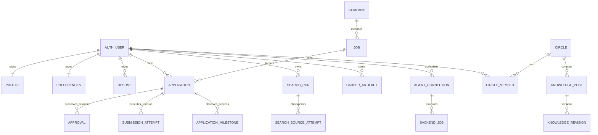

# Data model, ownership, and consistency rules

The executable schema authority is the ordered SQL in [`supabase/migrations/`](../../supabase/migrations/), not this page or `docs/schema.md`. Migrations contain more than table definitions: they establish RLS, grants, triggers, RPC facades, indexes, backfills, and compatibility dispatchers. Preserve and extend that history; do not replace it by editing a prose schema, deleting old migrations, or concatenating them into a new baseline without an explicit upgrade plan and tests.

At a high level, the model deliberately separates:

- **Shared catalog identity** — `companies` and `jobs` identify public entities. A job's `canonical_url` is unique; private recommendations and candidate-specific fit analysis do not belong on that shared row.
- **Private workspace state** — rows with `user_id` such as profiles, preferences, resumes, applications, batches, search records, artifacts, contacts, and preparation records belong to one authenticated user. Composite foreign keys such as `(user_id, application_id)` make that ownership relationship part of the database relationship rather than an application convention.
- **Private operational state** — credentials, agent tasks, backend jobs, requests, and leases live in the `private` schema. They support controlled execution and replay, but are not a second source of business truth.
- **Shared-by-consent Circle knowledge** — Circle records are private-schema records whose access boundary is membership and publication policy, not ownership alone. They must never make a member's private applications or profile data readable by association.

*Cross-domain ownership and evidence relationships that a change author must preserve.*

## Ownership and access boundaries

`auth.users.id` is the root private-owner identity. The browser data client obtains that identity from Supabase Auth, rejects a missing session or an account change, scopes reads by `user_id`, and writes the current `user_id` rather than accepting an owner supplied by the UI. This is defense in depth: RLS and RPC ownership predicates remain authoritative.

The baseline schema enables RLS on private user tables and gives authenticated users an `owner_access` policy only where `auth.uid() = user_id`; catalog `jobs` instead has a read-only public catalog policy. Sensitive tables are narrower still: approvals and submission attempts are readable by their owner, while attempt mutation is service-only. The `private` schema is revoked from browser roles; privileged facades must derive an owner from verified human auth or from a valid hashed agent credential.

An opaque agent token is not a user ID. The gateway hashes the bearer token, and the database dispatch path checks that its connection is unrevoked, unexpired, and has the operation's required scope before it uses the connection's stored `user_id`. A human issues or revokes connections through a separate human-authenticated gateway path; the raw token is returned only at issuance and the database stores its hash.

### Canonical writers — do not introduce parallel writable truth

Use the existing writer for each domain, and derive read projections from it. In particular:

| Domain truth | Canonical writer / boundary | Do **not** add |
| --- | --- | --- |
| Profile facts and preferences | scoped RPCs that validate expected versions/timestamps and merge permitted fields | a second editable profile, settings cache, or agent-owned profile table |
| Current application draft | `applications.draft` through the constrained direct/RPC draft paths; its trigger owns revision and draft-derived status | a writable draft-status or universal draft-history projection |
| Human consent | `approve_application`, which locks the owned application and creates the exact revision snapshot | a boolean approval flag, agent-created approval, or a reusable approval unrelated to a revision |
| Submission execution and receipt | gateway-derived authorization plus `runner_submission_transition` and `submission_attempts` | a client-writable “submitted” flag, attempt mirror, or fabricated receipt store |
| Recruitment progress | `record_application_milestone` / agent milestone dispatch and `application_milestones` | another writable recruiting-status column or timeline projection |
| Search execution | search run/source-attempt writers and their event-key receipts | a mutable “search complete” cache separate from the run/attempt records |
| Backend work | `backend_job_action`, `backend_job_dispatch`, and `backend_worker` | a browser-editable queue, lease table, or worker-status projection |

`applications.status` remains a compatibility field and is managed by the application trigger and controlled transitions. It is not a comprehensive account of recruiting progress. Richer process observations belong in milestones, and preparation belongs in plans/sessions. A projection is acceptable only when it is read-only to callers and one canonical writer maintains it transactionally; never create competing writable status or projection stores that can diverge.

## The application records have distinct meanings

An application is one owned record per `(user_id, job_id)`. Its current `draft` is mutable working material, while `revision` is the concurrency fence. Material draft or blocker changes increment the revision, reset draft-derived status, and update the timestamp; a created application starts at revision 0 and is `Queued` unless blocked. Clients must supply the revision they reviewed for draft saves, stage changes, approvals, and submission actions.

These entities are intentionally not interchangeable:

- **Draft (`applications`)**: the current editable answers, selected resume reference, form metadata, and blocker. It is not proof of review, consent, clicking submit, or employer acceptance.
- **Approval (`approvals`)**: a human-only, immutable snapshot of one owned application revision, including the draft, profile facts, and resume. Approval locks and checks the current revision, verified profile, owned resume, reviewed questions, and completed answers. A later material edit advances the revision and cannot reuse the old approval.
- **Submission attempt (`submission_attempts`)**: execution evidence for a particular revision, with pinned context and authorization snapshots. It is neither a human approval nor a recruitment milestone. States are `claimed`, `started`, `confirmed`, `uncertain`, and `cancelled`.
- **Milestone (`application_milestones`)**: a separately recorded process observation such as an interview, offer, rejection, or a reported submission. It carries its source evidence and phase; it does not mint consent, prove an employer submission receipt, or update the application through a competing status writer.
- **Receipt and activity event**: a confirmed attempt may write the employer-observed receipt to the application and append an idempotent activity event. Activity is historical/audit context, not a replacement for the attempt or approval record.

The distinction matters for safe UI changes: opening a job, saving a document, recording interview preparation, and logging a milestone must not be presented as “applied.” Conversely, a confirmed submission requires the guarded execution path and a supported observed confirmation, not merely user-facing success text.

## Consistency mechanisms

### Optimistic versions and immutable snapshots

Use an expected version/revision whenever a record can be edited concurrently. Examples include an application revision, artifact version, search-document version, preparation-plan version, backend-job version, and settings/version counters. The server compares the expected value while holding or updating the authoritative row and returns a conflict when it changed. A client should reload authoritative state and let the user resolve a real conflict; it must not overwrite it with a whole-workspace autosync.

Snapshots solve a different problem from versions. Approval snapshots preserve what a person approved. Submission context and authorization snapshots preserve what a runner was allowed to execute. Search runs pin their context. Artifact and search-document revisions preserve earlier content. Do not refresh those historical snapshots in place merely because the current profile, resume, or catalog record changed.

### Idempotency keys and event receipts

Stable caller-generated keys make a retry safe only when reused with the same semantic payload and owner. Examples include `job_batches.source_event_id`, `activity_events.event_key`, `application_milestones.event_key`, and private request/receipt ledgers. The database returns the prior result or rejects a key reused for different evidence; it does not silently reinterpret a retry as a new event. A unique `(application_id, attempt_key)` similarly ties a submission retry to one attempt.

Choose an event key at the external action boundary and persist its response in the canonical writer. Do not use a timestamp as an idempotency key, and do not add a second client-side retry ledger as an authority.

### Submission claims, short permits, and human recovery

Submission uses a stricter sequence than ordinary idempotent writes:

1. The gateway reads current owned context and derives authorization from it; callers cannot supply an owner, arbitrary context snapshot, or authorization object.
2. Claim locks the application, rejects changed context/authorization, cancels only an expired pre-click claim, and creates a `claimed` attempt if there is no active, confirmed, or uncertain attempt. A partial unique index enforces that single active/terminal-blocking attempt rule.
3. Start rechecks the stored context and authorization and changes only the matching agent's claim to `started`; it returns a five-second click permit. Repeating start cannot obtain a second click.
4. Finish is replay-safe. `confirmed` requires a supported observed employer confirmation and records the receipt; `uncertain` blocks the application and prevents automatic retry. A draft cannot change while an attempt is claimed or started.
5. Only a signed-in human can resolve an uncertain (or stale-started) attempt after verifying it was not submitted. Resolution cancels that attempt and clears the blocker; it is not an employer receipt.

This protects against duplicate workers, lost responses, and a timeout after the click. Treat uncertain as a safety stop, not a failure to be retried automatically.

### Worker leases are operational coordination, not domain status

`private.backend_jobs` coordinates service execution with a status/version, attempt limit, opaque `lease_token`, and expiry. The worker claims queued or expired-running work using `FOR UPDATE SKIP LOCKED`, increments attempts, and grants a five-minute lease. Every dispatch/finish verifies the token, expiry, and expected version. A terminal job clears the lease; invalid connections/profiles cancel work and retry exhaustion fails it. This queue may drive search records through their canonical writers, but it must not become a competing store of search or application truth.

## Schema evolution and verification

When changing data behavior, add a forward migration after the existing chain. Include DDL, RLS/policy and grant changes, indexes, constraints, trigger/function replacements, and any safe backfill in that migration. Retain historical migrations because production upgrades may depend on their intermediate functions or data repairs. `docs/schema.md` is a useful explanatory inventory, but it explicitly defers to migrations for executable truth.

The database test helper creates a disposable PGlite database with two Auth users and replays all migration files in lexical order. Focused SQL and Node tests then exercise the actual function/RLS boundaries. For a change here, extend the closest behavior test rather than relying only on validator unit tests:

- submission tests cover duplicate claims, stale settings/context, one-click permits, uncertain outcomes, human-only recovery, receipt validation, revocation, and absence of browser mutation privileges;
- milestone tests should cover owner checks, source/timestamp evidence, idempotent event keys, and the fact that a milestone is not a submission receipt;
- backend-job tests should cover owner-scoped reads/writes, event-key replay, lease mismatch/expiry, cancellation, terminal cleanup, and retry limits;
- migration/upgrade tests must start from the complete migration chain and include records that existed before the new migration.

For browser-facing changes, retain the authenticated client’s pre/post request account check, but never mistake it for authorization. Verify the actual SQL policy or `SECURITY DEFINER` facade owner check with two users, and verify that authenticated clients cannot directly update service-owned evidence or operational fields.

## Safe extension checklist

1. Classify the fact: shared catalog identity, one-owner workspace fact, consent/evidence history, Circle-by-membership knowledge, or operational coordination.
2. Prefer a bounded field or existing history/revision entity if it has the same owner and lifecycle. Add a table only for independently growing records that need their own query, retention, or permission boundary.
3. Name one canonical writer, enforce the owner/membership predicate in SQL, and make all other views projections or reads.
4. Select the applicable guard: expected version, immutable snapshot, unique event key, exclusive submission attempt, or worker lease. Do not substitute one mechanism for another.
5. Add migration constraints, RLS, grants, and indexes together; then test a second owner, stale/replay case, and failure/recovery path.
6. Update dependent clients/gateway validation only after the database authority is in place. Never accept `user_id`, approval, receipt, lease token, or server-derived snapshot as untrusted client-authored truth.

See [System overview](system-overview.md), [career toolkit and Circles](../concepts/career-toolkit-and-circles.md), [workspace sync and demo mode](../concepts/workspace-sync-and-demo-mode.md), [application submission workflow](../workflows/application-submission.md), and [job discovery workflow](../workflows/job-discovery.md) for the user-facing flows built on these boundaries.
