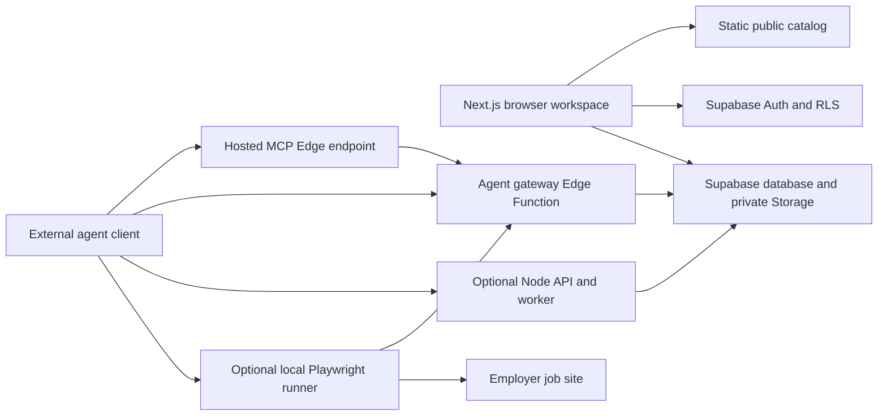

Lookout is a job-search workspace, not an autonomous agent host. It owns durable records—catalog entries, private workspaces, batches, drafts, approvals, attempts, and activity—and defines the server-side boundaries for reading or changing them. A connected agent supplies inference and judgment; its own runtime supplies scheduling, browsing (unless the local runner is installed), and notification delivery. Those capabilities are not silently provided by the website, Edge Functions, or Node worker.

## Runtime context

*Caption: Lookout’s browser and agent-facing paths converge on Supabase-owned records; inference, schedules, notifications, and ordinary remote browsing remain in the external agent environment, while the optional local runner is the constrained browser-execution exception.*

### Components and entrypoints

| Boundary | Role and entrypoint | What it does not own |
| --- | --- | --- |
| Browser UI | `next-app/` is a Next.js/React workspace. `WorkspaceProvider` selects a signed-in account workspace or detached demo; the account provider initializes the browser store, Supabase PKCE session, and cloud synchronization. | It has a publishable Supabase key only, not a service-role key or authority to impersonate a user. |
| Static catalog | `data/jobs.json` is the canonical static discovery feed packaged with the UI. It provides broadly visible job facts and must retain canonical URLs and known application statuses. | It is not the authority for a signed-in candidate’s application state or recommendations. |
| Supabase | Auth identifies people; Postgres and Storage hold durable workspace data; RLS protects owner-scoped rows; migrations define the schema. The `resumes` bucket is private and its object prefix is constrained to the authenticated owner. | It does not run an agent’s model, recurrence, text messages, or a general-purpose browser. |
| Agent gateway | `supabase/functions/agent-gateway/index.ts` accepts the human-authenticated connection-management operations and opaque `jb_agent_…` bearer credentials for agent operations. It hashes credentials and dispatches scoped, owner-derived database RPCs. | It exposes neither general SQL nor a shell, and it does not treat an agent-supplied user ID as ownership proof. |
| Hosted MCP | `supabase/functions/agent-mcp/index.ts` speaks the MCP protocol and forwards each operation and bearer token to the fixed gateway URL. | It is a protocol adapter, not a browser launcher or scheduler. |
| Node runtime | `backend/runtime/main.ts` runs as either an HTTP/MCP API or a worker. The API exposes `/mcp`, `/v1/operations`, optional resume parsing, and `/healthz`; the worker polls durable jobs only when execution is enabled. | A healthy process does not prove Supabase or a worker is available. The worker has no recurring-search scheduler. |
| Local runner | `runner/mcp-server.mjs` is an opt-in stdio MCP adapter. It forwards hosted data tools and adds narrowly scoped local tools for form inspection, private-resume fingerprinting, approved prefill, and guarded submission. | It deliberately omits arbitrary shell, evaluate/click, CAPTCHA bypass, model calls, and generic agent recovery. |
| External agent | The agent client uses its connection credential and decides how to infer fit, create reports, schedule work, and deliver notifications. It can optionally host the runner on a graphical machine. | Lookout cannot claim that an agent was scheduled, browsed Instagram, sent a text, or has persistent memory merely because it stored a preference or change event. |

## Public catalog versus private workspace

The data boundary is intentional rather than a UI convention:

- **Shared catalog facts** live in `public.jobs` and in the static feed: a canonical posting URL, employer/job facts, and discovery/verification metadata. The database policy permits catalog reads to anonymous and authenticated clients. Employer facts can be reused across candidates.
- **Private candidate records** include profiles, preferences, résumés, saved answers, job batches, batch-item recommendations, applications, approvals, activity, agent connections, and private files. Core tables use `user_id` RLS policies; the browser sync layer also supplies the current account and checks it has not switched while saving.
- **Personalization is private.** A batch item joins an owner’s batch to a shared job and carries the candidate-specific recommendation; it is not written onto the employer record. An opaque agent credential resolves to its connection’s owner server-side, and credentials are stored as hashes with expiry/revocation state.
- **Demo is a separate trust domain.** `?demo=1` selects an in-memory fictional runtime with no account client, cloud synchronization, or production MCP capability. It is useful for previewing interaction but produces no candidate records.

For schema-level ownership detail, see [Data and ownership](data-and-ownership.md).

## Control flow and action boundary

A browser session reaches Supabase as the signed-in user, subject to Auth and RLS. An agent does not receive that user session: the person first creates a scoped, expiring connection, then the agent presents its opaque bearer token to the gateway or MCP adapter. The gateway verifies the token’s hash, expiry, revocation, and operation scope inside database dispatch before it loads or changes the owner’s data. Connection issuance itself requires a human Supabase token, and the raw agent token is returned only at issuance.

The Node API is an optional compatibility and execution surface rather than a replacement database. It validates the same credential format and maps each operation to a declared service. Some Node-owned search pipeline operations call service-only RPCs directly; compatibility operations forward to the Edge gateway. In worker mode, it claims a durable, leased job, performs bounded deterministic discovery or an enabled application executor, and finishes with the job ID, lease token, and expected version. A failure is persisted as a failed outcome rather than granting indefinite authority.

The agent should read current state before retrying a write. Gateway failures intentionally direct callers to do this because a rejected or interrupted request might coexist with a completed durable operation.

### Application execution is deliberately narrower than preparation

Preparation records drafts and may require a human approval snapshot. Submission is a separately guarded action boundary:

1. The runner loads **current** server authorization and the owned private résumé; offline fixtures are not authorization.
2. It opens a canonical supported ATS posting in its dedicated browser, inspects the live form, and rechecks the approval after navigation.
3. For submission, the workflow validates the draft, résumé bytes/hash, canonical URL, and form fingerprint; it then obtains an atomic claim and a short-lived one-use click permit.
4. It makes one unambiguous native Submit click and requires an observed employer confirmation. Redirects, unsupported confirmation markers, and timeouts are uncertain—not successes.
5. An uncertain or started attempt is not automatically retried. It becomes a human handoff; human verification is required before a fresh attempt is allowed.

This separation is why an external agent may reason about a role or use its own browser for research, yet cannot manufacture human approval or convert “prepared” into “submitted.” The runner serializes calls through one dedicated browser page so concurrent application actions cannot share or mutate it.

## External capabilities and operational implications

Lookout persists schedules/preferences where supported and exposes context versions/change feeds for an agent to consume, but it does **not** wake an agent. The connected agent’s scheduler must invoke it. Likewise, notification templates/settings do not send messages: the agent’s own messaging integration must deliver them. Normal search and report quality depend on the agent’s inference; the Node discovery worker explicitly does not generate LLM reports, messages, or applications.

Remote-only agents can use the hosted MCP/gateway data tools, but cannot gain local Playwright actions unless a runner host is installed and reachable. The runner uses a fixed configured Supabase origin and validates signed resume-download paths before fetching, preventing it from sending the agent credential to arbitrary URLs. Employer content remains untrusted input.

Configuration follows the same split:

- Browser configuration uses `NEXT_PUBLIC_SUPABASE_URL` and `NEXT_PUBLIC_SUPABASE_PUBLISHABLE_KEY`; these are intentionally public build-time values. `NEXT_PUBLIC_AGENT_MCP_URL` may point at a separately deployed Node MCP endpoint.
- The Node runtime requires `SUPABASE_URL` and server-only `SUPABASE_SERVICE_ROLE_KEY`. `LOOKOUT_PROCESS` selects `api` or `worker`; `LOOKOUT_EXECUTION_ENABLED=true` enables queue polling, and `LOOKOUT_SUBMISSION_ENABLED=true` enables the application executor/tools.
- Local Compose separates the API and worker containers. The API binds `127.0.0.1:8080`; its host/origin allowlists and bounded request handling are additional network controls, not substitutes for gateway authorization.

## Failure model and focused verification

The design favors explicit durable state over inferred success: expired or revoked credentials fail closed, RLS/dispatch rejects cross-owner access, revision/version checks prevent stale writes, and submission uncertainty blocks automated retry. Private browser changes can remain locally dirty during a cloud failure; the sync controller retries background loads/saves and pauses on profile conflicts rather than overwriting remote state.

Useful focused checks include `tests/agent-gateway.test.mjs` and `tests/gateway-cors.test.mjs` for gateway authorization/request boundaries; `tests/discovery-runtime.test.mjs` and `tests/backend-jobs.test.mjs` for leased queue execution; and `tests/runner-mcp.test.mjs`, `tests/runner-attempt.test.mjs`, and `tests/runner-deterministic.test.mjs` for runner protocol and guarded browser behavior. Database scenarios additionally cover ownership, scopes, revocation, approval/attempt behavior, and recovery paths. A successful local test or `/healthz` response is not proof of a live external agent, notification channel, employer submission, or hosted deployment.
