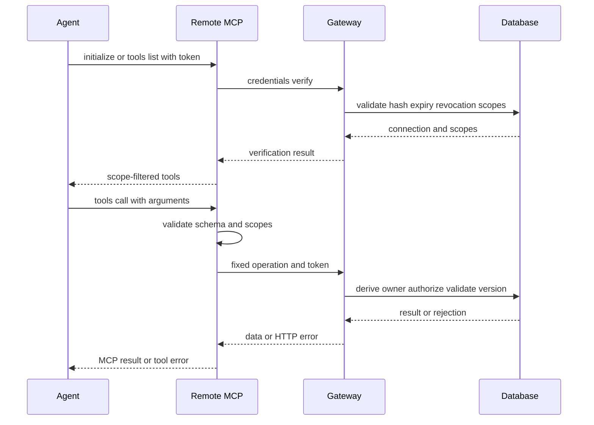

The agent integration is a **capability boundary**, not a general remote-control interface. A person creates a connection, chooses its scopes, and copies an opaque token into an agent's secret store. The agent can then use a fixed set of backend operations through either the gateway HTTP contract or the remote MCP transport. The gateway and database remain authoritative for identity, ownership, scope, versions, and state transitions.

For the wider component model, see [System overview](../architecture/system-overview.md); operational setup and releases belong in [Local and release runtime](../operations/local-and-release-runtime.md). Workflow intent is documented separately for [job discovery](../workflows/job-discovery.md), [application submission](../workflows/application-submission.md), and [onboarding and profile](../workflows/onboarding-and-profile.md).

## Connection lifecycle and trust model

### A human issues the connection

Connection management is a human-authenticated gateway path, not an agent capability. The gateway verifies the caller's Supabase Auth JWT with `getUser`, then sends `connections.issue`, `connections.list`, and `connections.revoke` to the management RPC with the authenticated `owner_id`. An agent-shaped bearer token is rejected for these operations.

`connections.issue` takes a name, a nonempty subset of supported scopes, and an optional `expiresInDays` value. The token is generated as `jb_agent_` plus 32 random bytes encoded as hex; the database receives a SHA-256 hash, while the plaintext token is returned only in the issuance response. The normal default expiry is 30 days, the maximum is 90 days, and an owner may have at most ten active connections. Listing never returns a token or hash. Revocation is restricted to a connection owned by the signed-in person.

Treat the copied token as a password: store it only in the agent host's private credential store, never in a URL, chat message, job data, browser state, source control, or logs. There are no refresh tokens: an expired token is manually replaced. Service-role credentials never leave the gateway function.

### Opaque credentials, server-derived owners

For agent operations, the bearer must match the `jb_agent_` token shape. The gateway hashes it and dispatches to the database, which validates the hash, expiry, revocation state, scopes, and operation in its authorization path. Owner identity is derived from that validated connection, not from an argument. Gateway payload schemas reject owner identifiers on context calls and MCP schemas reject injected `userId` arguments.

This separation is an important invariant:

- A human session can manage only its own connections, but cannot use management authentication to bypass an agent operation's scopes.
- An agent key cannot issue, revoke, or expand its own connection, nor call human-only recovery or approval actions.
- Tool permission, a claim by an agent, a chat assertion, or an `approved: true` field is **not** a human approval. Protected approval and uncertain-submission recovery remain authenticated human boundaries.
- Public client roles do not obtain direct execution of the service-role RPCs. The service role stays inside the gateway.

The primary scopes are deliberately narrow, such as `workspace:read`, `batches:write`, `drafts:write`, `activity:write`, `approvals:read`, `resumes:read`, and `profile:write`. Several operations require combinations: guarded submission transitions require `workspace:read`, `drafts:write`, `approvals:read`, and `resumes:read`. Discovery hides a tool when its complete baseline scopes are absent, then the gateway/database recheck authorization on the actual call. Some scope rules depend on the request or row and are still enforced downstream—for example, a resume-kind document upload additionally needs `profile:write`, while task/file-dependent requirements cannot safely be inferred from an ID by MCP alone.

## Gateway dispatch and failure semantics

The gateway is a JSON `POST` endpoint. A request has `{ "operation": "...", "payload": { ... } }`; successful responses are wrapped in `{data: ...}` and failures in `{error: ...}`. It limits request bodies to 256 KiB and maps database authorization/state failures to meaningful HTTP outcomes: invalid, expired, or revoked credentials are 401; missing scope is 403; an owned record that does not exist is 404; and optimistic-concurrency conflicts are 409.

Before dispatch, the shared contract allowlists operation names and validates payload shape. It is not a generic RPC proxy. The gateway handles particular adaptation boundaries—such as short-lived resume URLs, draft prefilling, guide reads, and Node-only handoffs—but authoritative writes continue through owner-scoped database dispatch. On an unavailable response or timeout, read current state before retrying a write; stable `eventKey` operations are designed for exact replay, but changing a payload with the same key is not a substitute for reconciliation.

Drafts and submission are intentionally stricter than ordinary record reads. A draft write pins an `expectedRevision`; a stale revision conflicts and changed drafts invalidate the existing approval. Submission claim/start pins both the application revision and `expectedPersonalVersion`, with server-side comparison under database locks. The server derives policy and answer authorization and never accepts an agent-supplied owner, authorization snapshot, or rank. `submission.start` produces a one-use, five-second click permit; lost or replayed responses do not authorize another click. A finish result is idempotent and cannot turn an uncertain outcome into fresh execution.

## Remote MCP: a filtered compatibility transport

The hosted endpoint is a small stateless Streamable HTTP JSON-RPC server. It supports MCP protocol versions `2025-11-25`, `2025-06-18`, and `2025-03-26`, accepts `POST` only, and requires JSON plus `Accept: application/json, text/event-stream`. It does not establish a server-initiated SSE session. On every request—including `initialize` and `tools/list`—it forwards `credentials.verify` to the gateway; invalid, expired, or revoked tokens therefore fail closed before discovery.

`tools/list` filters the fixed registry using the returned scopes. `tools/call` checks the complete scope set, rejects unknown/ill-formed arguments, runs the shared gateway validator for product operations, and forwards only the registered operation and validated arguments. A tool is consequently discoverable only as an affordance: gateway and database checks remain the final authority for ownership, expiry, revocation, write validation, row state, and revisions.

This sequence shows discovery and a delegated tool call: the MCP layer frames and filters, while gateway/database authorization owns the decision.

### Explicitly unsupported remote surface

Remote MCP is **data and bounded workflow transport**, not a remote computer. It deliberately exposes no browser tool or browser session, shell execution, generic SQL/database query tool, arbitrary HTTP executor, connection-management tool, arbitrary guide execution, or general employer-submission capability. It cannot bypass CAPTCHA or launch an ATS form. Browser inspection and submission, where supported, belong to a separately installed local runner/Node runtime and still revalidate current server authorization. File bytes are not sent in MCP JSON; resume upload uses its constrained upload flow and private signed URLs.

The Node API hosts the shared MCP protocol for compatibility and can supply explicitly configured bounded extras (for example, local resume parsing or bounded backend jobs). Its HTTP adapter has host/origin allowlists and routes `/mcp` to the same `createHandler`; its ordinary `/v1/operations` path validates the same opaque token shape and calls a supplied dispatcher. This does not move ownership into Node or create a second authorization system: most services remain in the Edge gateway, and the Node layer must delegate to it. Edge-only search pipeline operations explicitly return a Node handoff rather than silently performing a different implementation. Node-executed submission is separately feature-configured and uses the guarded server transitions; it is not an MCP browser capability.

## Context versions, changes, and routing

### Pull-based context cache

An authorized work run begins with `check_context_versions` / `context.versions`, which returns only `{personalVersion, developerVersion}`. Cache these values and the actual loaded content **per connection**, not per raw credential and not across accounts. On first use—or whenever host memory was lost—load both personal and developer contexts even if remembered version numbers happen to match. Otherwise reload only the section whose version changed; update local cache only after persisting the fetched content to the agent's own retained context.

Personal context is private owner-scoped settings, profile data, saved answers, and resume metadata. Developer context is deployed instructions plus a compact guide index. Version checks are read-only and do not consume a flag, so several agent connections independently see a change. A developer-version change also requires `tools/list` again because the registry/schema may have changed. A failed fetch must not advance the cache, and a change racing a fetch is caught by the next poll.

### Change feed is a pointer protocol

`read_muse_changes` reads pending system change pointers for the authenticated connection; it does not mark anything read, wake a host, grant consent, or authorize new work. Each bounded event carries a label and a `refresh` tool/arguments pair, and may identify a workflow guide/version. The worker reads the current affected record, resumes only previously authorized work, verifies completion or saves a durable blocker, then calls `acknowledge_muse_changes` for the handled event IDs.

Acknowledgements are idempotent and connection-specific. One connection cannot clear another's pending work, and an older acknowledgement cannot hide a newer event. They are neither notification-delivery acknowledgement nor submission consent. The optional watch mechanism offers a separate, unguessable **count-only** handle per connection for polling pending work; it can reveal only an integer and cannot read, acknowledge, or authorize anything. It must not be logged or placed in public links.

### Guides are discovery and instruction, not authority

`read_developer_context` includes a compact, versioned workflow index. `discover_toolkit` provides richer Career Toolkit metadata for natural-language routing, and `read_guide(id)` loads only the selected procedure. Both authorize by calling `context.developer` with the current opaque credential and accept no caller-supplied owner identity. Guide reads are read-only: discovery neither executes a workflow, schedules a host, installs software, nor grants a scope or approval.

A connected agent should infer the relevant workflow from the person's ordinary intent and fetch the minimal relevant guide; it should not require a skill name, prompt download, or separate installation. The platform cannot force an external host to route every request or wake it. Pinned reference documents are optional guide material, and their commands/instructions never confer local filesystem, browser, scheduler, or database authority.

## Configuration and verification

Connect a client that supports Streamable HTTP and a custom `Authorization` header to the remote endpoint, storing `Bearer <agent-token>` in the client's secret configuration. OAuth-only clients cannot connect directly because this is opaque-token authentication, not an OAuth authorization server. Native clients normally omit `Origin`; browser-direct CORS support is intentionally not implied.

Deployment needs both the gateway and MCP functions; a frontend deployment alone does not publish this contract. The remote endpoint implements custom credential validation, so it is deployed with platform JWT verification disabled while every request is independently verified through the gateway. Do not log request payloads, credentials, signed resume URLs, or returned private data.

Focused protocol coverage in `tests/mcp-protocol.test.mjs` checks protocol negotiation, credential/origin rejection, scope-filtered discovery, owner-injection rejection, fixed-operation forwarding, malformed arguments, size/method/version limits, safe infrastructure errors, and absence of browser/shell/SQL/approval-management tools. Gateway tests and hosted SQL checks cover token generation, ownership, expiry/revocation, scope enforcement, atomicity, and stale writes. These tests establish source-level behavior; use the release workflow and an authenticated hosted smoke check before claiming a deployed integration is available.

## Focused local update: default tool surface (contract 110)

The MCP adapter now lists 45 existing common actions plus `discover_tools` and
`call_discovered_tool`; supporting registrations are omitted from the initial
catalog. Maximum counts before connection scope filtering are hosted 47 exposed /
73 gated, configured Node API 50 / 73, and local runner 50 / 83. Seventeen paused
tools remain unavailable. Logs, progress/outcome reporting and bug tools stay
named. This updates the discovery behavior described above without claiming a
regeneration of this page or a hosted release.

For executable schemas call `discover_tools` with workflow search, applications,
profile, network, agent, toolkit, recovery or all; optional `name` is exact.
Results include original schemas, annotations and a presentation-only `gated`
flag. Use `call_discovered_tool` with `{name, arguments}` through the original
validation and execution path. Both discovery and calls retain existing scopes;
there is no unlock state or new authority. Direct calls by original names remain
compatible. `discover_toolkit` discovers instruction guides, not executable
schemas. See `mcp/README.md` and `tests/mcp-tool-surface.test.mjs` for the current
source contract and local verification; hosted clients remain unverified.

## Editing existing agent permissions

The signed-in owner can select Edit permissions under My Agent → Your connections. The human-only `connections.permissions` gateway action locks the active owned connection and compares `expectedScopes` before updating its supported nonempty scope set. It preserves the token hash, ID, name, expiry and all other fields; stale edits fail rather than overwrite concurrent changes. Expired/revoked connections cannot be edited. Agents cannot invoke management operations or grant themselves access. The scoped read-only `open_agent_permissions` MCP tool (`workspace.agent_permissions_handoff`, workspace:read) only returns the human editor link. After a save, refresh agent tool discovery; writes are still checked against current server scopes. Demo edits remain fictional/resettable. Source checks do not establish hosted deployment or a real-account round trip.

Local runtime follow-up: migration `20261107210538` was applied to the existing `lookout-local` database without resetting records or changing real connection scopes. The local Edge smoke check verified authenticated save → fresh list → scope removal, unchanged metadata and continued use of the original token, with disposable accounts cleaned up. This verifies local persistence only; a separate concurrent stale-edit probe timed out, and hosted release remains unverified. Run the verifier from the checkout owning the running Supabase configuration.

## Connected human-decision boundary (source update)

`read_action_board` / `actions.board.read` requires `workspace:read` and exposes deterministic pending decisions, source/version keys, current work holds, human decision history and exact website links. It is discoverable under applications and routes through the same Edge/SQL authority as browser reads. Agent credentials cannot call the authenticated-human review/response/resume operation. Existing `request_human_action` links now select the owned answer, application or outreach record. A declined application is a durable stop condition, never an invitation to repair it; only human Resume lifts the hold. Acceptance is neither submission nor message delivery. Canonical application/interview/outreach guides and change-feed guide versions carry these rules. Hosted parity requires migration plus gateway/MCP release and an authenticated check.

## Task text updates (notification guide v3)

Prepared-work review handoffs and task completion summaries use the existing
versioned Notifications guide and delivery policy. Prepared means saved and read
back; messages identify roles and material exceptions. Completion summaries
distinguish discovery, preparation and confirmed submission, and explain which
authorized work continues independently. Routine start announcements and repeated
unchanged reminders are omitted; overlapping updates are combined. No new daily
digest schedule or parallel update store is introduced. Existing polling resumes
authorized work after record changes independently of message composition.

Current exact-version approval remains an authenticated website action. Text can
collect missing facts through supported writers but cannot approve a batch or
forge a human receipt; swipe approval is not advertised without UI verification.
Contract 122 updates source directions only, not runtime messaging, scheduler
activation or hosted deployment.

### Muse-owned AI Apply routing (source update)

The narrowly scoped claim_application_request and report_application_request tools route through backend_job_dispatch on both Edge and Node. They share current job/application version checks, active connection scopes and existing job projection/feed state. The request belongs to its bound connection; there is no timed agent takeover or automatic browser runtime. See [the routing contract](../../docs/discover-application-jobs.md) and [current implementation state](../operations/current-state.md) for activation and host-verification limits.

### Event-driven Muse wake contract

The receiver polls the existing pending-event count, including application requests and Action Board decisions, independently of context versions. Agent package 0.2.0 defaults to 60-second polling and wake cooldown with capped error backoff. The authenticated worker reads actual events, deduplicates by event ID, reconciles durable domain state, verifies progress/blockers and acknowledges only handled events. Hosts must coalesce workers and retain a pending drain while busy. Existing explicit host settings must be updated; legacy configure_agent_watch responses still recommend 120 seconds. Package/guide source and local builds do not establish host activation or end-to-end delivery.

### Task connection choices
My Agent task editors show active connections with batch-publishing access.
Unselected revoked, expired and read-only connections stay out of the assignment
picker; their records remain available to backend history and validation. A saved
unavailable assignment remains visible with its actual reason so the person can
remove or replace it. This is presentation filtering, not credential deletion or
a permission change. Website/MCP schedule saves keep their existing version and
ownership checks. The detached connection demo includes revoked and expired history.

### MCP Events alternative to host polling (source update)

The Node `/mcp` endpoint optionally enables `events/list`, `events/subscribe` and
`events/unsubscribe`; the Edge endpoint does not advertise these methods. The
`lookout.work_available` event requires existing `workspace:read` and `activity:write`
scopes and exposes only a change ID and kind. Private subscriptions bind to the
authenticated connection, with signed challenge verification and rotation-aware
Standard Webhooks signatures. Delivery uses the existing workspace invalidation
channel, a transactional private outbox, fenced leases and stable event IDs.
The consumer still reads current records and acknowledges handled changes through
the existing tools; event receipt grants no authority.

See [the implementation and activation limits](../../docs/mcp-events.md) and
[current verification state](../operations/current-state.md#mcp-events-source-support-not-activated).
Code support does not establish a cloud connection: the existing opaque bearer
authentication remains unchanged and requires a separately authorized compatible
connection path before ChatGPT can subscribe.

## Host OAuth preparation (inactive)

[The host authentication decision](../../docs/mcp-oauth-boundary.md) records the
remaining consent, token isolation and revocation requirements. Ordinary Supabase
OAuth user tokens must not replace scoped agent credentials: OIDC scopes do not
restrict database permissions. This is a source-only design, with no OAuth routes,
clients, hooks, grants or subscription activated. The current runtime provider is
`osyrlausutnqzlegxmnd`; older-project discovery is not evidence for its configuration.

Offline preparation now includes an unconfigured SQL hook/immutable consent binding
and a `jose` token verifier under `backend/oauth-preparation/`, with eighteen actual
SQL/signature test scenarios. Neither is a runtime route or deployable migration.
The documented provider resource-binding gap and older production account-isolation
behavior prevent direct-token activation; the decision document describes a bounded
`oidc-provider` alternative that keeps human tokens inside Lookout.

### Selected host bridge (disabled pending activation)

[The opaque-token bridge](../../docs/mcp-host-oauth.md) now uses the maintained
`oidc-provider` package with private durable state and existing Supabase human
sign-in only for Lookout consent. Its source adds a consent page and fixed-client
PKCE endpoints, consolidates scoped connection lookup without copying credentials,
and binds event subscriptions to revocable grants. Runtime configuration and the
new database policy default to disabled; no cloud connection is implied. The
research hook above is not the chosen production path. Database policy disablement
is the full kill switch; disabling issuer routes alone does not revoke issued tokens.
