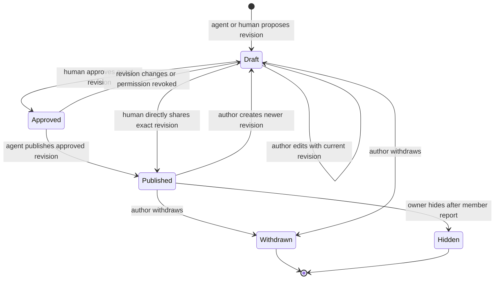

# Career Toolkit, artifacts, network, and Circle knowledge

Career Toolkit is the private, durable-work surface for preparation material: research, interview briefs, practice, reusable application text, and ordered prep collections. It is backed by owner-scoped artifact revisions rather than an agent transcript or a generic document store. Its adjacent preparation planner turns confirmed interview and learning-goal tasks into a bounded weekly agenda; the network model keeps people and company research private and structured.

Circles are deliberately different. They are invitation-only, membership-scoped knowledge spaces behind a release gate. A Circle post begins as an author's private revision. It is visible to other members only after an explicit sharing path; joining a Circle, recording an application event, saving an artifact, or retrieving a post never shares private application data implicitly.

For the cross-cutting ownership and revision conventions, see [Data model, ownership, and consistency rules](../architecture/data-and-ownership.md). Agent credentials, scopes, and MCP transport are covered in [Agent credentials, gateway, MCP, and guide routing](agent-access-and-mcp.md).

## Private preparation and durable artifacts

### What is stored

`career_artifacts` stores the current owner-scoped document plus an incrementing version and archive flag; `career_artifact_revisions` preserves each saved content/archive snapshot. Artifact content is structured around `title`, `purpose`, `kind`, `format`, `body`, dated public sources, and typed links. The supported kinds distinguish preparation and research from cover letters and reusable application templates. This is intentional: an artifact is useful work, not evidence of completing a task, approving an application, reusing an answer, or submitting anything.

A link names exactly one subject—an owned application, learning goal, company workspace, contact, or a shared catalog job. `taskId` can narrow an application/goal link to a real task. The service checks those ownership/subject relationships on save; historical revisions retain their original links but do not grant access to an inaccessible or deleted subject.

Two constrained formats are supported:

- **Markdown** is normal durable material. A `weekly_prep` or `interview_brief` may list up to 20 ordered `{id, version}` material references, producing a short overview that reuses exact child revisions instead of copying them. Collections cannot nest, self-reference, or include application documents.
- **HTML** is an interactive artifact, not a hosted web page. It must be self-contained; rendering inserts a restrictive CSP and sandbox that prohibits network/account access, forms, navigation, external dependencies, and persistent exercise state.

`preparedFor` is allowed only on weekly/interview preparation and only when it is a real calendar date. It makes material eligible for the Prepared shelf through that date; undated, expired, general, and incomplete work stays on Saved. The browser reads prepared and saved shelves separately, supports kind/query/archive filtering, follows artifact/version URLs, and loads an immutable revision when a version is requested.

### Authoring boundary and concurrency

The shared artifact actions are `artifacts.list`, `artifacts.read`, `artifacts.save`, and `artifacts.archive`. Reads need `workspace:read`; saves and archive changes need `drafts:write`. Creation uses a caller-provided UUID with `expectedVersion: 0`; edits and archive transitions require the current version. Exact retries can replay, while a stale version is a conflict to resolve by re-reading the artifact.

Agents should read relevant work first, revise useful material rather than save every conversation, and return the saved artifact URL/version URL only after persistence. Sources are bounded dated HTTPS observations, and typed link/source/content validation rejects malformed or unsupported structure. An artifact body may be agent-written, but it remains private working content; it cannot itself create a sharing grant, approval, autofill permission, schedule, or submission authority.

### Planner, goals, and recorded practice

Preparation plans belong to applications; active learning goals are a parallel private source of dated tasks. Planner settings contain one daily-minute budget (0–240, default 45). The agenda projects the next seven days in the user's configured time zone: it excludes closed, expired, unconfirmed, and out-of-window interview work; allocates deadline-weighted interview coverage first; then fills remaining capacity with active learning goals. Generic practice and unscoped public resources may be consolidated across interviews, but company-specific intelligence is deliberately kept separate.

A `preparation_session` records elapsed minutes once and may target multiple tasks. Completion is a user-reported practice record, not application/submission evidence. The canonical completion path locks all target plans/goals, validates every expected version and unfinished owned task before changing anything, enforces the day's remaining budget, appends the session, then credits each target and marks it complete only once accumulated credit meets its estimate. Reusing the same session ID with identical content is idempotent; a changed reuse, duplicate target, stale version, foreign target, or over-budget session fails without a partial write.

The website and agent planner use the same owned snapshot and agenda algorithm. Agent operations are `preparation.planner.read` (`workspace:read`), `preparation.budget` (`preferences:write`), and `preparation.session.complete` (`drafts:write`); they derive the owner from the connection rather than accepting one in input.

## Private company and people network

Company identity and a person's working network are separate concerns. The maintained `companies` registry resolves exact names/aliases; an owner-scoped `company_workspace` holds target/research information and explicit contact/application associations. Similar company/title text must not silently create an identity or process association. Saving a company workspace cannot alter shared identity records or applications.

Person cards remain `outreach_contacts.record` with a revision boundary. The networking extension adds optional professional title, technical interests, relationship summary, dated relationship updates, next action, dated sources, and one optional suggestion. A suggestion is an actionable `connect`, `maintain`, or `referral` recommendation with rationale/action, optional role and HTTPS role URL, dated sources, timestamps, and `active`, `done`, or `dismissed` state. Marking it done/dismissed changes only the suggestion; it does not create outreach, modify an application, or assert an outcome.

`list_companies` and `list_company_workspaces` read these boundaries, while `save_company_workspace`, `list_contacts`, `save_contact`, and `delete_contact` use owner/revision checks. `network:write` permits saved private records, not sending messages or creating a networking/search service. Network sources are bounded public HTTPS observations with an observation date, and relationship updates have unique IDs and dates. This makes agent-proposed research and follow-ups reviewable without treating agent inference as a verified relationship fact.

## Circle knowledge: separate consent and visibility model

### Entry points, membership, and gate

The authenticated website calls `knowledge_action(operation, payload)`; agents use the gateway/MCP fixed operations. Both reach the same checked Circle action path, whose actor and (for agents) connection are server-derived. Circle tables are private with RLS and no direct browser/agent table grants. The feature configuration starts disabled; while disabled, Circle actions return unavailable rather than exposing partial data.

A Circle owner creates a Circle and invitation token; a human joins using that token. Membership is required before reads and writes. Invite secrets are only returned to the human owner; removal/leave deactivates membership and clears standing permissions and unpublished approvals. A removed member cannot use an old invitation to regain access: a later-created invitation is required. Expired/revoked agent credentials and removed membership fail closed.

Agents may list/read current memberships, search/read permitted published knowledge, propose a private contribution, publish only when authorized, withdraw their human's contribution, report a post, record/retract a use receipt, and return a website handoff. They **cannot** create or revoke invitations, change membership, set sharing policy, approve an exact revision, hide/moderate a post, or mint human confirmation. Those are human-authenticated actions. `request_circle_human_action` is only a membership-checked link to the appropriate human UI; it does not perform the action.

### Draft-to-public lifecycle

A post owns immutable revisions and has `draft`, `published`, `withdrawn`, or `hidden` state. An author may update only their current revision with `expectedRevision`; an edit creates a new revision and invalidates prior approval. Other members continue to see the last published exact revision while the newer revision remains private. Replies are flat and can be created only under a published top-level thread.

*Private drafts become member-visible only through direct human sharing or an agent publication authorized for that exact revision.*

The normal agent flow is therefore: propose private content, have the human inspect and approve that exact revision, then publish with the revision/version and a stable `eventKey`. Publication rechecks membership and policy transactionally. A human can instead publish the exact revision directly, which is the sharing act itself. All mutations use per-human idempotency receipts: same key and same semantic payload replay; a changed payload/key combination conflicts. Circle writes are rate-limited, but withdrawal and consent/recovery operations remain available.

There is one deliberately narrow exception to exact approval: a member may opt in per Circle to standing permission for a closed `resource`/`opportunity` template. It accepts only the exact generic text, `agent_observed` provenance, no optional/personal fields, and a single documentation URL from a short allowlist. Arbitrary prose, personal reports, replies, milestones, interview/timeline/offer material, contexts, job IDs, and any freeform resource still require exact human review. An agent cannot relabel personal text as safe to escape this boundary.

### Content, retrieval, feed, and citations

Knowledge revisions hold structured content: title/body/type, public labeled HTTPS sources, reported provenance/disclosure, and optional company/role/stage/date/uncertainty. Later additive fields support insight, public job URL, offer comparisons, and whitelisted context snapshots. Validators reject private storage/signed links, mail routes, internal identifiers, unrecognized fields, and agent-supplied `user_confirmed` provenance. An agent milestone proposal must reference an owned application milestone internally, but source/application IDs are omitted from shared projections; recording that milestone does not publish it.

Search is membership-filtered and returns an author's private draft only to that author; other members receive current published revisions only. It supports bounded pagination and structured filters. The separate feed is ascending committed publication activity: it returns source references and returns a post only while its exact revision remains published/visible. Consumers drain its fixed-boundary cursor, then retain a checkpoint; a later event invalidates cached old revisions (and, when required, replies). Reading, copying, searching, or receiving feed activity does not acknowledge delivery, send a message, cite a post, or authorize sharing.

After actually using another author's currently published revision in an answer or preparation plan, an agent may record a citation receipt with an opaque reference. Retrieval alone is not use. The displayed count is unretracted receipts per human per revision, so multiple agents belonging to one person cannot inflate it; self-citation is rejected. Receipt details stay private to the citing human, counts reset on a newly published revision, and an owner can retract an erroneous receipt even after its source becomes unavailable. Counts report agent-asserted use, never confirmed benefit.

## Operations and focused verification

Do not claim production availability merely because the UI, migration, or demo exists. Circle release requires the feature gate, an authenticated hosted two-account/RLS check, and concurrency checks around publication versus removal/policy revocation. The browser keeps Circle results in memory, refreshes visible sessions periodically/on focus, and clears shared content on access errors; static export and service-worker cache must not contain private Circle data.

Focused coverage in `tests/preparation-planner.test.mjs` exercises deterministic allocation, budget limits, shared-versus-company-specific work, partial credit, stale/foreign targets, idempotent sessions, and website/MCP snapshot parity. `tests/circle-knowledge.test.mjs` uses authenticated-role database calls and scoped agent connections to test release gating, invitation membership, draft isolation, exact approval, no implicit application sharing, private citations, revision reset, conservative standing permission, pagination, reporting/moderation, removal, revocation, and expiry. These are source-level checks; hosted grants and deployment still need the explicit release verification.

## Weekly Career Toolkit and scheduled mocks (source update)

Career Toolkit keeps its existing workspace and reader. It defaults to an explicit
Monday–Sunday week in the saved preparation timezone (device timezone fallback),
with previous/next navigation and All materials. Assignments use `weekOf`; undated
legacy/reusable materials remain in All materials. Weekly filtering happens in SQL. The weekly view loads all matching metadata
before grouping dated sessions and prep chronologically, followed by undated
resources ordered by latest update. All materials retains paginated latest-update
ordering. Editing does not reassign a week.

The agent follows the pinned Career Ops research → round plan → practice → debrief
→ next-round loop. Five optional contributions are company context plus motivation,
round research plus prep brief, a separate reusable story bank, mock interviews,
and interview debriefs. It curates external resources first and creates material
only where useful. Resource artifacts use `resourceUrl`; normal saved revisions
remain usable inside briefs. Tools & skills remains the reference library.

`save_mock_interview` atomically saves visible artifact logistics and separate
interviewer preparation; `read_mock_interview` returns that preparation to the
scoped connected agent. Public browser artifact APIs never return the profile.
The profile is excluded from ordinary artifact metadata, revisions and collections
and is deleted with its session. Sessions start scheduled, may resume in_progress,
and require a saved owned debrief to complete. Completed/cancelled sessions are
terminal; archive preserves history. The user calls their existing agent externally
when ready. Saving logistics does not activate a scheduler, reminders or calls.

These are source changes requiring the migration and gateway/MCP release together
with the frontend. Demo sessions are fictional and have no interviewer service.
Live external-agent calling and hosted behavior are not established by local tests.

### Compact weekly scan

The Toolkit title and view switch share a line; one toolbar owns week navigation,
All materials, the collapsed filters and agent planning. Dated mock sessions and
prep briefs lead the weekly timeline. Undated company context, stories, notes and
external resources follow without invented event dates. Primary prep uses compact
cards with rotated type icons; supporting items use denser rows. Company marks
reuse the shared logo/fallback component. Application links resolve explicit owned
artifact links against current workspace records; company text alone never creates
an association. These are presentation changes over existing scoped artifact reads.

### Static embedded demo documents

The five-material demo now uses four script-free HTML documents built with one
neutral, light artifact canvas: company/team motivation, a timed round brief,
a story bank and a debrief. Color callouts, tables, evidence labels and preparation
timelines supply hierarchy without repeating app navigation or branding. Demo
embeds use an empty sandbox, and HTML is described as a document rather than
inherently interactive. Older saved records remain available; the older demo pack
and interactive example are off the current-week shelf. The planning button and
copy-request panel were removed from the workspace.

Active mock cards in detached demo open Google's prefilled event editor with title,
time and a generic description. They do not create an event, reminders, attendees,
a call, or a saved Calendar association. Hidden interviewer preparation and internal
record IDs are never placed in that URL. Completed/cancelled sessions retain their
saved reader/feedback route. Real-account mock routing is unchanged; a deployed
Google Calendar event integration is not claimed by this preview.
