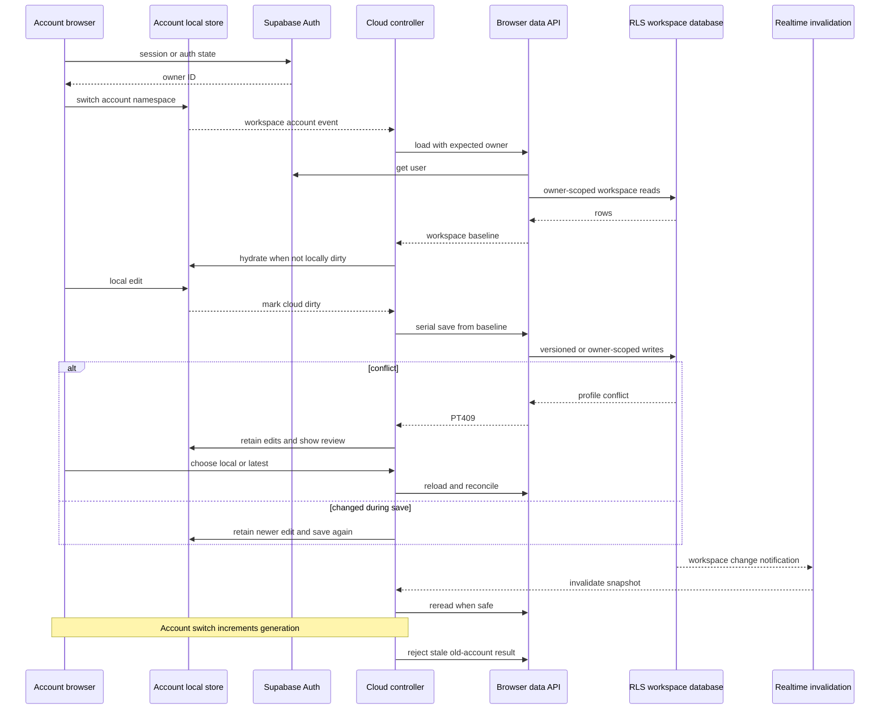

# Browser workspace state, cloud sync, and demo isolation

The product has two mutually exclusive browser runtimes:

- The **account workspace** is authenticated, locally cached per account, and synchronized with the owner-scoped Supabase workspace.
- The **demo workspace** is fictional and disposable. It is built from fixtures and an in-memory store, not from an account or browser persistence.

This is an ownership boundary, not merely a UI flag. The account runtime may handle private data and Supabase sessions; the demo runtime must not import production account storage, auth clients, cloud sync, or production MCP. Switching modes performs a full navigation and removes URL query/hash context, so private batch or callback parameters cannot cross the boundary.

For the database ownership and canonical-writer rules beneath this client behavior, see [Data model, ownership, and consistency rules](../architecture/data-and-ownership.md).

## Account workspace: state ownership and bootstrap

`next-app/lib/account-workspace.jsx` is the account-runtime entry point. It boots the dependency-free browser store and domain models, configures tier-list presets, creates a Supabase browser client with PKCE session persistence and refresh, and exposes the authenticated client and current user ID to the cloud controller. Auth-state changes call `store.switchAccount(id)` before the cloud controller loads the account.

The store in `lib/store.js` holds the application state under a versioned localStorage key. A guest uses `job-signal-state-v1`; an authenticated account uses `job-signal-state-v1:user:<UUID>`. Switching accounts flushes the old namespace, loads the new one, notifies subscribers, and emits `workspace:account`. It rejects a non-UUID account identifier. Consequently guest state and two accounts' cached profiles, answers, drafts, and other workspace slices remain distinct. The `ui` slice is intentionally transient and is not written to localStorage.

Local persistence is an availability cache, not authority: changes are debounced, and are flushed on `pagehide` or when the document becomes hidden. If browser storage is unavailable or full, the in-memory state remains usable. Once an authenticated account connects, the server workspace is the baseline used for synchronization.

### Loading the server baseline

`connectCloud(client, ui)` in `lib/cloud.mjs` coordinates the account runtime. It tracks an account ID, monotonically increasing `generation`, server `loaded` baseline, in-flight worker, timers, and UI lock state. On an account event it increments the generation, clears baseline/subscription/timers, then starts a load for the new owner. A load locks controls, checks reset status, obtains a browser data API constrained to the expected user, reads the workspace, maps the rows through `fromCloud`, and hydrates the local `workflow` slice only when it is not already dirty.

`createBackend` in `backend/client.mjs` is a browser-facing, non-service-role API. Its `owner()` obtains the Supabase user and rejects an absent or changed identity. Workspace loading reads the profile, preferences, résumés, answer library, applications (with jobs), activity, attempts, milestones, and action inbox with `user_id` predicates; paginated table reads use stable ordering. Those client checks fence navigation/account changes, while RLS and RPC owner checks remain the authorization authority.

The account provider imports `data/jobs.json` as a **static public catalog**. It exposes those roles only as the public fallback; private role cards come from an owned batch fetched by cloud sync. A missing or deleted private batch clears that batch without making an otherwise healthy account workspace unavailable.

*Authenticated hydration, serial save, conflict/retry, realtime invalidation, and the generation fence that prevents an old-account response from hydrating a new account.*

## Serial synchronization and safety properties

A subscription to `workflow` marks the account workspace `cloudDirty` unless hydration or controller-managed updates are being applied. The controller debounces saving for 650 ms. `save()` has exactly one active worker: concurrent callers receive the same promise, while the worker loops until the dirty flag is clear. This avoids parallel writes and also drains an edit made while a request is in flight.

`persist()` snapshots the local workflow (excluding its profile sync-base metadata) and compares it with the last loaded server baseline. It writes only changed domains through their appropriate backend boundaries:

- profile fact changes go through version-aware profile RPCs, followed by verification handling;
- preferences combine local search/theme/tier-list state with the existing preference record;
- locally created résumés, saved answers, deleted answer IDs, and editable application drafts are reconciled individually;
- non-draft application states are not rewritten by ordinary autosync.

After writes, it reloads the authoritative workspace. If the exact snapshot that was sent is still current, it hydrates it and clears dirty state. If the browser changed during the request, it preserves the newer local edits (including returned application IDs/revisions), removes only deletions already sent, and schedules the next serial save. A failed save preserves the local dirty cache and queues a retry; background retry delay backs off from 5 seconds up to 60 seconds. Explicit profile conflicts stop automatic retry rather than risking a silent overwrite.

Every load, save, refresh, import, and application transition captures the current generation and user ID, then verifies them before accepting results. `createBackend` repeats its owner check around sensitive requests. An account switch, demo suspension, or stale request therefore cannot hydrate or write as the previous account.

### Profile conflict and form protection

Profile facts have a more precise merge path than whole-workspace replacement. The controller saves the loaded profile row as `workflow.profileSyncBase`, allowing `profileChanges` to identify local field changes against a known baseline. A server `PT409` creates a profile-conflict state, keeps browser edits, and requires review. Reload reconciliation preserves non-overlapping local changes; same-field differences require a `local` or `latest` choice. Choosing latest discards only conflicting local fields and retains other local edits. Any actual profile field edit clears verified state.

Background hydration is deliberately conservative. It does not replace state when a profile form is being edited, when local state is dirty, or when the snapshot changed during the read. Focus, reconnect/online, visibility return, and realtime changes can request a refresh, but a read does not overwrite typing in progress.

## Realtime refresh and reset recovery

Realtime is invalidation, not a replication stream. `subscribeWorkspaceChanges` subscribes to the owner-filtered `workspace_changes` table, then invokes refresh immediately on subscription/reconnection to reconcile missed events. Database triggers coalesce mutations across relevant workspace tables into one per-owner version row; the notification contains no private workspace document body. On a safe refresh, the controller rereads RLS-protected workspace rows. Channel failure reports that live updates are disconnected; saved actions remain retained, and normal browser events can refresh later.

Before load and persist, the controller calls `workspace_reset_state`. A pending reset blocks normal editing/loading; when it sees a completed reset ID different from the cached `resetEpoch`, it clears only that account's browser namespace and reloads. The database reset protocol itself serializes reset and workspace writers, rejects writes during a pending reset, removes the owner’s resettable workspace records after file cleanup, and records a completion receipt. This client-side epoch check prevents stale dirty browser data from being autosynced after a remote reset.

## Detached fictional demo runtime

`next-app/lib/workspace.jsx` chooses either a lazy-loaded `AccountWorkspaceProvider` or `DemoWorkspaceProvider` after resolving the tab-scoped `lookout:detached-demo` sessionStorage flag. Account/login/onboarding routes clear remembered demo mode unless an explicit demo preview is appropriate. `navigateWorkspaceMode` performs a full navigation with only `?demo=1` or `?demo=0`, deliberately discarding every other query parameter and fragment.

`DemoWorkspaceProvider` loads only pure domain helpers and constructs a new detached runtime with `createDetachedDemo`. It replaces the legacy handles visible to domain consumers with the fictional store plus `auth` values of `null` and `cloud` of `null`. The provider reports no signed-in user, no Supabase client, and no account services; sign-in/sign-out instead instruct the user to exit demo mode.

The runtime composes deterministic fictional fixtures and scenario adapters, then uses `createDemoStore`. That store clones initial values, returns clones to readers, publishes subscriptions, and supports reset, but has no localStorage, account switching, backend, or file access. Demo edits are isolated to one in-memory runtime and disappear on reset/recreation. Fixtures are marked fictional and use `example.com` URLs; production account handles and downloadable object paths are not part of the demo data.

**Non-negotiable extension rule:** demo code must not import production account storage (`lib/store.js`), Supabase auth clients, cloud synchronization (`lib/cloud.mjs`), backend clients, or production MCP. Add a pure helper or a demo-specific adapter when demo behavior needs to resemble a production feature. The build-level isolation test is the guard against accidentally bundling those dependencies.

## Change and verification guide

Keep synchronization changes focused on the controller's safety invariants: account namespace before load, generation checks around asynchronous work, a single save worker, baseline-aware reconciliation, and retention of unsynced local edits on failure. Add a server-side owner/version guard for any new persistent field; browser checks cannot replace RLS or canonical RPC enforcement.

Focused tests are especially valuable here:

- `tests/account-store.test.cjs` verifies guest/account namespaces, UUID validation, and account-only cache clearing with a reset epoch.
- `tests/cloud-sync.test.cjs` covers serial saves, edits during requests, offline retention/retry, stale account responses, realtime refresh, profile conflict choices, reset invalidation, and demo suspension of cloud I/O.
- `tests/demo.test.mjs` verifies deterministic, fictional fixtures and that demo memory does not use real local storage/accounts.
- `tests/detached-demo.test.mjs` verifies tab-scoped mode navigation and builds the demo entry to assert that account bootstrap, production store/cloud/backend client, and Supabase dependencies are absent.

When changing workspace data semantics, also follow the database consistency and migration guidance in [Data model, ownership, and consistency rules](../architecture/data-and-ownership.md).

### Startup recovery

Auth session and website setup reads report a retryable error after 12 seconds instead of leaving the workspace loading indefinitely. A timed-out read does not grant access or discard cached account data. The timeout does not establish why the underlying service or browser session stalled.
