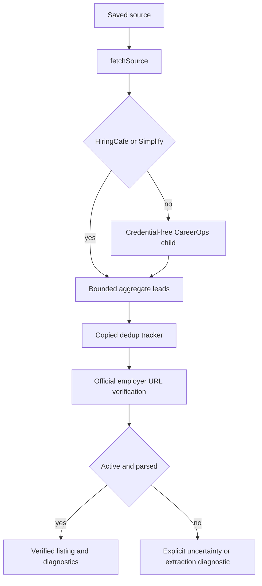

Lookout has deliberately narrow integration boundaries. Job discovery may collect public leads and then verify an official employer posting; application submission is an opt-in, guarded browser operation; and a resume is an owned private file, not a caller-supplied URL. None of these boundaries establishes that every provider is reachable, that an applicant is eligible or a fit, or that an employer received an application.

## What is enabled, copied, and not a promise

| Area | Enabled path | Important boundary |
| --- | --- | --- |
| Employer discovery | Greenhouse and Lever are the approved copied-provider path; the runtime also has first-party aggregate adapters, including HiringCafe. | A catalog entry or installed provider is not evidence that it is reachable or that its description parser is supported. |
| Lead verification | The copied ATS API/browser liveness ladder verifies a candidate employer URL. The current full-description extraction path is Greenhouse. | An active unsupported or failed extraction is a diagnostic, not a fabricated parsed job record. |
| Application browser runner | Canonical Greenhouse, Ashby, and Lever postings, including `jobs.eu.lever.co`, are recognized. | It is disabled unless `LOOKOUT_SUBMISSION_ENABLED=true`; live tenant compatibility and real employer round trips are not established by fixtures. |
| CareerOps materials | Adapted manuals and verbatim executable files are pinned to CareerOps `c78e14cdfd52f18a92e4a67694efab7ddef59385` / VERSION `1.36.0` under MIT. | The larger provider catalog, browser sources, AI enrichment, local parsers, upstream UI, installers, model runners, user data, and a scheduler are not thereby activated. |
| Resume parsing | A private, owned PDF/DOCX can be sent to the fixed APILayer endpoint when `APILAYER_API_KEY` is configured. | The vendor's deletion/retention statement is not independently verified; OCR and extraction accuracy still require review. |

CareerOps is imported rather than treated as an opaque dependency. `scripts/import-career-tools.mjs <reviewed-source-checkout>` copies the selected dependency closure and records SHA-256 hashes in the executable manifest. It explicitly excludes `providers/local-parser.mjs`, preventing configured arbitrary subprocesses. The child worker receives a disposable workspace and only a minimal environment—no agent, cloud, proxy, or user credentials—then is limited to a 384 MiB heap, 120 seconds, and 16 MiB of output. Its workspace, including the mapped dedup tracker, is deleted afterwards. This retains upstream scanner identity and tracker behavior without creating a second user tracker or a new parser/normalization implementation in the backend adapter.

## Discovery: lead collection is not publication

`source-providers.ts` uses Career Ops’ `{id, detect, fetch}` pattern and copied resolver for HiringCafe, Simplify, and the isolated Career Ops collector. `fetchSource` runs every provider result through the same deduplication and employer-verification pipeline before database persistence. For ordinary sources it asks the isolated child to use unchanged upstream provider pagination, deduplicates returned leads using copied code, and passes URLs to `verify-discovery-leads` in batches of at most 25. Every returned lead is processed; failed batches retain per-link uncertainty while other batches remain available. A child failure produces `inaccessible` coverage rather than a made-up result. The verification result is saved only when the employer posting is active **and** its description is parsed; otherwise per-link diagnostics preserve whether it is expired, uncertain, unsupported, or failed.

This shows why a collected lead cannot become a verified listing merely because an aggregate or provider returned it.

Liveness and extraction are independent. The liveness orchestrator first uses copied ATS APIs; inconclusive results can fall back to a guarded browser check. API work can run concurrently, while browser checks remain sequential; a soft browser budget reports remaining links as uncertain. URL guards run before network or browser access. For example, an authoritative Greenhouse API 404 can be expired, whereas a Lever 404 falls back to browser checking; a bot challenge, unavailable browser, or exhausted budget stays uncertain. An active page outside the JD dispatcher remains `extraction: unsupported`, and a parser failure does not overwrite active liveness.

The discovery worker attempts every configured run source with up to ten concurrent source tasks. It preserves upstream pagination, request spacing, retries and provider safety limits instead of adding blanket page/request/result caps. It carries provider incomplete-pagination flags into partial coverage. Child process resource budgets and job lease fencing remain in force. Returned descriptions are bounded before persistence. Source coverage can consequently be `truncated` even when the selected leads were checked; it is never a claim of exhaustive market search, fit, eligibility, or publication date accuracy.

### HiringCafe is a collection provider

A source is recognized as HiringCafe only for a public HTTPS allowlisted HiringCafe hostname with no credentials and the default/443 port. The adapter invokes the public MCP endpoint `https://hiringcafe.com/api/chatgpt/mcp`, converting saved role, location, employment, seniority, and required work-arrangement constraints into queries. It calls `refine_hiringcafe_job_results` for every configured query combination within a 75-second deadline, requests the published maximum of 25 jobs per query and five per employer, rejects redirects, and bounds response bodies. The current MCP schema exposes no pagination cursor; unexecuted queries are counted in diagnostics.

HiringCafe is intentionally a lead source, not an employer-record authority. For each result, Lookout accepts a direct public non-HiringCafe apply URL or resolves exactly one explicit external anchor labelled Apply from the HiringCafe job page. Missing, ambiguous, private, or challenge-blocked links are retained as uncertain diagnostics and never sent into employer verification. Provider freshness is stored as source-list age rather than promoted to an employer posting date; the public MCP result limit, absence of a pagination cursor, and rounded windows mean coverage remains partial. See [the discovery workflow](../workflows/job-discovery.md) for the downstream screening and shortlist handoff.

## Supported application forms: one guarded click, otherwise a handoff

The runner recognizes only canonical URLs for Greenhouse, Ashby, and Lever. It opens the canonical posting and, only when necessary, one visible, unambiguous same-job Apply entry; it will not click a control inside a form or follow a navigation to a different job. There must be exactly one visible native form. Ashby and Lever also must match their platform selectors, and labels/option values are captured in a trusted form fingerprint.

The supported form surface is intentionally small: native text, email, telephone, URL, textarea, select, checkbox, grouped radio, and exactly one PDF resume upload. Before the click, the runner rechecks authorization, selected canonical URL, current application revision and profile policy, the fingerprint, DOM validity, every pinned value, and the uploaded file's SHA-256. It claims and starts a durable single-click permit only after those checks. A confirmed result requires an expected same-job confirmation URL, a platform-specific visible success marker/message, and no visible form—disappearance of a form alone is not success.

Custom widgets, CAPTCHA, embedded or multiple forms, extra documents, unknown questions, changed conditional fields, ambiguous/missing entry controls, changed fingerprints, and unsuitable submission controls produce a blocker and manual handoff. The runner does not guess answers, solve CAPTCHA, create accounts, upload a resume to a transcript/cover-letter slot, or retry a click. Once start was requested, a timeout or lost response is treated as uncertain; the user must verify employer status, and recovery may report the outcome but may not authorize another click.

`submit_application` and `submit_application_batch` are exposed only when `LOOKOUT_SUBMISSION_ENABLED=true`. A batch contains 1–10 unique owned application/revision references, runs sequentially during the request, and checkpoints each result durably. An active lease returns busy; an expired lease can resume unfinished entries with stable attempt IDs, while terminal outcomes replay without browser work. `read_application_batches({batchId})` is the reconciliation path after a lost response. The API process isolates browser contexts per request and allows at most two executions. The worker additionally requires `LOOKOUT_EXECUTION_ENABLED=true` before it polls the durable queue.

The submitted-form controls incorporate narrowly adapted MIT selector/label code; they do not import an upstream browser extension, answer generator, browser storage, CAPTCHA solver, automatic submission loop, or its database policy. Controlled Chromium E2E fixtures exercise the MCP/Node/Edge/SQL path and intercept every employer request. They prove the internal workflow, one POST, uploaded bytes, receipts, and duplicate prevention—not a live Greenhouse, Ashby, or Lever submission.

For the draft/approval lifecycle and user-facing repair path, see [Application submission](../workflows/application-submission.md). Runtime activation and deployment caveats are in [Local and release runtime](../operations/local-and-release-runtime.md).

## Private resume storage and optional parsing

The resume-import API accepts only `{resumeId}`. It authenticates the human or agent, looks up a current resume owned by that identity, requires an owner-prefixed private `pdf`/`docx` object path and a valid content hash, downloads from the private `resumes` bucket, and verifies bytes against that hash before calling APILayer. Reference URLs, user IDs, arbitrary object paths, and caller-selected provider URLs are never accepted. Agent parsing requires `workspace:read`, `resumes:read`, and `profile:write` on every authorization check.

The raw document is sent as bytes with the server-only `apikey` to the fixed `https://api.apilayer.com/resume_parser/upload` endpoint. Responses are bounded and schema-checked; only supported name, email, skills, experience, and education facts are mapped into a review-required proposal. It does not write the profile. The user must explicitly accept a versioned field update, so imported facts remain unverified. Missing configuration, an unavailable vendor, malformed output, or a changed resume leaves the private upload and existing profile intact.

Successful sanitized proposals are cached in API memory per owner and content hash for 15 minutes (20 entries maximum); ownership is rechecked on cache hits. This reduces duplicate calls within one process but is not durable billing deduplication across restarts or replicas, and interrupted/retried calls can consume another vendor request. Logs omit keys, file contents, and raw vendor responses.

## Verification and safe extension

Focused tests cover the important boundaries:

- `tests/hiringcafe.test.mjs` checks host guards, bounded query construction, explicit/unique apply-link resolution, failure diagnostics, duplicate aggregate IDs, and the collect → verify → screen → dedup handoff.
- `tests/career-liveness.test.mjs` covers API/browser decision behavior, URL guards, budgets, uncertainty, and separation of liveness from extraction.
- `tests/search-dedup.test.mjs` and `tests/career-execution.test.mjs` verify pinned vendor hashes, provider loading without `local-parser`, identity-only dedup input, safe child execution, and private PDF finalization.
- `tests/ats-submission.test.mjs` verifies canonical target rejection, confirmation receipt binding, resume-slot scope, and pinned adapted upstream blobs. `npm run test:submission:e2e` uses controlled routes and does not send a real application.

To extend an integration safely, retain the distinction between lead collection, employer verification, extraction, screening, and publication; introduce a provider only through the isolated registry/allowlist; preserve diagnostic states rather than converting failures into active records; and add controlled fixtures before claiming external support. A real provider or employer smoke test is a separate operational activity, not something unit or fixture coverage can imply.

The Simplify provider recognizes New Grad, Summer 2027 and the configured off-season README link. All read the official structured JSON, retaining only active visible leads. Summer uses `Summer 2027`; off-season uses the page's published Fall 2026 / Winter 2027 / Spring 2027 window, including rows with any matching term. The same deduplication, employer-verification and owned persistence stages follow all three feeds. Aggregate terms and dates do not prove employer eligibility or publication dates.
