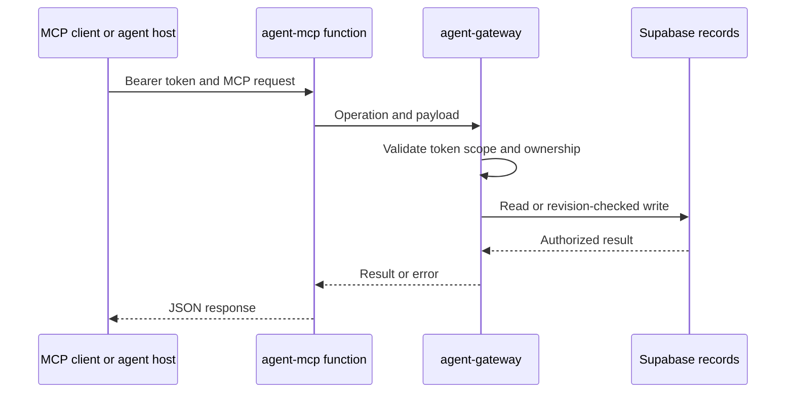

# Current implementation state and operational limits

This page separates **code present in this repository**, **behavior that a local operator can enable**, and **behavior evidenced as deployed**. It is not a promise that an agent host, external service, or employer system has completed an action. In particular, the product persists records and enforces scoped workflows; it does not itself supply a model runtime, recurring scheduler, SMS/notification transport, inbox monitor, remote browser, or general database/shell access.

## Status vocabulary

| Label | Meaning in this page |
| --- | --- |
| **Implemented** | Source and focused tests describe the behavior; it still may need a configured environment or an end-to-end check. |
| **Feature-gated** | The code path exists but is disabled until a named runtime flag, deployment, permission, or human action permits it. |
| **Locally runnable** | A developer can run it with the documented local services and credentials. It is not evidence of hosted availability. |
| **Deployment recorded** | Repository documentation records a particular hosted rollout. It is not a claim that the checked-out code has reached that environment or that every client integration works. |
| **Unverified** | No end-to-end evidence should be inferred. It remains a release blocker for claims that depend on it. |

## What is implemented

Application automation honors the strict account-wide `autoSubmitApproved` guard even for explicit profile modes. Profile controls show the account block and remain disabled while it is off or missing; profile saves cannot grant global consent. Policy reads and runner authorization explain the block and direct the user to exact-draft approval in Applications. This is locally verified behavior; hosted availability requires the frontend and gateway release.

### Product and persistence surfaces

The production UI is a static Next.js export, while Supabase owns identity, private records, storage, and server-side authorization. The public catalog remains static data; signed-in private state—including profile facts, preferences, resumes, batches, applications, approvals, attempts, search records, and operational records—is modeled by migrations and protected by owner-aware services. A detached `?demo=1` workspace uses fictional in-memory fixtures, deliberately avoids the account store, auth client, cloud sync, and production MCP, and resets on refresh.

The schema/reference documents a prepared hosted rollout (54 application tables and 49 recorded migrations as of 2026-10-23), but also calls out a separately developed workspace-reset migration as local-only. Treat migrations as the executable schema source, not the documentation or an older UI proposal.

Discover batch items can be removed through the scoped `remove_discover_job` action. Removal hides the owned item in Discover while retaining its batch history, shared catalog entry and applications. Availability depends on deployment of the migration and gateway; see `changes/discover-remove-7PMSxi.md`.

### Agent data plane, not an agent runtime

Remote MCP is a stateless Streamable HTTP transport: every request forwards an opaque bearer credential to `agent-gateway`, which is the authority for connection scope, ownership, expiry/revocation, validations, and revision checks. MCP discovery is scope-filtered. The transport has no server-initiated SSE, browser tooling, shell, SQL tool, connection management, or submission endpoint of its own. Developer instructions require context-version checking, scoped-tool discovery, read-back after writes, and preservation of human approval/verification boundaries.

The system also has persisted task, change-feed, lease, and delivery concepts. They let a compatible personal-agent host resume authorized work and acknowledge durable outcomes; they do **not** install a host, execute a model, wake an external agent, or create a schedule. The optional `mcp/change-worker.mjs` is an adapter a host must supply with its own authorized call, handling, and verification functions.

This shows the hosted MCP authorization path; it does not depict an autonomous agent execution loop.

### Search and discovery execution

The local Node API and worker are separate Docker services. The worker only claims already-queued jobs; it contains no recurring-search scheduler. When explicitly enabled, one `search_ats` job is bounded to configured sources and observations, uses service-only RPCs with job/version/lease/connection/profile fences, and fetches through a constrained child-process boundary. It collects and verifies supported leads, persists observations and screening inputs, and returns shortlist IDs. It does not generate model reports, messages, or applications. Unsupported extraction remains partial rather than becoming a fabricated parsed record.

The source is deliberately conservative: configured execution is off by default (`LOOKOUT_EXECUTION_ENABLED=false`), the worker is idle otherwise, and retry/lease behavior can finish a run as partial. The repository’s local proof documentation explicitly says it does not establish a hosted deployment, externally reachable MCP endpoint, real Google OAuth, or real employer submission.

### Application execution

A local stdio runner implements deterministic inspection, resume fingerprinting, prefill, and guarded submit tools for listed ATS types. Submission requires current server authorization, exact owned resume bytes and form fingerprint, a single atomic claim, a short-lived one-use click permit, and an observed confirmation. One active/uncertain/confirmed attempt is enforced per application; a started or uncertain attempt never becomes retryable automatically. An uncertain result requires human verification before a new attempt.

This is an **implemented but operationally gated local execution path**, not a blanket employer-submission claim. The runtime API exposes submission behavior only when `LOOKOUT_SUBMISSION_ENABLED=true`; the runner still needs a graphical/local browser host and a compatible MCP client. CAPTCHA, Workday, custom widgets, extra documents, unsupported confirmation pages, embedded recovery, and a real Muse/employer round trip remain unsupported or unverified. The repository states that no real employer application was submitted during development.

### Resume import

The Node API can parse an owned private resume using a server-only APILayer key. Browser and Node MCP inputs accept only `resumeId`, derive ownership from validated credentials, verify current private bytes/hash, and return a proposal rather than writing profile facts. Accepted imports require the normal revision-checked save flow, and imported facts remain unverified. This API integration is locally configurable; mocked/local checks do not establish vendor extraction accuracy or hosted availability, and OCR for scanned resumes is unverified.

## Hosted and local release boundary

The November 7 hosted-readiness reconciliation uses the observed Lookout project
history in `tests/fixtures/hosted-lookout-20261107.json`: 80 applied versions,
including audit migrations, with six older feature migrations still absent at
inspection. The regression replays that precise history and then the pending
migrations, comparing the resulting columns, constraints, indexes, policies,
RLS, grants, triggers, views and functions with a fresh migration replay. It also
checks preservation of fictional owned data and the imported-tracker, Discover
removal, connection, profile and search paths. Historical statement hash differences
in four migrations were statement-separator formatting, not conflicting SQL.

The production migration push explicitly selects the linked project, includes
reviewed older pending migrations, and skips local Vault configuration. A forward
migration revokes direct browser execution of the optional hosted
`public.rls_auto_enable()` event-trigger helper while preserving its DDL behavior.
This release prepares schema/backend compatibility only: local personal accounts,
private files and sessions are not imported. Hosted readiness still requires the
main-branch backend workflow and live source/schema/permission checks; local test
success alone is not a release receipt. Existing detached demo fixtures remain
unchanged and are covered by the ordinary isolation tests.

Live comparison also identified platform default privileges that a bare test
database did not model. Hosted readiness now replays the observed public-schema
defaults for table, function and sequence grants. A forward migration removes
all direct browser grants on `career_toolkit_results` and restores only the
existing owner-scoped SELECT access; fixed backend writers keep service-role
access. In particular, signed-in users must not retain TRUNCATE, which RLS does
not protect. Schema comparison normalizes only pgvector's optional schema prefix,
retaining its dimension/type checks. Service-role defaults are compared in the
same platform context rather than mistaken for browser permissions.

Verified hosted receipt, November 7: main-branch **Deploy Supabase backend** run
`42409833561` succeeded from `34a3c50b59b78503b883340603022459e15c3308`.
All 89 migration versions and 2,960 source-derived schema/permission entries
matched the live project after accounting for observed platform defaults and
pgvector qualification. The optional RLS helper retained its enabled event hook
and passed a rolled-back DDL probe, with direct anon/authenticated execution
revoked. No application table exposed browser TRUNCATE/REFERENCES/TRIGGER grants.
Live MCP reported that exact source commit and developer contract 112. Disposable
checks passed gateway/MCP unauthenticated denial, executable tool discovery,
owned imported-record writes/read-back/retry, foreign-owner/read-only denial,
and authenticated browser RPC/profile isolation. Test accounts, connections and
imported records were removed; hosted ended with zero accounts, profiles, files,
imports or connections. The six shared companies, knowledge configuration and
Storage bucket settings were preserved. Local personal data was not imported.
Security advisors report no anonymous definer-execution warning; authenticated
owner-scoped definer entry points and private-table RLS notices remain expected.
Google OAuth and GCP worker/browser execution were not exercised. The separate
Pages release `42408607455` timed out after its successful backend step; this
receipt establishes database/backend readiness, not successful website publication.

The Pages workflow runs on `main`, calls the backend deployment workflow first, runs the repository test suite and data validation, builds the static export, then deploys the Pages artifact. Backend deployment runs only from `main`, requires the production environment and `SUPABASE_ACCESS_TOKEN`, and invokes `npm run deploy:backend`. This wiring means a frontend-only build should not be represented as publishing gateway/MCP or migration changes.

Repository documentation records a prior prepared schema rollout and gateway/MCP release, including unauthenticated denial checks. It simultaneously says authenticated MCP discovery/read/write, client support, real Google sign-in, and intended-device round trips need verification. Therefore describe those releases as **recorded deployment evidence with explicit verification gaps**, not as blanket proof that all current functionality is live.

For local development, `make services` starts local Supabase; `make frontend` starts the frontend; `make dev` sequences services, the optional ngrok tunnel, and frontend. The API/worker Compose stack is distinct and needs server-only `SUPABASE_URL` and service-role credentials. The tunnel is opt-in, exposes only `/mcp`, and preserves bearer authentication. Local Supabase uses separate data from the hosted project; do not use `--linked`, hosted URLs, or production credentials for local checks.

## Configuration and security boundaries

- Keep browser settings limited to `NEXT_PUBLIC_*` values. `NEXT_PUBLIC_LOOKOUT_API_URL` and `NEXT_PUBLIC_AGENT_MCP_URL` are origins, not secrets; `SUPABASE_SERVICE_ROLE_KEY`, APILayer credentials, and agent tokens are server/secret-store only.
- Agent connections are hashed, scoped, expiring, and revocable. An agent token is not a human session and does not mint approval, verification, consent, or employer-submission evidence.
- The Edge functions intentionally use platform `verify_jwt=false` because they perform custom session/opaque-token verification. This is safe only with the fixed gateway checks; do not add a general SQL or service-role browser tool.
- Version and expected-revision checks protect writes. Read current owned state before writing; read back saved state before reporting success; treat timeouts as uncertain and reconcile before retrying.
- Private resume links are short-lived and must not appear in logs, committed configuration, or routine agent replies. The Node child worker receives neither agent credentials nor signed URLs.

## Release-readiness checklist

A change author should make a claim no broader than the checks actually completed.

1. **Run baseline checks:** `npm test`, `npm run test:db`, `npm run validate:data`, `npm --prefix next-app run typecheck`, and `npm run build`. CI currently runs the tests, catalog validation, and production static export; database checks and local-edge checks should be run when the change affects their boundary.
2. **Run focused checks for the changed path.** Examples include `node --test tests/mcp-protocol.test.mjs` for MCP framing/scope behavior; the documented local runtime checks for discovery; and runner/database tests for claim, permit, uncertainty, and recovery semantics. Passing fixtures or PGlite scenarios proves those contracts, not a hosted external integration.
3. **Validate the correct deployment unit.** Schema and Edge/MCP changes require the backend deployment path and post-deploy authenticated checks. A Pages deployment only establishes the static frontend artifact. Keep migration/function release versions together when the contract changes.
4. **Verify the intended environment with isolated data.** Local verification must reject hosted endpoints and use disposable/fictional accounts where the supplied scripts do so. A local Docker/Compose proof does not validate production Auth, Storage, OAuth, agent connectivity, or notification delivery.
5. **Exercise a real integration before claiming it.** Verify the target Google OAuth device/client, authenticated MCP client with custom bearer headers, external agent host scheduling/wake/delivery, and—if relevant—the exact supported employer flow. Do not call a scheduled search, text, email, external browsing session, or employer application “live” merely because repository tools, records, or prompts exist.
6. **Preserve safety semantics.** Confirm that scope/owner boundaries, current authorization, revision fencing, human review, and uncertain-submission blocking remain intact. Never convert prepared, queued, running, saved, published, user-reported, or runner-observed states into one another.

## Explicit non-claims and current gaps

- A README onboarding prompt mentioning daily scans, Instagram, or text updates does not activate those automations. Scheduler, Instagram access, notification transport, inbox monitoring, and agent wake-up depend on the external personal-agent runtime and are not validated here.
- MCP client compatibility is not established merely by exposing the endpoint. A client must support Streamable HTTP plus a custom `Authorization` header; named personal-agent clients and human confirmation in chat remain end-to-end unverified.
- Remote MCP is not remote browser automation and does not bypass CAPTCHAs. Local runner support is narrower than its ATS inspection list, and no real employer submission has been exercised.
- Google is configured according to backend documentation, but a complete real-user sign-in and iPhone/private-file round trip are still verification work.
- Wider rollout still needs account export/deletion, orphan-file cleanup, operational monitoring/rate limits, and abuse handling.

See [local and release runtime](local-and-release-runtime.md), [verification strategy](../testing/verification-strategy.md), [the system overview](../architecture/system-overview.md), [agent/MCP setup](../../mcp/README.md), and [the schema reference](../../docs/schema.md) for adjacent operational detail.

## Smaller agent tool catalog (local contract 110)

MCP startup now lists common actions, logs and bugs directly. Hosted maximum:
47 exposed / 73 gated; configured Node API: 50 / 73; local runner: 50 / 83.
`discover_tools` returns scope-filtered executable schemas by workflow or exact
name, and `call_discovered_tool` shares the original direct-call validation path.
`discover_toolkit` still discovers guides. Existing names remain callable;
paused operations remain unavailable. See `mcp/README.md` for access and release
limits. Hosted/client behavior is not verified by local catalog tests.

### Local audit runtime verification

The local API was rebuilt from `6c44441`; the mounted Edge runtime now reports
developer contract 110. The two existing audit migrations (`20261107002624` and
`20261107005745`) were applied to the local database without applying other
pending migrations. The existing MCP connection successfully loaded agent-audit
v3, discovered all three audit tools, and started/appended/read a labeled repair
verification audit. Clients with cached tool catalogs need a refresh/reconnect.
No job search was queued and no batch was published during verification. The
worker and separate résumé API were preserved; hosted deployment and full worker
execution remain outside this check. See the feature change note for details.

## Local startup reliability

The local startup helper bounds Docker/CLI checks, can reuse verified running local
APIs with saved public loopback configuration, treats the configured MCP tunnel
as optional, and recognizes an existing Lookout frontend. Main preview locks
track process ownership and recover stopped owners; unknown owners are preserved.
See [local runtime details](local-and-release-runtime.md#focused-startup-reliability-update)
and the startup feature change note for checks and live-verification limits.

The warm local startup path was verified after recovering an unresponsive Docker
Desktop engine: Auth/REST health passed, the port-3000 frontend was gracefully
restarted with a process-owned preview lock, and the page returned HTTP 200.
Repeated startup commands reuse the running setup. No database reset or container
removal was performed; cold startup and remote tunnel connectivity remain unverified.

## Application tracker outcomes (contract 111 source update)

The import writer and website editor support explicit hiring outcomes and the
existing employment types from settings, including Part-time, Contract and
Temporary. `update_imported_job` is a gated applications tool requiring
tracking:write; reads require workspace:read. It shares browser ownership, row
validation, version locks and replay checks. Original source rows and existing
imported records are preserved. No automatic repair of statuses encoded in
notes is performed. See the application-submission workflow for field boundaries.
Local checks and demo coverage establish source behavior only; a running contract
110 endpoint does not expose this update until its migration/functions are released.

The UI-first follow-up routes imported rows through the original application
detail dialog and progress display. The separate metadata row editor has been
removed. Original source notes and subsequent tracker notes remain visible in
history; notes do not become linked emails. Native application actions remain
visible but imported records have no native application ID: timeline writes
show the existing sync error and workflow writes report an unsaved update.
This intentional backend mismatch must remain explicit until a later integration.
