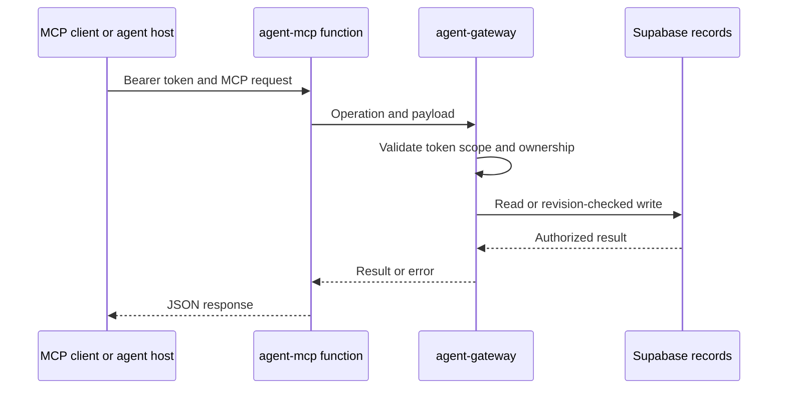

# Current implementation state and operational limits

This page separates **code present in this repository**, **behavior that a local operator can enable**, and **behavior evidenced as deployed**. It is not a promise that an agent host, external service, or employer system has completed an action. In particular, the product persists records and enforces scoped workflows; it does not itself supply a model runtime, recurring scheduler, SMS/notification transport, inbox monitor, remote browser, or general database/shell access.

## Status vocabulary

| Label | Meaning in this page |
| --- | --- |
| **Implemented** | Source and focused tests describe the behavior; it still may need a configured environment or an end-to-end check. |
| **Feature-gated** | The code path exists but is disabled until a named runtime flag, deployment, permission, or human action permits it. |
| **Locally runnable** | A developer can run it with the documented local services and credentials. It is not evidence of hosted availability. |
| **Deployment recorded** | Repository documentation records a particular hosted rollout. It is not a claim that the checked-out code has reached that environment or that every client integration works. |
| **Unverified** | No end-to-end evidence should be inferred. It remains a release blocker for claims that depend on it. |

## What is implemented

Application automation honors the strict account-wide `autoSubmitApproved` guard even for explicit profile modes. Profile controls show the account block and remain disabled while it is off or missing; profile saves cannot grant global consent. Policy reads and runner authorization explain the block and direct the user to exact-draft approval in Applications. This is locally verified behavior; hosted availability requires the frontend and gateway release.

### Product and persistence surfaces

The production UI is a static Next.js export, while Supabase owns identity, private records, storage, and server-side authorization. The public catalog remains static data; signed-in private state—including profile facts, preferences, resumes, batches, applications, approvals, attempts, search records, and operational records—is modeled by migrations and protected by owner-aware services. A detached `?demo=1` workspace uses fictional in-memory fixtures, deliberately avoids the account store, auth client, cloud sync, and production MCP, and resets on refresh.

The schema/reference documents a prepared hosted rollout (54 application tables and 49 recorded migrations as of 2026-10-23), but also calls out a separately developed workspace-reset migration as local-only. Treat migrations as the executable schema source, not the documentation or an older UI proposal.

Discover batch items can be removed through the scoped `remove_discover_job` action. Removal hides the owned item in Discover while retaining its batch history, shared catalog entry and applications. Availability depends on deployment of the migration and gateway; see `changes/discover-remove-7PMSxi.md`.

### Agent data plane, not an agent runtime

Remote MCP is a stateless Streamable HTTP transport: every request forwards an opaque bearer credential to `agent-gateway`, which is the authority for connection scope, ownership, expiry/revocation, validations, and revision checks. MCP discovery is scope-filtered. The transport has no server-initiated SSE, browser tooling, shell, SQL tool, connection management, or submission endpoint of its own. Developer instructions require context-version checking, scoped-tool discovery, read-back after writes, and preservation of human approval/verification boundaries.

The system also has persisted task, change-feed, lease, and delivery concepts. They let a compatible personal-agent host resume authorized work and acknowledge durable outcomes; they do **not** install a host, execute a model, wake an external agent, or create a schedule. The optional `mcp/change-worker.mjs` is an adapter a host must supply with its own authorized call, handling, and verification functions.

This shows the hosted MCP authorization path; it does not depict an autonomous agent execution loop.

### Search and discovery execution

The current direct-search implementation uses pipeline version 2: immutable temporary
snapshots on a named Docker worker volume, metadata gates before official verification,
full configured gates and historical dedup before permanent shortlist saves. SQL stores
leases, fenced snapshot references, aggregate progress and bounded diagnostics while
collection runs. The agent receives a terminal shortlist receipt and pages the run for
all results; its first 100 IDs are a preview. Automatic hosted-board collection and
publication are disabled for this path. Personal eligibility remains agent review.
Applications are untouched. See the current [workflow](../workflows/job-discovery.md)
and `backend/runtime/README.md`; earlier execution descriptions below are historical.

The local Node API and worker are separate Docker services. The worker only claims already-queued jobs; it contains no recurring-search scheduler. When explicitly enabled, one `search_ats` job is bounded to configured sources and observations, uses service-only RPCs with job/version/lease/connection/profile fences, and fetches through a constrained child-process boundary. It collects and verifies supported leads, persists observations and screening inputs, and returns shortlist IDs. It does not generate model reports, messages, or applications. Unsupported extraction remains partial rather than becoming a fabricated parsed record.

The source is deliberately conservative: configured execution is off by default (`LOOKOUT_EXECUTION_ENABLED=false`), the worker is idle otherwise, and retry/lease behavior can finish a run as partial. The repository’s local proof documentation explicitly says it does not establish a hosted deployment, externally reachable MCP endpoint, real Google OAuth, or real employer submission.

### Application execution

A local stdio runner implements deterministic inspection, resume fingerprinting, prefill, and guarded submit tools for listed ATS types. Submission requires current server authorization, exact owned resume bytes and form fingerprint, a single atomic claim, a short-lived one-use click permit, and an observed confirmation. One active/uncertain/confirmed attempt is enforced per application; a started or uncertain attempt never becomes retryable automatically. An uncertain result requires human verification before a new attempt.

This is an **implemented but operationally gated local execution path**, not a blanket employer-submission claim. The runtime API exposes submission behavior only when `LOOKOUT_SUBMISSION_ENABLED=true`; the runner still needs a graphical/local browser host and a compatible MCP client. CAPTCHA, Workday, custom widgets, extra documents, unsupported confirmation pages, embedded recovery, and a real Muse/employer round trip remain unsupported or unverified. The repository states that no real employer application was submitted during development.

### Resume import

The Node API can parse an owned private resume using a server-only APILayer key. Browser and Node MCP inputs accept only `resumeId`, derive ownership from validated credentials, verify current private bytes/hash, and return a proposal rather than writing profile facts. Accepted imports require the normal revision-checked save flow, and imported facts remain unverified. This API integration is locally configurable; mocked/local checks do not establish vendor extraction accuracy or hosted availability, and OCR for scanned resumes is unverified.

## Hosted and local release boundary

The November 7 hosted-readiness reconciliation uses the observed Lookout project
history in `tests/fixtures/hosted-lookout-20261107.json`: 80 applied versions,
including audit migrations, with six older feature migrations still absent at
inspection. The regression replays that precise history and then the pending
migrations, comparing the resulting columns, constraints, indexes, policies,
RLS, grants, triggers, views and functions with a fresh migration replay. It also
checks preservation of fictional owned data and the imported-tracker, Discover
removal, connection, profile and search paths. Historical statement hash differences
in four migrations were statement-separator formatting, not conflicting SQL.

The production migration push explicitly selects the linked project, includes
reviewed older pending migrations, and skips local Vault configuration. A forward
migration revokes direct browser execution of the optional hosted
`public.rls_auto_enable()` event-trigger helper while preserving its DDL behavior.
This release prepares schema/backend compatibility only: local personal accounts,
private files and sessions are not imported. Hosted readiness still requires the
main-branch backend workflow and live source/schema/permission checks; local test
success alone is not a release receipt. Existing detached demo fixtures remain
unchanged and are covered by the ordinary isolation tests.

Live comparison also identified platform default privileges that a bare test
database did not model. Hosted readiness now replays the observed public-schema
defaults for table, function and sequence grants. A forward migration removes
all direct browser grants on `career_toolkit_results` and restores only the
existing owner-scoped SELECT access; fixed backend writers keep service-role
access. In particular, signed-in users must not retain TRUNCATE, which RLS does
not protect. Schema comparison normalizes only pgvector's optional schema prefix,
retaining its dimension/type checks. Service-role defaults are compared in the
same platform context rather than mistaken for browser permissions.

Verified hosted receipt, November 7: main-branch **Deploy Supabase backend** run
`42409833561` succeeded from `34a3c50b59b78503b883340603022459e15c3308`.
All 89 migration versions and 2,960 source-derived schema/permission entries
matched the live project after accounting for observed platform defaults and
pgvector qualification. The optional RLS helper retained its enabled event hook
and passed a rolled-back DDL probe, with direct anon/authenticated execution
revoked. No application table exposed browser TRUNCATE/REFERENCES/TRIGGER grants.
Live MCP reported that exact source commit and developer contract 112. Disposable
checks passed gateway/MCP unauthenticated denial, executable tool discovery,
owned imported-record writes/read-back/retry, foreign-owner/read-only denial,
and authenticated browser RPC/profile isolation. Test accounts, connections and
imported records were removed; hosted ended with zero accounts, profiles, files,
imports or connections. The six shared companies, knowledge configuration and
Storage bucket settings were preserved. Local personal data was not imported.
Security advisors report no anonymous definer-execution warning; authenticated
owner-scoped definer entry points and private-table RLS notices remain expected.
Google OAuth and GCP worker/browser execution were not exercised. The separate
Pages release `42408607455` timed out after its successful backend step; this
receipt establishes database/backend readiness, not successful website publication.

Final reconciliation also includes the subsequently committed worker-conflict
guards `20261107200723` and `20261107201211`. Official backend run `42411416297`
succeeded from protected main `4a1c1f635e7a0e535f0c429b9f4d99a55e8f1fe2`.
All **91** migration versions and **2,960** schema/permission entries match the
source replay. The real hosted worker queue/ownership/cancelled-expired-lease
conflict scenarios passed in one rolled-back transaction using fictional users
and actual Auth claim settings. Final counts are zero accounts, profiles, files,
connections, imported records, backend jobs and backend requests; shared records
and bucket settings are unchanged. All 56 deployed MCP and 87 gateway source
files match that reviewed commit, including the stamped runtime version. Their
executable sources are otherwise byte-identical to the earlier live smoke-tested
contract-112 handlers; the added SQL guards only change stale worker conflicts
to non-retryable `PT409`. No personal data was transferred and no execution was
enabled. The separate website publication limit above still applies.

The Pages workflow runs on `main`, calls the backend deployment workflow first, runs the repository test suite and data validation, builds the static export, then deploys the Pages artifact. Backend deployment runs only from `main`, requires the production environment and `SUPABASE_ACCESS_TOKEN`, and invokes `npm run deploy:backend`. This wiring means a frontend-only build should not be represented as publishing gateway/MCP or migration changes.

Repository documentation records a prior prepared schema rollout and gateway/MCP release, including unauthenticated denial checks. It simultaneously says authenticated MCP discovery/read/write, client support, real Google sign-in, and intended-device round trips need verification. Therefore describe those releases as **recorded deployment evidence with explicit verification gaps**, not as blanket proof that all current functionality is live.

For local development, `make services` starts local Supabase; `make frontend` starts the frontend; `make dev` sequences services, the optional ngrok tunnel, and frontend. The API/worker Compose stack is distinct and needs server-only `SUPABASE_URL` and service-role credentials. The tunnel is opt-in, exposes only `/mcp`, and preserves bearer authentication. Local Supabase uses separate data from the hosted project; do not use `--linked`, hosted URLs, or production credentials for local checks.

## Configuration and security boundaries

- Keep browser settings limited to `NEXT_PUBLIC_*` values. `NEXT_PUBLIC_LOOKOUT_API_URL` and `NEXT_PUBLIC_AGENT_MCP_URL` are origins, not secrets; `SUPABASE_SERVICE_ROLE_KEY`, APILayer credentials, and agent tokens are server/secret-store only.
- Agent connections are hashed, scoped, expiring, and revocable. An agent token is not a human session and does not mint approval, verification, consent, or employer-submission evidence.
- The Edge functions intentionally use platform `verify_jwt=false` because they perform custom session/opaque-token verification. This is safe only with the fixed gateway checks; do not add a general SQL or service-role browser tool.
- Version and expected-revision checks protect writes. Read current owned state before writing; read back saved state before reporting success; treat timeouts as uncertain and reconcile before retrying.
- Private resume links are short-lived and must not appear in logs, committed configuration, or routine agent replies. The Node child worker receives neither agent credentials nor signed URLs.

## Release-readiness checklist

A change author should make a claim no broader than the checks actually completed.

1. **Run baseline checks:** `npm test` (includes database scenarios), `npm run validate:data`, `npm --prefix next-app run typecheck`, and `npm run build`. CI currently runs the tests, catalog validation, and production static export; database checks and local-edge checks should be run when the change affects their boundary.
2. **Run focused checks for the changed path.** Examples include `node --test tests/mcp-protocol.test.mjs` for MCP framing/scope behavior; the documented local runtime checks for discovery; and runner/database tests for claim, permit, uncertainty, and recovery semantics. Passing fixtures or PGlite scenarios proves those contracts, not a hosted external integration.
3. **Validate the correct deployment unit.** Schema and Edge/MCP changes require the backend deployment path and post-deploy authenticated checks. A Pages deployment only establishes the static frontend artifact. Keep migration/function release versions together when the contract changes.
4. **Verify the intended environment with isolated data.** Local verification must reject hosted endpoints and use disposable/fictional accounts where the supplied scripts do so. A local Docker/Compose proof does not validate production Auth, Storage, OAuth, agent connectivity, or notification delivery.
5. **Exercise a real integration before claiming it.** Verify the target Google OAuth device/client, authenticated MCP client with custom bearer headers, external agent host scheduling/wake/delivery, and—if relevant—the exact supported employer flow. Do not call a scheduled search, text, email, external browsing session, or employer application “live” merely because repository tools, records, or prompts exist.
6. **Preserve safety semantics.** Confirm that scope/owner boundaries, current authorization, revision fencing, human review, and uncertain-submission blocking remain intact. Never convert prepared, queued, running, saved, published, user-reported, or runner-observed states into one another.

## Explicit non-claims and current gaps

- A README onboarding prompt mentioning daily scans, Instagram, or text updates does not activate those automations. Scheduler, Instagram access, notification transport, inbox monitoring, and agent wake-up depend on the external personal-agent runtime and are not validated here.
- MCP client compatibility is not established merely by exposing the endpoint. A client must support Streamable HTTP plus a custom `Authorization` header; named personal-agent clients and human confirmation in chat remain end-to-end unverified.
- Remote MCP is not remote browser automation and does not bypass CAPTCHAs. Local runner support is narrower than its ATS inspection list, and no real employer submission has been exercised.
- Google is configured according to backend documentation, but a complete real-user sign-in and iPhone/private-file round trip are still verification work.
- Wider rollout still needs account export/deletion, orphan-file cleanup, operational monitoring/rate limits, and abuse handling.

See [local and release runtime](local-and-release-runtime.md), [verification strategy](../testing/verification-strategy.md), [the system overview](../architecture/system-overview.md), [agent/MCP setup](../../mcp/README.md), and [the schema reference](../../docs/schema.md) for adjacent operational detail.

## Smaller agent tool catalog (local contract 110)

MCP startup now lists common actions, logs and bugs directly. Hosted maximum:
47 exposed / 73 gated; configured Node API: 50 / 73; local runner: 50 / 83.
`discover_tools` returns scope-filtered executable schemas by workflow or exact
name, and `call_discovered_tool` shares the original direct-call validation path.
`discover_toolkit` still discovers guides. Existing names remain callable;
paused operations remain unavailable. See `mcp/README.md` for access and release
limits. Hosted/client behavior is not verified by local catalog tests.

### Local audit runtime verification

The local API was rebuilt from `6c44441`; the mounted Edge runtime now reports
developer contract 110. The two existing audit migrations (`20261107002624` and
`20261107005745`) were applied to the local database without applying other
pending migrations. The existing MCP connection successfully loaded agent-audit
v3, discovered all three audit tools, and started/appended/read a labeled repair
verification audit. Clients with cached tool catalogs need a refresh/reconnect.
No job search was queued and no batch was published during verification. The
worker and separate résumé API were preserved; hosted deployment and full worker
execution remain outside this check. See the feature change note for details.

## Local startup reliability

The local startup helper bounds Docker/CLI checks, can reuse verified running local
APIs with saved public loopback configuration, treats the configured MCP tunnel
as optional, and recognizes an existing Lookout frontend. Main preview locks
track process ownership and recover stopped owners; unknown owners are preserved.
See [local runtime details](local-and-release-runtime.md#focused-startup-reliability-update)
and the startup feature change note for checks and live-verification limits.

The warm local startup path was verified after recovering an unresponsive Docker
Desktop engine: Auth/REST health passed, the port-3000 frontend was gracefully
restarted with a process-owned preview lock, and the page returned HTTP 200.
Repeated startup commands reuse the running setup. No database reset or container
removal was performed; cold startup and remote tunnel connectivity remain unverified.

## Application tracker outcomes (contract 111 source update)

The import writer and website editor support explicit hiring outcomes and the
existing employment types from settings, including Part-time, Contract and
Temporary. `update_imported_job` is a gated applications tool requiring
tracking:write; reads require workspace:read. It shares browser ownership, row
validation, version locks and replay checks. Original source rows and existing
imported records are preserved. No automatic repair of statuses encoded in
notes is performed. See the application-submission workflow for field boundaries.
Local checks and demo coverage establish source behavior only; a running contract
110 endpoint does not expose this update until its migration/functions are released.

The UI-first follow-up routes imported rows through the original application
detail dialog and progress display. The separate metadata row editor has been
removed. Original source notes and subsequent tracker notes remain visible in
history; notes do not become linked emails. Native application actions remain
visible but imported records have no native application ID: timeline writes
show the existing sync error and workflow writes report an unsaved update.
This intentional backend mismatch must remain explicit until a later integration.

Application rows show a separate **Needs action** flag for due, unresolved
handoffs from the existing durable action inbox (review, blocker or submission
check). The recorded reason opens the existing application detail dialog. Flags
clear when the underlying inbox action resolves and appear when a deferred action
becomes due; hiring stages and Active date ordering stay independent. This is the
same read surface as Action Board and MCP `read_action_inbox`; it does not add a
manual task flag or infer recruiter requests from notes or interview stages.
The resettable fictional demo includes a review handoff; demo approval remains
disabled. Source verification does not establish production deployment.
## Weekly Career Toolkit (contract 113 source update)

### Later hosted schema refresh, November 7

Protected PR #80 released the reviewed 104-migration source through official
backend run `42439092216`, commit
`d057a578eebf3549a6ebc0bf41d0905298265c5e` (developer contract 132). All
3,144 live schema/permission entries match source replay, and all 62 MCP/93
gateway files match that release. The four pending migrations added application
action projections, shared calendar reads, inline decisions and material prep
dates. Full local tests passed (1,085 passed, 5 skipped), protected CI/build passed,
and hosted SQL/MCP checks verified ownership, retry, calendar metadata privacy,
material date save/clear and human-only action boundaries. Disposable accounts
and records were removed; accounts, profiles, files, connections, artifacts,
private mock profiles, imported records and backend jobs ended at zero. Six shared
companies remain; knowledge publication is disabled. No personal data was copied.

The running local Docker stack was inspected without modification: two accounts,
eight files and 97 history entries, with older schema gaps. This hosted receipt
uses committed migrations as authority and does not claim local runtime parity.
GCP API/worker and website publication are separate releases. See the reconciliation
change note for the exact upgrade, security advisor and verification scope.

The existing Toolkit cards and reader now support explicit weekly filtering and
an All materials library. Agent preparation follows the pinned Career Ops loop,
curating external resources and reusing stories rather than generating every
possible document. Scheduled mocks save visible logistics separately from
agent-only interviewer preparation, with versioned resume/completion and a linked
debrief. The user calls their agent externally; no scheduler or call transport is
provided. Source tests and detached demo coverage do not establish hosted release
or an external-agent call. See the Career Toolkit concept page and feature note.

The hosted reconciliation subsequently released the contract-113 backend through
official main-branch run `42412623024`, source
`0d3eac234ca4982e37a690d7de6ea78a7c04132e`. All **92** migration versions and
**2,994** schema/permission entries match source replay. All 57 MCP and 88 gateway
files match that release. Fresh hosted MCP and browser checks passed owned writes,
read-back/retry, foreign-owner/read-only denial and private mock-profile separation.
Weekly toolkit scenarios passed in a rolled-back hosted transaction, excluding
the fixture-only role alteration and destructive cascade assertion. Fictional
accounts were removed; accounts, profiles, files, connections, artifacts, private
mock profiles and backend jobs all ended at zero. Shared data and bucket settings
are unchanged. Personal local data was not transferred. This establishes database
and backend readiness for that release; real Google login, personal-data cutover,
GCP worker execution and separate Pages publication remain unverified. Later local
guide contract 114 is not included in this deployed receipt.

## Test harness consolidation (focused source update)

The full Node suite uses a disposable migrated PGlite snapshot for independent
ordinary database fixtures, with four concurrent test files. Migration/upgrade
fixtures retain full replay and custom hooks. The snapshot lives only for one
run and is cleaned up; focused direct Node tests need no snapshot. Demo reset
isolation is checked over whole fixture graphs instead of repeated exact sample
contents. That check found shared nested preparation resource data; the two
workspace fixture factories now clone their returned graphs. See the verification
strategy for scope and the feature change note for actual validation results.

Application rows additionally display optional next-action dates from current
scheduled rounds or confirmed unfinished preparation deadlines, with no guessed
dates or second manual date store. Active offers an explicit Next action date
sort (earliest first; undated last), while progress/date stays the default.
Completed/superseded rounds and terminal records are excluded. Website and MCP
continue using the existing owned timeline/preparation writers and readers; see
the application-submission workflow for mappings and lifecycle details.

## Structured imported action progress (contract 116 source update)

Imported application records now support nextAction/actionDate/needsAction and
explicit completedStages through the existing owner/version/replay-checked update
writer and MCP tool. Overview Tracking details exposes the same fields. Screen
completion is separate from current stage; recorded dates feed optional sorting.
No source notes are parsed or rewritten, and no native records or submission
receipts are synthesized. Source tests establish behavior; runtime and hosted
release verification remain separate and are recorded in the feature note.

Dev verification for the imported-progress update: the connected local MCP reports
contract 116, advertises all four fields on update_imported_job and serves
application-workspace guide 15. Migration 20261107211643 is recorded locally and
the API is healthy. This did not migrate personal records or notes. It does not
establish hosted/production availability; see the feature note for validation.

### Jobright public lists

The Jobright new-grad and internship GitHub lists are enabled default lead sources. A thin collection provider parses every published README row, carries forward continuation-row companies, removes Jobright tracking parameters, and resolves eligible titles with up to six concurrent public detail requests. Only explicit, identity-matched public `applyLink`/`originalUrl` fields can enter the existing employer verification, temporary staging, full filtering and final account-history deduplication pipeline. No Jobright summaries are saved as verified employer postings. Website and MCP source configuration use the existing versioned portals document and search-job tools.

Coverage always remains partial: Jobright documents a subset of jobs from the last seven days, and public detail pages may omit employer application URLs. Live checks on 2026-11-07 found those fields absent on ten sampled listings; these entries are reported unresolved and are not saved. No authenticated Jobright API or paid service is used. Fixture success does not establish live employer-link availability. Default updates do not overwrite customized account portals or modify already-running source snapshots.

## Agent workspace material formats (contract 117, locally verified)

`toolkit-materials` v1 is advertised in the primary index and through
`discover_toolkit.materialGuide`. It exposes optional material recipes, the neutral
static HTML starter and matching career skill IDs through existing authorized
`read_guide`. Company/interview skills route to it; existing scoped artifact/mock
tools retain execution, ownership and versions. No new writer, Calendar or scheduler
integration is added. Full source validation passed (1,030 tests, five skipped),
including detached discovery/guide/save/read-back and read-only denial.

The landed source was built into the local API image and the mounted local Edge
runtime reloaded. Connected MCP checks report contract 117, all 39 career skills,
the six recipes, HTML starter and interview-research v6 routing. The worker and
database stayed running. Live verification read only; no account artifacts or
external events were created. Hosted release is separate and was not performed.

### Simplify feed limit

The direct background worker verifies at most the 100 newest title/seniority-matching leads from each Simplify feed per run (new-grad, summer and off-season independently). It reads active visible feed metadata newest-first, applies the existing metadata prefilter, then selects the first 100 before existing deduplication and 25-link employer verification. Full screening, temporary staging, lease fencing and final shortlist persistence remain unchanged. Older omitted matching leads produce explicit partial coverage and an omitted count; no durable cursor or automatic continuation is retained. Repeated scans select the newest matching leads again, so older jobs may never be verified. This is an intentional Simplify-only limit; Jobright, HiringCafe and employer-source behavior are unchanged. Website/MCP backend searches use the same provider; explicit manual Simplify lead paging remains available separately.

## Mock save readiness correction (contract 118, locally verified)

The contract-117 check established guide discovery, not mock persistence. A real
Node MCP save exposed two missing prerequisites: the local database lacked weekly
Toolkit migration `20261107201448`, and Node's service registry lacked the `mock`
prefix. The source migration alone was applied locally, after checking later
artifact-function overlap, without changing existing user/artifact counts. The
Node route now retains the existing checked Edge/SQL boundary, and safe error
forwarding explains a missing migration instead of a generic content rejection.

After the local API/gateway refresh, connected context reports 118. The local-only
mock check passed save, idempotent retry, private read and ordinary-read profile
separation through the actual running API, then removed its disposable fixtures.
The rolled-back lifecycle/ownership SQL checks passed with real Supabase auth
settings. Full source checks passed (1,036 tests, five skipped), typecheck/build
and data validation passed. No real candidate session, Calendar event, worker or
database restart, push or hosted deployment occurred. Muse must retry its original
session save; source/tool discovery alone must not be called persistence-ready.

## Shared application round counts (contract 121 source update)

Native milestone round metadata and imported record.rounds feed one shared
projector used by Applications Stats and the workspace:read MCP
read_application_round_stats tool. Counts distinguish rounds from applications,
Screen from Interview, and pending/scheduled/completed/cancelled. Existing scoped
writers retain owner, version, evidence and retry/correction checks. No private
application data is automatically backfilled from notes. Runtime activation and
production release are separate; consult the feature note for actual receipts.

### Agent-reviewed private Discover handoff

A completed or partial direct scan supplies the private shortlist; it does not itself populate Discover. The connected personal agent now finishes an authorized search by reading all shortlist pages and current candidate/profile evidence, selecting personally suitable live opportunities, writing the four assessment dimensions and role-specific narrative, then publishing through the existing scoped `publish_batch` service. It reads each returned private batch back before claiming Discover is populated. Stable run/profile/chunk event keys prevent duplicate batches on completion-event replay. No new model runtime, scheduler, worker publication, automatic applications or shared hosted-board collection is added. Raw filter matches remain outside Discover until agent review. Empty Discover keeps the existing search-history/request control visible while waiting.

## Connected Action Board (contract 120 source update)

The source preserves desktop Action Board framing and existing review dialogs,
adding deterministic human questions and Accept/Reject controls with mobile swipe
parity. Exact application/message review is versioned; application rejection
keeps the job saved and fences agent work until a version-checked human Resume.
Outreach acceptance only marks the message ready for the user to send.
Canonical round IDs, typed practice categories, confirmation and cancellation now
drive the existing Weekly Prep/session ledger without duplicate deadline labels.

The website and read-only `read_action_board` MCP operation share owned SQL
projection and validation; human decisions remain authenticated website actions.
Disposable database, upgrade, domain and detached browser checks establish local
source behavior. The integrated production export and desktop/mobile connected
flow were verified. Migration plus gateway/MCP release and an authenticated
hosted check are still required; no hosted parity or real submission/message
execution is claimed. See the connected-action-board feature note and the
application-submission and Career Toolkit concept pages for the contract.

### Broad review with fit-based effort

Search guide16 surfaces relevant plausible jobs after personal analysis instead of selecting only exceptional fits. Fit strength guides priority and tailoring depth; weaker fit, unknown pay, unclear team scope and unconfirmed clearance/citizenship are not automatic rejections. User-requested clearance roles stay visible with active-at-application/start versus obtainable-after-hire requirements called out explicitly. Confirmed non-exempt mandatory conflicts and clearly unrelated work can still be excluded. Conditional graduation scenarios remain targeting, never changes to actual education facts or employer-form answers.

Application guide17 supports routine accurate preparation volume during already authorized application work, with deeper effort for the best matches. Notifications guide2 distinguishes actual prepared, tailored, blocked, ready-for-review and submitted counts. Instructions do not execute work, activate schedules, send messages or grant submission consent. Match strength reuses the existing recommendation priority (Apply Now, Strong Consider, Skip Unless Team Fit) and four fit scores, with no separate tag, column or UI. Lower priority does not stop otherwise authorized preparation. Current Discover batches and applications are not reassessed or republished by this pass.

## Mock schema diagnostics (contract 123, locally verified)

The mock tool schema now excludes document-only preparedFor/materials/resourceUrl,
requires its scheduling fields and advertises an explicit-offset RFC 3339
scheduledAt pattern. Material-format guide v2 explains these requirements. The
local API/gateway refresh was verified through connected discovery and disposable
Node MCP -> Edge -> SQL tests: each invalid field gets a specific rejection, while
the corrected mock saves, replays and reads with its profile kept private. Server
mock-rejection logs retain generated diagnostic IDs, stages, allowlisted reasons
and field types only. Historical failures without this logging cannot be recovered.
No real user session or external event was created. Forty-nine relevant integrated
checks passed; a full-suite search-pipeline failure passed on isolated rerun.
Hosted publication was not performed.

### Connected Action Board application coverage follow-up

The shared board projection includes filled native drafts, approved applications
awaiting submission, and explicitly flagged imported application next actions.
These open exact existing records without inventing binary approval. The source
update preserves inbox precedence, owner isolation, hold enforcement and
cross-page resolution. Migration
`20261108004208_action_board_application_actions.sql` was applied to the existing
local database without changing application, import or decision records. Both
owned reads succeeded and all eight flagged imported actions were included.
Detached desktop/mobile flows, full tests, data checks, typecheck and production
build passed; real-account browser and hosted verification remain separate. See the connected-action-board change note for verification receipts.

### Shared Action Board calendar (contract 125 source update)

The existing seven-day Weekly prep calendar also projects current application
rounds without requiring a preparation plan, explicit dated imported next actions,
and scheduled/in-progress Toolkit mock sessions. The shared owned planner snapshot
includes imported records without source notes and only visible mock logistics;
private interviewer preparation stays excluded. Website and MCP
`read_preparation_planner` use the same projector. Existing round corrections,
import updates, mock lifecycle and practice writers remain authoritative.
Cancelled/completed rounds and mocks, archived mocks and terminal applications
leave the upcoming calendar; source links open their existing editors. Dates use
the saved preparation timezone, and native/import duplicate preference matches
round stats. Existing interview/learning practice still shares one daily budget.
The visible calendar refreshes every minute, on focus/reconnect and account sync;
returning to the board reloads the owned snapshot. Demo reads the same fictional
mock sources. No external Calendar events, calls or scheduler are created.
Source validation and local runtime activation are reported in the feature note;
hosted deployment is separate.

### Employer compensation on private Discover cards

`publish_batch` accepts optional `recommendation.jobFacts.compensation` for an existing catalog job, using the same source URL/check timestamp as its other observed facts. It is bounded employer pay text preserving currency, range, original pay period (hour/week/month/year) and base/bonus/equity distinctions. No automatic annualization or benchmark substitution occurs. The browser and card-pack projection prefer this private observed value over older catalog compensation; explicit Not disclosed can override an outdated value. Omission retains the catalog fallback. Cards no longer extract a salary from personal fit prose, which can contain comparison benchmarks. This extends the existing private JSON observation; it does not rewrite catalog facts, assessments, applications or historical batches and introduces no database column/migration.

Search guide17, application guide19 and developer contract124 advertise the scoped publication path. Fictional Discover previews cover hourly/monthly and undisclosed pay; validation covers annual pay too. Local code/database tests and a frontend export establish source behavior only; hosted release remains separate.

### Inline action card design

The Action Board source now uses distinct inline content for application drafts,
questions, outreach, interviews, next actions and submission verification. It
uses Circles-style owned object mentions and check/red-X decisions, with required
input and exact saved-review gates. Saving answers is distinct from approval;
reported submission is distinct from execution. Website and read-only MCP share
the enriched projection and source identities. Migration `20261108005642` extends
the existing human-only response operation and was applied locally without
changing application, import or decision records. Both owned reads succeeded;
integrated tests (1,074 passed, five skipped), build, typecheck, data checks and
detached desktop/mobile flows passed. Combined developer contract 129 and
application-workspace guide 21 include current calendar/Network work. Hosted
release and real-account browser verification remain separate. Consult the
connected-action-board feature note for receipts.

#### Full-week calendar and missing-task correction (contract 126)

The Action Board now displays every Monday–Sunday date with previous/next/current
week controls. `read_preparation_planner` accepts optional Monday `weekOf`; website
and MCP use `buildWeeklyPreparationAgenda` over the existing owned snapshot.
The lower-level rolling allocator remains available for bounded planning checks.
Past days never acquire newly allocated practice. The saved timezone is shown.

Other pending tasks retains unfinished assessment rounds with unknown dates,
imported next actions without dates, overdue/out-of-week events and preparation
or learning tasks excluded by budget/date rules. Links open their owning source;
unknown dates remain null. Week browsing does not change dates, task completion,
budget or personal preferences. Dated interviews/mocks outside the selected week
remain accessible through navigation and pending items. Completed/cancelled rounds
and inactive/terminal/archived sources retain their existing exclusion rules.

A scoped diagnosis found zero saved learning goals/preparation plans, one mock,
and undated pending assessment rounds; it did not infer tasks from material text
or assign guessed dates. The detached demo covers an unfinished undated OA.
Validation and local activation receipts are in the shared calendar feature note;
hosted deployment remains separate.

### Compact team-focused fit analysis

Search guide18 makes the default analysis a 130–180-word decision brief: existing priority with a short verdict; up to five chat bullets covering team, candidate contribution, growth, support and practical fit; and one sentence on what changes priority. Research exact-team evidence first and clearly distinguish adjacent-team context, inference and unknowns. Save the same substance in existing whyItFits/materialGap text and four assessments; no new tags, fields or Markdown-rendering requirement. Application guide20 follows this format during authorized work. This changes future instructions, not historical assessments or publication.

#### Application date precedence and duplicate removal (contract 128)

Imported next actions use saved actionDate even without needsAction. A lone
unfinished undated round is represented by its existing next action; the date
is not copied into the round. Current round dates suppress duplicate same-day
application actions; different-day actions and multiple open rounds remain
separate. This applies both in calendar days and Other pending tasks. Action
cards show company and description. The detached demo covers an assessment
whose deadline is saved on next action with its attention flag false. Source
validation and local read-back receipts are recorded in the shared calendar note.

Action card material follow-up: each type now has a full border and colored
background, borrowing the Career Toolkit's theme-aware material palette. Matching
ink/divider colors preserve contrast in light and dark modes. This is a visual
change; the existing inline decision and ownership rules are unchanged.

### Assigned material preparation dates

Toolkit documents and online resources support optional `prepOn` (YYYY-MM-DD),
separate from a brief's target/need `preparedFor` date. The reader's Prep on
control saves or clears it through the existing owner/version-checked
`artifact_action` writer; agents use `save_artifact` with the same validation.
Omit `prepOn` in a revision to clear it. Its Monday week takes precedence over
legacy `weekOf` in weekly lists; clearing restores the stored weekly assignment.
The calendar reads the current saved artifact directly, links to its reader and
never creates a second task, time credit or completion record. Archived material
is excluded. Undated materials remain reusable; no dates are inferred. Mock
interviews retain `scheduledAt`, and application documents cannot use `prepOn`.
Planner snapshots expose only calendar metadata, never document bodies or private
interviewer profiles. Demo includes dated company context and a round brief plus
undated resources. Runtime/hosted availability requires its own verification.
#### Upcoming relevant-date presentation

The website calendar now skips empty/past days and groups upcoming dated work
chronologically, including dates beyond the current week from the owned pending
projection. Each group shows Today/In X days. Week navigation is removed from
this compact widget; the scoped planner's weekOf read remains available. Undated
and overdue tasks stay in Other pending tasks. Source dates, duplicate rules,
budgets and completion writers are unchanged; this is a presentation correction.

Material prep dates are locally activated at contract 130 (toolkit-materials v3).
Connected schema discovery and disposable live save/list/calendar/clear checks
passed, with private mock separation retained and all fixtures removed. Existing
real dates were not backfilled. This is a local receipt, not a hosted release.

### Broader collection with recoverable Jobright leads

Both Jobright providers snapshot every published row into immutable, lease-fenced temporary storage before title triage or detail resolution. Source dates/work settings remain source-list metadata. Each raw row retains resolution and triage status, while only live parsed, filtered and history-deduplicated jobs enter database discoveries. Completion keeps Jobright pools for seven days; read expiry is enforced even before filesystem pruning. A missing pool is explicit, never silently replaced by a fresh feed.

The existing `read_search_source_leads` tool pages all retained rows (100 maximum per response) after both run/source and backend-job ownership checks. It never drops title-excluded or unresolved rows. The API requires the existing staging volume mounted read-only at the same configured path as the worker. This works on the existing single-host Docker/Compute Engine deployment; separately hosted API/worker instances need a genuinely shared staging volume. No new database table or generic file reader is introduced.

Explicit engineering families expand to common title variants while preserving negative and seniority rules. US-wide profile targeting recognizes country/state forms and treats incomplete locations as unknown; explicit foreign countries and explicit scanner/narrow city restrictions retain their exclusions. The saved freshness limit controls provider collection as well as later filtering. General was updated through the owned writer to seven days with engineering aliases; candidate facts and applications were preserved.

Search guide19/developer131 directs the connected agent to inspect retained/pending counts, page source pools, research exact employer links for plausible unresolved leads and use the existing verification/screening/deduplication path before private publication. Worker completion does not imply those research tasks finished. Source accounting distinguishes raw, title-excluded, unresolved, verified, filtered and screened-candidate counts from the final shortlist. No automatic worker search engine or LLM is added.

Action Board application references now reuse the Circles JobAttachment component
instead of a text-only @ mention. Scheduled interviews remain calendar context;
only explicitly flagged human tasks enter the decision list. Three event-only
flags were corrected via the scoped tracker writer with round/date/status
preservation verified; genuine assessment and confirmation tasks remain pending.

### Agent-managed application sets (contract 133 source update)

Application-workspace guide23 describes host-managed job assignments for any
connected Agent: delegate analysis/preparation, save drafts, wait for authenticated
Lookout review, then resume the assigned subagent on the user's explicit continue
request. Each item rechecks its exact approval and server authorization. Assignment
routing stays in Agent context; existing domain records retain all application
state. No new tools, schema, UI, automatic watcher or wake runtime are introduced.
Host delegation/resume and real employer execution remain unverified; gateway
release and client context refresh are separate from local source validation.

### Engineering-family recall and focused link recovery

Jobright Markdown parsing now preserves nested/escaped brackets in posting titles and inherits the source company website as an unverified research hint. Software-engineering family aliases include MTS/Member of Technical Staff, junior/associate/application developers and platform/GPU/graphics engineering. Both prefilter and full screening use the same title-context adapter: Staff inside the MTS family and bracketed multi-level ranges offering a junior path do not become senior-only exclusions. Explicit senior rank outside those contexts and explicit role-specific negative rules still apply. Original titles and identities are preserved; unknown actual experience requirements remain for review. The copied Career Ops matcher/classifier implementations remain unchanged.

The existing owned `read_search_source_leads` tool accepts optional `resolution=unresolved`; it pages only pending/unresolved/reverification rows while sourceTotal preserves the full pool count. Returned companyWebsite/researchQuery fields guide the connected agent's exact employer lookup; they are not canonical application URLs or live-job evidence. No search engine, LLM or automatic publication is added to the worker. Search guide20 and notifications guide4 distinguish broadly verified Worth a look recommendations from deeply researched Top picks using existing priorities/scores, and require honest recovery counts. Closed employer postings stay out of live recommendations. Saved profile constraints, candidate facts, current batches and application permissions are unchanged.

## Single-portal search (local feature)

The focused tool `submit_portal_search` uses `backend.jobs.portal.submit` and
delegates to `backend.jobs.submit`, with a required `input.portalId` on the tool and an optional selector on the original
browser/MCP operation. SQL validates owned enabled sources, creates exactly one
source attempt, excludes configured queries and fences queued selection at run
creation. The existing full pipeline produces the shortlist; Muse still chooses
and analyzes top roles. Fixture coverage includes selected-source isolation,
retry, owner/disabled validation, browser/MCP parity and detached demo reset.
No TikTok adapter or ByteDance verifier was added. Local activation and live
portal verification are reported separately in the feature change note.

## Cumulative Discover loading

Discover's default browser projection reads all owned batches instead of just
the latest one, deduplicates repeated jobs using the newest saved assessment,
and defaults to unapplied jobs across all discovery dates. Applied records and
individual batch snapshots are retained. The existing batch readers, RLS and
MCP `read_batch` own access; no new service or database migration is introduced.
A fictional 32+14 overlap fixture proves 42 unique roles, not a 14-role cap;
fictional UI fixtures cover an older unapplied role and the applied-history toggle.
Local build/test evidence and hosted release remain separate.

### Orchestrator audit rule (contract 136 source update)

Application guide24 requires the coordinating Agent to reconcile every assigned
job, inspect saved analysis/drafts for omissions and mistakes, repair supported
gaps and read back corrections before calling work ready. Unresolved information
stays explicit; submission summaries are audited against saved outcomes. No new
tools, UI, schema or runtime are added. Gateway release/client refresh and real
host compliance remain separate from source validation.

### Rejection-only Discover protection

Discover explicitly excludes rejected outcomes even when there is no recorded
submission. All matching owned job/URL records and tracker outcomes participate;
a queued duplicate cannot mask an older submission or rejection. The existing
applied-history toggle does not reveal rejected roles. A fictional rejection-only
fixture covers the detached demo. The direct worker's existing tracked-job
exclusion is tested with Submitted and Rejected records, preserving each full
application row. No new writer, migration, tool or permission is added.

### Embedded communication reference

Action Board message reviews now embed a compact communication summary alongside
the existing application attachment pattern. It shows the saved recipient, company,
destination and subject when available; its link opens the owned Network message
and retains the board return path. Application summaries are also clickable across
the widget, with a separate accessible external-posting target and no extra
details text link. The complete draft and exact-message review
remain inline. Acceptance still only marks the draft ready for the human to send.
This is presentation over the existing board read/response boundary (including
read_action_board MCP); it introduces no writer, sending capability or schema.
Detached fixtures cover a subject/email and missing optional metadata. Hosted
release and real-account browser verification remain separate.

The board's Edit message control saves subject/body through the existing
owner/revision-checked save_outreach_contact writer, preserving all other contact
fields and status. Cancel keeps the saved draft. Unsaved editing disables
decisions; changed drafts receive a new exact-review identity. Agents use the
existing save_contact/contacts.save boundary. No message is sent. Detached
interaction and adapter checks cover save/cancel, fresh review and stale writes.

Action Board input indicators derive from the existing owned pending decisions:
blockers, missing answers, uncertain submissions and drafts with unanswered
required fields. A reusable passive dot appears on affected cards and navigation,
with an accessible input count; successful owning-record resolution removes it.
Filled application drafts lead the list using a stable partition; chronology
within each group, review gates and backend priority/supersession remain intact.
This adds no notification delivery service or new MCP mutation. Existing
`read_action_board` and owning writers supply the same pending items to agents.

### Single-portal persistence repair

The existing `submit_portal_search` tool and leased worker remain the execution
path. Shared observation validation and SQL now accept location text up to 2000
characters: one valid 572-character Cisco location previously rejected an entire
final save batch. This preserves the complete location rather than truncating it.

The owned, paged worker history now includes applied/rejected imported tracker
records as well as native applications, and is refreshed after collection before
final deduplication. Imports are identity hints only; search never rewrites their
records or excludes every role at a company. Lease, owner, settings and bounded
transaction checks remain in place. Fictional SQL-leased tests cover multi-location
saves, imported applied/rejected exclusions and an import arriving mid-collection.

A live local Jobright-only run retained 845 source rows, but its 581 selected
public detail pages exposed no employer application link; it saved zero listings.
That is unresolved coverage, not evidence of an empty job market. Exact employer
link research remains the existing agent handoff; no login bypass, guessed links,
LLM worker or alternate write path was introduced. Local Docker persistence proof
is recorded separately from hosted deployment in the feature change note.

The ordinary detached demo now includes the connected Action Board examples
without a hidden scenario parameter: filled drafts first, a missing answer,
CAPTCHA verification, and an uncertain submission. All resolve in memory through
fictional services and return on Reset demo data. Explicit named test scenarios
keep their existing fixtures. No account writes or external employer forms open.

The repeat test also exposed a SmartRecruiters URL-alias gap: its native identity
was not reconstructed from storage, which retained only Greenhouse/Lever triples.
The existing adapter now restores all five verified provider triples (including
Ashby, Workday and SmartRecruiters) before delegating to copied Career Ops dedup.
An unchanged short/slugged URL pair is covered by both child-process and SQL-leased
regressions; distinct native posting IDs remain separate.

Discover now uses a dedicated compact DiscoveredRoleWidget with company identity,
role title, facts, fit summary, expandable match details and existing queue/preview
actions. The decorative rarity banner is removed. Application references retain
the shared Circles progress preview; discovery never implies an application
stage. This is presentation only; existing service and MCP writers are unchanged.

Action review now groups application preparation/submission under Submission,
and questions, CAPTCHA/login blockers and uncertainty under Need your input.
Both use the compact role widget and display the selected draft résumé/version,
employer-question sources, AI/inference labels and explicit unknown sources.
Draft inferences are part of the same owned draft/projection, not a parallel
post. Read parity and receipt authority remain unchanged; hosted projection
and guide25/contract137 availability requires the normal backend release.

The shared miniwidget's compact board variant now matches the application
attachment's icon, role/company hierarchy, spacing, contrasting neutral surface
and border. It renders a saved fitLabel when present, otherwise an existing
saved priority. Scores never synthesize a label. Exact owned role identity links
a board application to its saved discovery label; missing labels are omitted.

### Bounded Discover analysis

The five-point fit analysis keeps Team, Your contribution and Your growth in a
rounded fit surface, with Support and Practical fit in a separate rounded
“What to watch out for” surface. Saved caveats and trailing priority text remain
intact, including the legacy prose fallback. This is presentation over existing
owned records, not a new assessment or writer. Hosted release is verified
separately from source and component tests.
The disclosure heading is Job Description. Explicitly marked Structured paraphrase
content is presented as a saved summary rather than an employer quotation; saved
content and the existing source URL are preserved.

### Unified Action Board and AI Apply change feed

Production paths now emit action_decision (human decisions/native approvals)
and application_requested (AI Apply job insertion) into the existing pointer-only
change feed and count-only watcher. Per-connection acknowledgement is delivery
consumption, never completion. Tracker approvals stay pending until the claimed
agent reports an outcome through record_tracker_action_progress. Owner/version/
connection fences, durable rejection, explicit human reopening and late-outcome
preservation use the existing decision ledger and owning tracker records. The
normal Action Board displays this pipeline inline. Demo fixtures exercise the
same requests and lifecycle in detached memory. Historical Done/Dismissed receipts
are not retroactive permissions. Contract138/guide26 and the migration require
normal backend release; a real Muse wake remains host/environment verification.

Local activation of revision 35310de9 on 2026-11-08 applied the missing watcher, schedule refresh,
disclosure and pipeline migrations and refreshed the API/Edge runtime. Existing
account records were preserved; the worker was retained. A disposable local
account verified authenticated human approval, MCP pickup/completion and feed
acknowledgement with count 0 → 1 → 0. AI Apply event insertion was verified in a
rolled-back transaction before worker visibility. This establishes local runtime
behavior only; hosted deployment and the actual Muse host wake remain unverified.

### Muse-owned AI Apply routing (source update)

AI Apply now emits the existing application_requested feed pointer and waits for
its bound agent. The agent-only claim_application_request / report_application_request
tools use the existing job journal, current job/application versions, active
connection scopes and human stop checks. Single pickup has no timed takeover.
Muse reuses the saved draft with its host browser and optional host subagents;
no backend browser session transfers. Outcome reports distinguish prepared,
completed, blocked and uncertain, never create approval/submission evidence,
and retain the existing application projection and finished-job feed.

Deterministic worker pickup is disabled in SQL and its runtime hookup plus
Node/local deterministic browser-tool registrations are commented out. Source
implementations remain. Search workers and separate approval/receipt authorities
are preserved. Existing started deterministic attempts can still persist a true
finish. Host computer use cannot bypass required approval, authorization, stops
or uncertainty checks; unavailable capability must become a saved blocker.

See [the current routing contract](../../docs/discover-application-jobs.md).
This is source-level behavior: migration, gateway/MCP and Node activation plus
real watcher/browser-host verification are separate. The detached demo traces
fictional pickup/outcome in memory and never opens or submits an employer form.

Local Muse request activation (2026-11-08): migration 20261108050816 and
API image lookout-node:muse-requests-c7d8534a are active in the local stack.
Connected MCP discovery exposes both claim_application_request and
report_application_request. A disposable account verified authenticated queueing,
MCP pickup and a saved blocked outcome; no employer action or real account
decision occurred. Actual Muse wake/browser work and hosted release remain
unverified.

### One-minute Muse event watcher (local activation)

Agent package 0.2.0 uses 60-second default polling/wake cooldown and bounded error backoff against the existing event count. Context versions remain freshness checks. The optional receiver adapter now accepts Action Board refresh arguments; authenticated handling still requires verified durable outcomes before acknowledgement. Local Node MCP read-back confirmed developer140 and agent-package/change-resumption v2, and localhost serves the checksummed 0.2.0 package. This does not activate a host watcher: Dots Local watch was disabled and WGU remained queued v1 at verification. Edge/hosted release, actual host wake and employer work remain separate.

Local dev transport verification (2026-11-08): Node image lookout-node:muse-public-transport-140 serves shared `/agent-gateway/pending-count` and checksummed `/agent-package/manifest.json` plus archive 0.2.0 through the MCP tunnel origin. Live public checks confirmed archive internal version/hash, active-watch count 1, missing-ID 400, unknown-ID zero and denial of unrelated paths. Hosted site publication remains separate. The enabled watch belongs to Muse Local, while WGU is queued for Dots Local (watch disabled); no request was rebound, claimed or acknowledged to hide that mismatch.

Quiet application guidance locally activated (2026-11-08): connected MCP read-back confirmed developer141/application-workspace28/notifications5 after Node image activation and local Edge refresh. The guides require quiet browser work, Lookout-first recovery and a verified owning Need your input card for real blockers. Host secure-store/mailbox use is conditional on actual authorized capability; secrets never belong in Lookout or ordinary messages. Existing human approval and secure-entry boundaries remain. Fictional MCP-to-board integration covers the agent secure-entry handoff; real host compliance/credential capability and hosted release remain unverified.

General batch/resume guidance locally activated (2026-11-08): MCP read-back confirmed developer142/application-workspace29/change-resumption3. The rules are Lookout-first facts, parallel independent work, serialized shared accounts/records, and retaining/resuming the same browser application where supported. Employer draft persistence and host session retention require evidence; no host isolation, real account state or actual browser compliance is established by guide activation.

Grouped-input clarification locally activated (2026-11-08): connected MCP read-back confirmed developer143/application-workspace30, explicitly requiring all unanswered employer fields in one existing application/Need your input card, verified before notification, then the same application’s Submission review after resolution. This is a guide clarification over existing scoped writers/projections, not a new card implementation or evidence of host compliance. No real answers/cards/approvals were changed by this pass.

### Discover question inspection disclosure

Source now keeps Application answers visible for unchecked Discover jobs and distinguishes missing/partial form inspection from an explicitly completed inspection. An empty draft cannot produce the no-input reassurance. Fictional demo roles cover unchecked and partial questions. Developer146/application-workspace33 requires incrementally saved employer questions and a read-back-verified grouped Need your input handoff before notification. This uses existing draft/board boundaries; guide deployment, external host compliance and real WGU record repair are not established by this source change.
Focused card and submission-label repair locally activated (2026-11-08): card UI keeps résumé and unresolved/proposed/unsourced questions while full saved answers remain in the application widget and versioned payloads. Applications suppresses superseded preparation warnings after applied/later progress while retaining genuine uncertainty. Existing Discover default filtering already excludes recorded applied roles, with explicit history browsing preserved. Desktop/mobile detached checks and full suite passed; Node/Edge MCP read-back confirmed developer145/application-workspace32. WGU was read back as Submitted with its historical partial/blocked job unchanged; this pass did not modify real application data or establish real-account browser refresh.

### Explicit AI Apply routing (2026-11-08)

Future requests use an owned, versioned application-agent preference, separate from the display agent name. My Agent → Use for AI Apply and scoped MCP read_application_agent/select_application_agent use the same validators and database ownership/version checks. New connections do not replace the saved choice; unavailable selections fail without fallback. Existing queued/running jobs keep their connection and claim authority. Without a saved choice, browser queueing requires exactly one eligible connection; MCP retains the authenticated caller as its explicit destination. Changing the preference grants no scopes, approval or submission receipt. Migration 20261108081625; local activation and hosted release must be verified separately.

Local routing activation: the migration and Node image lookout-node:application-agent-147 are active. Scoped MCP write/read-back saved Muse Local as the default, and the live queue resolver confirmed Dots callers target it without queueing a test application. Full suite (1145 passed/five skipped), focused final reset/demo checks, production build and detached desktop/mobile selector checks passed. Existing WGU state, Dots permissions and watch configuration were not changed. Hosted release and real-account browser interaction remain unverified.

## Ten-second watcher follow-up

Package 0.2.1 defaults and minimums are 10 seconds for count polling and wake cooldown (up to 10% polling jitter). Explicit existing configs retain their values and must set both fields to 10. Error backoff stays exponential, capped at five minutes plus jitter; serialized worker/durable acknowledgement rules are unchanged. Guides agent-package 3/change-resumption 4 and developer 148 describe the new contract. Runtime installation/activation must be verified separately from package publication.
Discover cards use the original tier-colored company header and glass body,
compact compensation/location facts and four match scores. Fit/recommendation
summaries stay out of the cards; full analysis remains in the job drawer. The
separate embedded role widget is unchanged. Demo cards share this presentation.

Local publication verified: the Muse dev tunnel serves manifest/archive 0.2.1 with matching SHA-256 and 10/10 defaults. Refreshed MCP reads developer148 and agent-package guide3/package0.2.1. The existing watch handle/config was not changed; Muse must upgrade its installed package, set both explicit intervals to10 and restart its existing host service. Remote running cadence remains unverified.

## Saved human response in decision notifications

Action-decision events now include savedResponse, the exact validated durable card request (including input.note and input.answers). An after-ledger trigger enriches the existing event atomically, including the inline writer's final request update. Existing events are enriched without clearing acknowledgements or replaying historical consent. The authenticated scoped feed exposes the body only for action_decision; count-only polling remains body-free. No new writer or approval authority. Guides require reconciling current source versions and persisting/read-verifying answers before acknowledgement. Fictional demo matches the feed contract.

Local recovery verified: developer149 is live. A single idempotent Whatnot recovery event carries the original saved ranking (NYC, SF, Seattle, LA, Phoenix) in savedResponse.input.note; the Muse connection’s authenticated changes.read returned that complete body. The original acknowledgement was retained. No application revision, answer, approval or submission was changed by this notification repair; actual Muse handling is not yet verified.

## Blocker answers resume preparation

Human resolve_blocker acceptance now saves answers/notes and clears the blocker with questionsReviewed=false, returning the application to Draft instead of automatically producing Awaiting approval. Muse owns the subsequent preparation/readiness declaration; final human submission approval remains separate. The saved response event and historical decision are preserved. Existing exact-review approvals and other card actions retain their validators. Fictional demo and database regression cover the no-question note case and structured-answer blocker case.

Verified locally:1153 full-suite tests passed/five skipped; focused blocker/response/guide tests, production frontend build, Docker build and data validation passed. Migration20261108233438 applied alone. Whatnot was version-fenced from revision3/Awaiting approval to revision4/Draft by changing only its readiness flag; no résumé, questions, saved ranking, decision history, approval or submission was fabricated. Scoped read_action_board confirms no Whatnot card remains. Hosted release and external Muse preparation remain unverified.

### Superseded preparation blocker cleanup

Migration 20261108235459 makes recorded tracking stages retire stale preparation
blockers in the shared application transition and reconciles existing tracked rows.
Website set_application_stage and MCP record_application_progress keep their
existing ownership/version checks and reported-progress provenance. No active or
uncertain submission attempt is cleared, and no draft, approval, submission receipt
or historical job outcome is manufactured or rewritten. The detached demo covers
reported submission after a fictional blocked preparation. Source verification and
local database activation are recorded separately in the feature change note;
hosted release is not implied.

AI Apply pickup guidance (developer152/application-workspace38/notifications6)
requires a brief host-conversation receipt only after verified claim, grouped for
requests claimed together, followed by quiet preparation. It never reports queued
roles as running, grants submission approval or acknowledges unhandled work.
Existing host messaging permission, quiet-time restrictions and real delivery
receipts remain required. Guide availability and actual Muse notification delivery
are separate verification boundaries.

## Compact draft handoff and reread recovery (source update)

`prepare_draft` defaults to its compact response and accepts
`responseMode: "full"` for the persisted application. Muse may use that returned
saved revision and answer set instead of immediately rereading the draft.
The owning Action Board card still requires `read_action_board` verification
before a grouped-input notification. Claim/report, progress/evidence writes and
event acknowledgement remain separate scoped operations with their existing
validation and readback requirements.

Recovery guidance starts from current owned application and request records,
including terminal request history, rather than repeating the previous chat's
steps. Missing/stale guides reload; stale writes reconcile against current
revisions. Saved outcomes can recover lost acknowledgements without repeating
employer work. Uncertain submission remains a stop, and final human approval is
not implied by answered questions or refreshed context.

This is source-level behavior. The detached demo exercises rereading a saved
uncertain request after service recreation and rejecting a second pickup;
reset remains isolated. Gateway activation, actual Muse guide refresh, host
session retention and real employer behavior require separate verification.

Local activation verified after landing a911b9e4: migration20261108235459 applied
alone (no remaining legacy rows needed cleanup). Rollback-only fictional human
and agent progress reports cleared stale blockers without changing drafts/revisions
or creating submission evidence. API image lookout-node:application-pickup-152 is
healthy and local Edge was refreshed; the worker was preserved. Connected MCP reads
developer152/application-workspace38/notifications6 and the task-list pickup rule.
Whatnot remains Submitted with blocker null and its existing history unchanged.
Final integrated suite:1,162 passed/five skipped; final guide checks44/44, production
build, typecheck, Docker build and data validation passed. Actual Muse message
sending, host refresh/compliance and hosted release remain unverified.

### Access-task cards and routine-consent guidance (follow-up source)

Fieldless sign-in, secure-entry, host-permission and employer-verification cards
show the selected resume and a specific human completion action through the
existing versioned human response boundary. They do not ask users to review unseen
answers, edit unrelated resume selections or review draft inferences. Real answer
fields and submission-uncertainty controls remain separate. User completion is a
reported update, not proof that host access changed or an application submitted.
Developer154/application-workspace40 keeps supported Workday sign-in/preparation
with Muse and narrows any necessary password handoff to secure entry. Required
privacy/application-processing consent needs explicit user/saved-profile authority;
optional marketing is declined unless authorized. Source, detached visual checks,
local activation and real host execution are separate verification boundaries.

### AI Apply activity and local access-guidance activation

Discover shows Queued until the owned job is claimed, then Working with a spinner.
Applications and the Action Board show the same active states, separate from human
action counts. No Needs input activity flag is added. Terminal jobs, later recorded
application progress and unrecorded browser activity cannot produce Working.
Desktop/mobile detached transitions and reduced motion are verified. Local API/MCP
read-back returns developer154/application-workspace40; the explicit required-consent
accept/optional-marketing decline preference is saved and read back in General
profile46. Real employer sign-in, password-host support and external Muse messages
remain unverified; no hosted release is implied.

Fieldless employer sign-in blockers now show only a brief access explanation, the
saved employer application link and the existing explicit sign-in completion
action. Resume details and diagnostic prose are omitted from this card. Other
access tasks and actual unanswered questions retain their separate controls.
Missing/unsafe links fall back to saved application details. The owned human
response writer and agent read boundary are unchanged.

### Temporary Workday and company-site manual handoff

Developer155/application-workspace41 supersedes the earlier Workday sign-in/resume
procedure: return these applications to the user with the saved employer job link.
Muse stops before account setup, credentials, previewing remaining questions,
filling or submission. Native Greenhouse, Ashby and Lever flows retain existing
preparation; redirects into Workday/company forms hand back. Save and verify a
manual blocker on the existing unfinished application, preserve all prior work and
uncertain/submitted outcomes, report a currently claimed request blocked and never
reopen terminal history. Human responses do not authorize automatic retries.
Fieldless company/Workday blocker cards show Open application without a resume-Muse
button; the user can record the actual outcome in Applications. Existing versioned
prepare_draft/report and human progress writers provide MCP parity. No new store,
approval or employer receipt is created. Local runtime activation is verified
separately from source/tests and actual Muse host adoption.

Local API/MCP activation read-back confirms developer155/application-workspace41
and its Workday/company-site manual-handoff rule. General profile47 stores the
explicit user preference. Actual external Muse host refresh remains unverified.

### Optional Langfuse tracing (source integration)

The Node API tool dispatcher, human resume parser and worker execution have optional server-only tracing. A separate versioned importer reads terminal runtime-v4 Codex logs without changing frozen benchmarks. Structural capture is the default; exact model-call boundaries and hidden reasoning are unavailable. See [setup and verification limits](../../docs/langfuse-tracing.md). Source type/syntax checks passed; live ingestion and a rebuilt backend are not yet verified. No historical runs were uploaded. Hosted Edge and the intelligence service are outside this pass; detached UI demo remains isolated.

### N01 prospective notification-stream evaluation

The separate [N01 stream harness](../../docs/n01-notification-redesign.md) delivers first-message onboarding, staged user reactions and simulated calendar/inbox wakes across fresh sessions. It records local evidence and separates prescribed initiation, observed interaction demands, quality and native-tool adherence. Independent semantic review is required; missing review cannot produce a quality pass. A dedicated Langfuse mapping registers one trajectory per item, stage child spans and root scores. Frozen prior campaigns are unchanged; synthetic telemetry verification does not establish participant performance or a real host schedule. No production/UI/MCP contract was changed.

N01 stream v2 hardens grading after audit: scenario/grader-bound independent review, checkpoint evidence validation, complete telemetry requirements, distinct unreached adherence coverage, deduplicated interaction references and explicit simulated-waiting labels. Resumed sessions route native trace/actor state to the active stage. Earlier stream freezes remain historical; see the N01 guide for execution and grading limits.
### Reusable frozen job-board source

The [frozen job-board infrastructure](../../docs/frozen-job-board.md) captures a
commit-bound Jobright new-grad table separately from the production catalog and
private accounts. The initial snapshot contains 794 listings and 30 captured
Jobright descriptions; 30 further detail attempts retained explicit failures.
Employer availability and application URLs are not verified by this capture.
Hash verification and stage-subset exports preserve evidence and prevent accidental
future-batch packaging. The public archive is not a participant sandbox; N02 uses
private staged packets. Static-only public publication is separate from Lookout
frontend/backend deployment. No candidate data, scoring labels or product actions
are included. This focused update does not refresh the generated wiki as a whole.

### Communication benchmark naming

COM1 (formerly N01) uses prospective COM1-stream-v3 storage orientation: native Lookout retrieval/save guidance versus baseline persistent-file guidance. Historical results remain N01; legacy scripts/n01 paths remain supported. COM2 is application communication and COM3 is planned connection discovery. Adherence is diagnostic; pilot quality rubric calibration remains outstanding.
### JOB01 bounded job selection and analysis

The [JOB01 infrastructure](../../docs/job01-job-search.md) uses frozen source packets
and prospective JOB01-search-v1. At each grading turn, ten predetermined target IDs
must appear in the returned saved-job list; additional appropriate jobs are allowed.
Exact recall and missing/extra IDs are separate from semantic analysis quality.
Intermediate checkpoints assess preferences/continuity. Both conditions reuse N01
candidate context; Lookout receives scheduled email evidence, baseline the same
email uploaded with a user request. Time, effort and quality remain separate from
native-tool adherence. Langfuse plumbing has synthetic verification; no participant
run or real wake is implied. Private candidate-grounded targets require independent
review before the paired pilot. Historical N02 scenarios/datasets remain retained.

### Reusable Langfuse evaluation contract

A common [eval-v1 result contract and dashboard setup](../../docs/langfuse-evals.md) supports future scenarios without modifying the N01/N02 exporters. Setup creates score definitions and comparison tables; final-result export registers whole-trajectory experiment items using local dataset correlation IDs. Scenario/grader versions separate comparisons; pilots and synthetic traffic are excluded from the measured dashboard. Detailed traces and private evidence stay in their existing stores. Configuration setup does not execute participants or upload historical grades.

### COM2 communication evaluation (local infrastructure)

[COM2 application communication continuity](../../docs/com2-application-communication.md) adds
an isolated 13-turn, seven-session fictional stream for scheduling, user-reported completion,
source-backed advancement, requests, rejection and stale notifications. It excludes preparation
materials and external sends. The standalone runner/grader checks evidence completeness and
native outcomes separately, and emits detailed structural traces plus the shared eval summary.
A dedicated COM2 account and actual tool preflight remain required before execution. Synthetic
checks establish contracts only; no COM2 participant, database reset or live export is claimed.

### Langfuse selected case/run view

The common dashboard is now Eval Case & Run, filtered by eval-case and eval-run
native Tags selectors. Future common exports supply these tags. Seven panels show
one selected attempt per condition; campaign/version labels retain disambiguation.
Saved remote configuration was read back; populated rendering awaits compatible
measured exports. Historical traces were not backfilled. See docs/langfuse-evals.md.
### JOB01 pilot-host preparation

The [JOB01 host](../../docs/job01-job-search.md#ready-to-run-paired-pilot-host)
reuses N01's candidate and pinned executor with a newly verified local test account,
staged email versus user-upload delivery, and an internal-network inference gateway.
A no-inference preflight passed for both conditions. Ten-target inclusion at each
grading turn is separate from analysis quality; reviewed extraction binds to actual
saved-state evidence. Earlier setup failures are retained. No participant pilot or
real model outcome is claimed. Product state, original accounts and public catalog
maintenance remain outside this evaluation setup.

### JOB01 complete-shortlist clarification

Prospective JOB01-search-v2 returns a complete updated shortlist at the later
grading turn and removes interested-role tracking. Initial style follows onboarding;
corrected style applies only after feedback. Fixed per-turn storage orientation
explicitly directs Lookout tool use and permits baseline notes. Stage-specific
quality includes unsuitable extras, separately from exact target recall. Effort
counts unique interaction turns with overlapping category breakdowns. Pilot
telemetry is labeled pilot, not measured. Existing private freezes and prior
datasets remain unchanged; new preparation/preflight is required before execution.

### COM4 introduction-continuity evaluation

Prospective COM4 has a 12-turn/7-session notification stream, dedicated fictional local owner, supported contact-field writer verification, independent read-only terminal capture and saved-state/report grading. Semantic commitment state is evaluated separately from the direction-derived UI waiting label. See [COM4](../../docs/com4-introduction-continuity.md). Readiness checks do not imply participant execution or a measured advantage.
### JOB01 independent final-grader handoff

Prospective JOB01-search-v3 freezes reviewer instructions, automatically emits a
post-pair handoff and separate read-only native-confirmation receipt, and requires
a fresh agent assignment/attestation before final review. Coordinators launch the
grader with no inherited context; shell tooling does not spawn an agent. Both
conditions use frozen artifact citations and rubric bindings. Partial attempts stay
reportable; prior freezes remain unchanged. Native confirmation success means
reads succeeded, not that semantic matching or participant quality passed.

### COM3 connection discovery benchmark

COM3 adds a six-session, ten-turn post-application networking case with a release-gated 30-document corpus, retained emails, independent durable-state grading and an isolated local owner. Source: scripts/com3 and docs/com3-connection-discovery.md. Native writer/readback smoke and restoration pass; no participant performance is asserted.
### Prospective COM1 terminal-state evaluation

COM1-stream-v4 adds a final participant reconciliation and independent saved-state/report-accuracy checks. Terminal evidence is captured under the account lock and bound to owner, episode, scenario and snapshot/file hashes; historical review does not query a reused live account. Optional scoped reads supplement the frozen snapshot. See [COM1 evaluation](../../docs/n01-notification-redesign.md). Focused fixtures verify contracts; no v4 participant run or live scoped-capture verification is claimed.

### Communication repair protocol

[COM1–4 repair mapping](../../docs/communication-repairs.md) documents the local missing-person-card migration that caused valid advertised fields to fail, shared rolled-back writer checks before inference, classified call metrics and prospective versions. COM1 now retains released emails and uses independent read-only terminal verification, observable onboarding and semantic preservation grading. General outreach guidance covers stable message IDs, reuse of saved drafts and bounded recovery. Old pilot scores/freezes remain historical; repaired participant performance and hosted release are unverified.

### Prospective evaluation cost accounting

COM and JOB's shared session runtime records structural cumulative-token deltas
across resumed sessions, with complete/partial/unknown coverage. Frozen policies
supply exact sourced rates; defaults leave dollar estimates unavailable. Whole-run
reports feed scenario/common Langfuse scores and explicit offline cost-per-success
aggregation including failed attempts. See docs/eval-cost-accounting.md. Syntax and
catalog checks only: no participant run, historical backfill, metered external
billing or live ingestion is established. Existing freezes must not be rewritten.

### JOB02 batch application preparation infrastructure

The [JOB02 plan](../../docs/job02-application-plan.md) covers a fixed three-target
batch: Workday manual handoff, personal-input answer card and supported Greenhouse
preparation. Implementation verification includes a fictional browser rehearsal
and actual no-inference container/tool/browser probes; setup failures are retained.
Exact live target safety and authenticated human-response ingress remain separate
readiness gates. No participant or real employer form execution is claimed.

### JOB03 portfolio tracking and reminder evaluation

[JOB03](../../docs/job03-application-tracking.md) has five fictional applications
across eight sessions: mixed decisions, B's controlled preparation interruption
and later resume, rejection, duplicate notifications and dated reminder behavior.
Frozen expected states, independent final review and cost coverage remain separate
from native adherence. Actual native owner/adapter/shared reminder service are
unconfigured; retained preflight is blocked. No participant or real schedule is
verified; unit tests do not establish reminder delivery.

### JOB04 pipeline-aware preparation evaluation

[JOB04](../../docs/job04-interview-preparation.md) implements seven checkpoints
across six sessions for pipeline facts, generation/non-generation, user debriefs,
round-specific adaptation, duplicate/logistics reuse and closure. Fresh independent
review compares grounded specificity, not usefulness or interview outcomes. Time,
unique effort, quality and common cost accounting are separate; unknown cost stays
unknown. Fourteen scripted tests and an actual blocked no-inference preparation
receipt exist. A dedicated native owner and real isolated runtime adapter with
save/read/revise/restore receipts are still required; no participant run is ready
or claimed. This is benchmark infrastructure, not an interview-prep product change.

### JOB benchmark review repairs (prospective)

JOB01-search-v4 persists reached-turn metrics before output/state capture.
JOB02-batch-v2 fences live forms against frozen/reviewed conditional fingerprints
and stops incomparable pairs on drift. JOB03-tracking-v2 / JOB03-grade-v2 bind
actual adapter/interpreter/dependency bytes and permit explicitly unverifiable
partial review after failed after-state capture, retaining time/effort/cost.
Historical pilot/receipt folders are unchanged. Focused regressions and fictional
browser rehearsal verify these repairs; actual JOB02 live targets/human ingress,
JOB03 native/reminder service and JOB04 actual host gates remain unresolved.

### Matched-intent communication pilot harness

COM01 v6 and COM02 v5 use identical task requests and scoped native MCP startup/discovery rather than eager schema injection. Structural startup/discovery overhead is measured separately. This isolates tool/storage effects; proactive user-effort savings are not measured. See [repair protocol](../../docs/communication-repairs.md). Focused checks verify contracts; fresh native preflight and participant runs remain separate evidence.

### COM03/COM04 matched-intent comparison

Prospective COM3-stream-v3 / COM3-grade-v3 and COM4-stream-v4 / COM4-grade-v3 use identical prescribed task requests and evidence in both conditions, retaining native scoped startup/default tools/on-demand discovery. Generic scheduled wakes and proactive effort credit are excluded. Wrapped tool and failure telemetry records cumulative response latency/bytes within execution; wall time and prescribed/observed effort remain separate. Actual no-inference preflights passed in new private roots; historical freezes remain unchanged. Focused fixtures and catalog checks passed. Participant results and product recommendations require post-pair semantic review; readiness alone implies no performance outcome. See the case docs for limits. This focused update does not regenerate the wiki.
