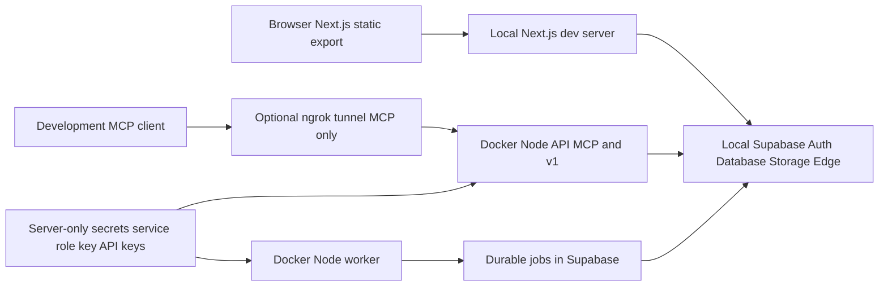

# Local stack, backend processes, and release boundaries

Lookout has separate deployment units. The browser is a static Next.js export; Supabase owns Auth, database, Storage, migrations, and Edge Functions; and the Docker Node runtime is an optional API/worker service with privileged server-side access. An optional ngrok tunnel makes the local Node MCP route reachable by a development connector. Running or deploying one unit does not deploy the others.

For the wider ownership and authorization model, see [System architecture and trust boundaries](../architecture/system-overview.md) and [Agent credentials, gateway, MCP, and guide routing](../concepts/agent-access-and-mcp.md). For evidence-qualified rollout status, see [Current implementation state and operational limits](current-state.md).

## Runtime topology and trust boundary



*Caption: the browser uses publishable configuration to reach Supabase, while the API and worker alone receive server-only secrets; the optional tunnel exposes only the Node MCP route to a development client.*

The browser must receive only public, build-time settings such as `NEXT_PUBLIC_SUPABASE_URL`, `NEXT_PUBLIC_SUPABASE_PUBLISHABLE_KEY`, `NEXT_PUBLIC_AGENT_MCP_URL`, and `NEXT_PUBLIC_LOOKOUT_API_URL`. URL values are public endpoints, not credentials. **Never expose `SUPABASE_SERVICE_ROLE_KEY`, an API-provider key, an agent bearer token, or any other service-role key through browser configuration.** The Next config reads only `NEXT_PUBLIC_` values from the root local environment (with a narrow legacy mapping for the Geoapify value).

The Node entrypoint requires `SUPABASE_URL` and the server-only `SUPABASE_SERVICE_ROLE_KEY` before it starts. It creates a service client without persisted or refreshed sessions and selects its role using `LOOKOUT_PROCESS`:

- `api` starts the HTTP server, normally on port 8080. It serves `/healthz`, MCP at `/mcp`, agent operations at `/v1/operations`, and an optional resume-import route. Host and Origin allowlists are network controls; the underlying dispatch/credential checks still determine authorization.
- `worker` is a separate process using the same image and environment. It polls the durable queue only when `LOOKOUT_EXECUTION_ENABLED=true`; otherwise it remains idle. Enabling `LOOKOUT_SUBMISSION_ENABLED=true` additionally constructs the application executor and exposes its configured API tools. The worker has no recurring-search scheduler.

`/healthz` means the API process is responding; it does not prove that Supabase is reachable or that the worker is enabled/running.

## Start a local browser and Supabase stack

Install the locked root and frontend dependencies, install the Supabase CLI, and run Docker before starting services:

```sh
make install
make services
make frontend
```

`make services` checks for the CLI and Docker, then runs `supabase start`. The local configuration defines a `lookout-local` project with API at `http://127.0.0.1:54321`, database at 54322, Studio at 54323, and Inbucket at 54324. It enables migrations and does not seed data. Local Supabase is Docker-managed and must remain isolated from hosted data: do not use `--linked`, a hosted `SUPABASE_URL`, or production credentials for local checks.

`make frontend` runs the branch-aware frontend launcher. Outside `main`, it obtains the API URL and anonymous key from `supabase status -o json`, rejects non-loopback values, and starts Next on `127.0.0.1:3000`. It passes the anonymous/publishable key—not the CLI service-role key—to the frontend. On `main`, it uses the live-preview helper, which maintains a separate clean preview clone and refreshes it from landed local-main commits.

Useful lifecycle commands are:

```sh
make status
make down
npm run validate:local-db
npm run validate:local-edge
```

`make down` runs `supabase stop`, preserving local data. Stopping the frontend with Ctrl-C does not itself stop Supabase. The validation commands are local checks, not evidence of a hosted rollout.

### Local environment files

`next-app/.env.example` shows browser-safe settings. A local `next-app/.env.local` can contain local public endpoint values, for example:

```dotenv
NEXT_PUBLIC_LOOKOUT_API_URL=http://127.0.0.1:8080
```

`scripts/configure-local-supabase.mjs` can write mode-600 ignored local browser and Edge configuration after checking that `supabase status` reports a loopback project; it deliberately writes a publishable key rather than a service-role key.

The API/worker has a different ignored file, `backend/runtime/.env.local`. It needs the Docker-reachable local `SUPABASE_URL` (typically `http://host.docker.internal:54321`) and `SUPABASE_SERVICE_ROLE_KEY`. Optional service integrations such as resume parsing belong here as server-only values. Recreating a container is required for changed container environment values to take effect.

## Run the optional Docker Node runtime

Build and start both processes from the same Node image:

```sh
docker compose -f backend/runtime/compose.yaml build api
docker compose -f backend/runtime/compose.yaml up -d api worker
```

The Compose project binds the API only to `127.0.0.1:8080`; the worker has no published port. Both load `backend/runtime/.env.local`, set their distinct process mode, use the host gateway to reach local Supabase, restart unless stopped, and retain bounded local Docker logs. Start the API before attempting the development tunnel.

Treat execution switches as explicit operational approval. A worker with `LOOKOUT_EXECUTION_ENABLED` absent or not equal to `true` does not claim work. A running worker only processes already-queued durable jobs and persists results through fenced service RPCs; it does not create a schedule or infer permission to perform unrelated actions. See [Current implementation state and operational limits](current-state.md) for the bounded discovery and submission limits.

## Optional development MCP tunnel

The tunnel is for testing a hosted/development MCP client against the already-running local API. It is not part of the production frontend deployment and does not start Supabase, the API, the worker, or Next.js.

Place the ngrok settings in the ignored repository-root `.env.local`:

```dotenv
NGROK_AUTHTOKEN=your_ngrok_agent_token
NGROK_URL=https://your-assigned-host.ngrok-free.app
```

Then run:

```sh
make muse-dev
make muse-dev-logs
make muse-dev-down
```

`make muse-dev` uses `backend/runtime/compose.muse-dev.yaml` in a separate `lookout-muse-dev` project and attaches it to the existing `lookout-backend_default` network (or `LOOKOUT_DOCKER_NETWORK`). Only `NGROK_AUTHTOKEN` is supplied to the tunnel container. It forwards internally to `http://api:8080`, has no published host ports, disables inspection, and does not restart automatically.

The mounted traffic policy denies all public paths except exactly `/mcp` and rewrites the upstream `Host` to `localhost:8080`; `/v1` and `/healthz` are not published through the tunnel. This transport restriction does not authenticate callers: MCP requests still require the existing scoped bearer token, and allowed-Origin checks still apply if the client sends an Origin header. The ngrok authtoken is for tunnel operation, not MCP authentication; never substitute a Supabase service-role key for an agent connector token.

`make dev` sequences `make services`, `make muse-dev`, and `make frontend`. Consequently it requires valid tunnel configuration and an existing backend Docker network/API as well as the normal local prerequisites. To run without a tunnel, start `make services` and `make frontend` separately. When `NGROK_URL` is set for a local frontend, the launcher derives `NEXT_PUBLIC_AGENT_MCP_URL` as the HTTPS origin plus `/mcp`; restart Next after changing it. Browser data requests continue to use local Supabase directly.

## Static frontend build and deployment

The frontend uses `output: 'export'`, trailing-slash routes, and an optional `NEXT_PUBLIC_BASE_PATH`. Its production build is:

```sh
npm run build
```

This delegates to `next-app` and runs its public-asset preparation, `next build --webpack`, and export finalization. The finalizer generates a content-hashed service-worker cache for exported assets. The normal output is `next-app/out`. `npm run build:sites` copies that export to root `out` with no URL prefix for a static-hosting layout.

The `Deploy React board` workflow runs on `main` and is deliberately ordered:

1. Call the backend deployment workflow.
2. Run CI: install both lockfiles, `npm test`, data validation, and the production static export with `NEXT_PUBLIC_BASE_PATH=/${repository name}`.
3. Upload `next-app/out` and deploy it to GitHub Pages.

A Pages artifact is only static UI and its public configuration baked in at build time. **Gateway/MCP and migration deployment are distinct from frontend deployment.** Do not describe a successful frontend build or Pages deployment as having released a schema change, Edge Function, Node API, worker, or MCP endpoint.

## Schema and Edge-function release

`supabase/migrations/` is the **schema source of truth**. Add an ordered migration for every database-schema or durable database-contract change; do not treat documentation, a local database’s current state, or frontend code as the schema authority. Local `supabase start` applies these migrations to the isolated project, while production uses the backend workflow.

`npm run deploy:backend` invokes `scripts/deploy-supabase.mjs`. The script refuses anything except a clean `main` checkout running in the matching `refs/heads/main` GitHub workflow commit. It stamps the runtime bundle, links the fixed production project, previews migrations with `supabase db push --dry-run`, applies them with `supabase db push --yes`, and deploys exactly `agent-gateway`, `agent-mcp`, and `workspace-reset` using the API deployment path. It restores the committed version file after packaging.

The reusable backend workflow runs only on `main`, in the production environment, with `SUPABASE_ACCESS_TOKEN` supplied as a GitHub secret. It is invoked before the Pages build but can also be dispatched separately. Supabase does not host the optional Node API, worker, parser, or browser executor: deploying migrations/functions does not deploy those services. A separately operated Node runtime needs its own image publication, server-only environment, network policy, and environment-specific smoke checks.

## Operational verification and failure boundaries

Choose checks by changed deployment unit:

- For the static UI, run `npm --prefix next-app run typecheck` and `npm run build`; CI also runs the root tests and data validation.
- For migrations and Edge contracts, run the database and local-edge validation as appropriate, deploy the backend unit, then perform an authenticated environment smoke check. A local schema test is not a hosted authorization/MCP proof.
- For API/worker behavior, use the focused runtime tests documented in [`backend/runtime/README.md`](../../backend/runtime/README.md), plus a disposable local Supabase environment. Container startup and `/healthz` do not verify queue processing or external integrations.
- For a tunnel, test `tools/list` and a permitted read against isolated local data before writes. A connected ngrok process does not establish that a hosted client supports the connector or that a production endpoint is live.

Keep test identities and data disposable, keep secret files ignored, and reconcile durable state after an interrupted write rather than assuming a timeout failed. The release boundary exists to prevent a static frontend change, a local Docker proof, or a source-level test from being mistaken for deployment of privileged backend behavior.

## Personal GCP hosting option

The optional configuration in `infra/gcp/` supports a single-VM
deployment for the existing Node API/MCP and queued discovery worker. Terraform
owns dedicated Compute Engine networking, IAP-only SSH, a static IPv4 address and
an Ubuntu VM. A separate committed-source upload builds the Docker image on the
VM and runs Caddy for HTTPS. Server credentials are uploaded over SSH separately
and do not enter Terraform state or VM metadata. GitHub Pages and hosted Supabase
remain separate deployment units; this option does not migrate accounts, run
Supabase migrations, supply a personal agent scheduler or verify browser submission.
The static build can consume the public API/MCP repository variables after the
hosted endpoints pass authenticated verification. This is locally validated
deployment configuration, not evidence of a live GCP release. Existing detached
demo fixtures and MCP actions are unchanged; no new product action is introduced.

## Focused startup reliability update

`make dev`/`up`, `services` and `frontend` now use `scripts/local-startup.mjs`.
An identified existing Lookout frontend is reused; an unrelated occupied port is
reported without stopping its owner. Saved public loopback configuration is reused
only after Auth and REST health checks. This avoids waiting on Docker's control
API when the local backend is still serving requests. Otherwise Docker/CLI checks
have 10-second deadlines and cold Supabase startup has a three-minute limit.
Configured tunnel startup is best effort and does not block the frontend.

Preview locks now record a process owner; dead owners can be recovered, while
live owners and unowned legacy locks require review. The preview falls back to
internal temporary storage if the external SSD is absent. No automatic Docker
restart, container removal, database reset or takeover of another server is added.
Tests cover timeout termination, fallback credential restrictions, tunnel failures,
occupied ports and lock recovery. Local live verification is recorded in the
startup feature change note; it does not establish cold Docker or hosted behavior.
