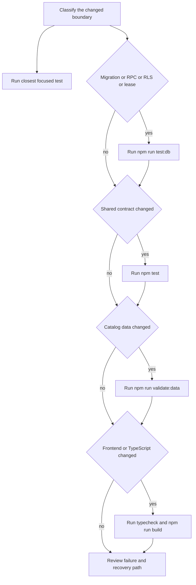
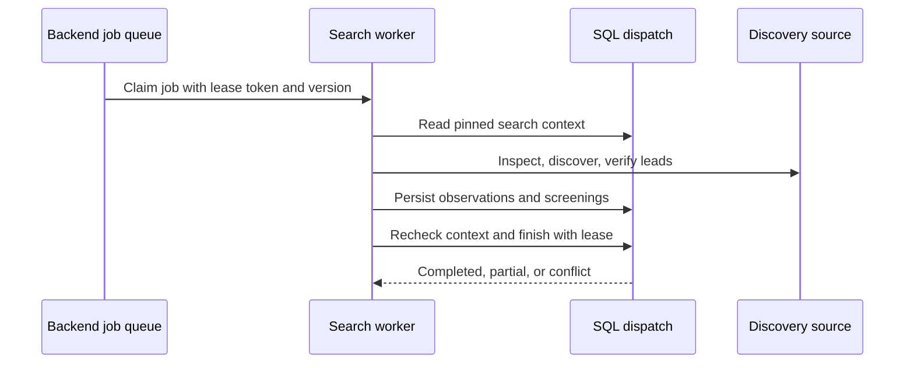

# Testing strategy and safety invariants

The test suite is most valuable when it proves a boundary cannot be crossed, rather than merely confirming a screen renders. Start from the workflow being changed, identify the authoritative writer and its failure mode, then run the narrowest tests that exercise the real boundary. Expand to the database suite, data validator, typecheck, or frontend build when a change crosses into those layers.

This is a guide to **what must remain true** and how to select checks; it is not a test-file inventory. For the data authority and writer model behind these checks, see [data model, ownership, and consistency rules](../architecture/data-and-ownership.md). For what local checks do—and do not—prove about deployment, see [current implementation state](../operations/current-state.md).

## Verification ladder

1. **Focused behavior test first.** Run the closest `node --test tests/<name>.test.mjs` while implementing a narrowly scoped change. It gives fast feedback on the high-risk contract and makes a regression expectation explicit.
2. **Database/PGlite check for persisted authority.** If a migration, RPC, RLS policy, trigger, private table, lease, receipt, or canonical writer changes, run `npm run test:db` and the focused SQL-backed test. This is the layer that can prove two-owner isolation and service-only mutations.
3. **Whole Node suite for shared code.** Run `npm test` when a shared contract, common model, gateway validation, or cross-workflow behavior changed. The root command is `node scripts/run-tests.mjs`: it replays current migrations once, exports a temporary PGlite snapshot, and runs Node tests with four concurrent files. Ordinary database fixtures load independent databases from that snapshot. Custom migration lists, directories and before-migration hooks bypass it, preserving upgrade coverage. Direct `node --test` focused runs still replay their own migrations. The snapshot is deleted after the full run; no persisted cache or new dependency is used.
4. **Contract data validation.** Run `npm run validate:data` after editing `data/jobs.json` or any generator that produces it. It rejects missing required job fields, invalid priorities/types, and duplicate IDs or application URLs.
5. **Type and UI artifact checks.** Run `npm --prefix next-app run typecheck` when TypeScript or frontend interfaces change, and `npm run build` for static-export/UI, routing, asset, or production frontend changes. Run both after a cross-cutting frontend change.

*The validation ladder adds checks when a change reaches a broader authority; it does not replace focused safety tests.*

## Command selection

| Change or question | First command | Add these checks when applicable | Why it matters |
| --- | --- | --- | --- |
| A single workflow contract | `node --test tests/<closest>.test.mjs` | `npm test` for shared utilities/contracts | Focused tests isolate the intended safety property and are fast enough for iteration. |
| SQL migrations, RLS, RPCs, trigger behavior, receipts, leases, or database writers | `npm run test:db` | closest SQL-backed `node --test` test; `npm test` | The PGlite helper replays migrations into a disposable database, initializes Auth-like roles/users, and runs SQL behavior under role context. |
| Job catalog records | `npm run validate:data` | `npm test` if consumers changed | Validator checks required fields, allowed priority/employment values, and duplicate identifiers/URLs. |
| MCP tool registration, schema, protocol, scope, or gateway mapping | `node --test tests/mcp-protocol.test.mjs` | `node --test tests/mcp-scope-contract.test.mjs`; `npm test` | Discovery and calls need scope and schema enforcement before product forwarding. |
| Search pipeline, sources, filters, or worker execution | `node --test tests/search-job-pipeline.test.mjs` | `npm run test:db`; `npm run test:filter`; `npm test` | Search safety combines SQL leases/version fences with runtime partial-coverage reporting. |
| Runner prefill or employer submission | `node --test tests/runner-deterministic.test.mjs tests/submission.test.mjs` | `npm run test:db`; `npm run test:submission:e2e` when changing its exercised integration | A browser-like fixture alone cannot prove the durable claim/receipt state machine. |
| Cloud synchronization, profile conflict, account switching, or demo transition | `node --test tests/cloud-sync.test.cjs` | `node --test tests/demo-mode.test.mjs`; `npm test` | Sync has race and identity boundaries that component rendering does not cover. |
| Circle knowledge, membership, publication, or citations | `node --test tests/circle-knowledge.test.mjs` | `npm run test:db`; `npm test` | It covers human/agent separation, membership, revisioned publication, and revocation. |
| Next.js/TypeScript UI surface | `npm --prefix next-app run typecheck` | `npm run build`; focused UI/model tests; `npm test` if shared code changed | Type compatibility and the production static artifact are separate checks. |

`package.json` defines `test`, `test:db`, `validate:data`, `build`, `test:filter`, and `test:submission:e2e`; `test:db` deliberately imports the same database scenarios used by the suite. Use it for focused debugging; do not repeat it after a successful `npm test`. Vendor integrity is checked once against the complete Career Ops manifest in `career-execution.test.mjs`; liveness and dedup suites focus on behavior. React render tests share the small `tests/helpers/render.mjs` bundling helper. CSS spelling and exact selector formatting are left to visual review rather than source-text assertions. The intelligence runtime has its own `npm run intelligence:typecheck`. Do not interpret a passing unit fixture, PGlite database, or static build as proof of a hosted provider, real agent host, or employer interaction.

## Keep the harness small

Treat a test as useful when it detects a distinct user-impacting failure. Keep authorization, owner isolation, consent, version/retry safety, uncertain submissions and persisted workflow outcomes. Test each common registration/validation mechanism centrally; add per-feature cases when its behavior differs. Prefer action/result assertions over exact fixture names, counts, guide phrases, source text or prescribed call sequences, unless that sequence itself enforces a safety boundary.

`demo-fixtures.test.mjs` checks reset independence across entire fixture graphs. Feature-specific demo tests should exercise interactions or meaningful states, rather than repeat fixture inventories. Component renders still protect missing-data and consent behavior. `database-fixture.test.mjs` verifies independent rows/session roles and custom-history bypass for the shared baseline.

These are deterministic product tests, not a measurement of model reliability. Actual agent evaluation requires representative tasks, execution traces and checks against saved outcomes; preserve failures from real use as regression cases. Do not add model judges or an eval framework unless a concrete nondeterministic behavior needs them.

The pruning policy follows [OpenAI evaluation best practices](https://developers.openai.com/api/docs/guides/evaluation-best-practices) (task-specific goals and representative failures) and [Anthropic's agent evaluation guidance](https://www.anthropic.com/research/demystifying-evals-for-ai-agents) (deterministic grading where possible and outcome-based checks). Neither recommends an arbitrary ceiling for product unit tests. This focused update describes current source; it does not refresh the rest of the generated wiki's verification metadata.

## Invariants by workflow

### 1. Ownership and authorization are server/database facts

**Invariant.** A browser or agent must not select another owner by sending `userId`, and a valid-looking UI state must not bypass RLS, credential scope, or an authoritative RPC. Private operational tables and trusted dispatch remain inaccessible to browser roles.

**Why this is risky.** Owner filtering in a client is only a convenience. The dangerous regression is a new direct table write, a missing SQL owner predicate, or a gateway payload that accepts server-derived identity/authorization data.

**Focused evidence to preserve.** The database suite executes schema and workflow scenarios against migrated PGlite, resets session identity between tests, and explicitly checks that authenticated/anonymous roles cannot call trusted context dispatch. The MCP protocol tests additionally reject injected `userId` arguments and confirm a tool call is mapped only to a fixed gateway operation.

**Change-oriented checks.** For a new private record or write path, add a two-user test: owner succeeds, another owner cannot read or mutate, and a browser role cannot mutate service evidence. Exercise the SQL/RPC boundary—not only `validateRequest`. Run `npm run test:db`, then the closest workflow test and `npm test` if a shared contract was touched.

### 2. Versions, idempotency, and account identity stop stale or duplicate writes

**Invariant.** An expected revision/version identifies the state reviewed by the caller; a stale write conflicts rather than overwriting current data. Retried semantic actions reuse their event/attempt key and return a stable outcome or reject a changed payload. Account switches and demo transitions invalidate in-flight reads/writes so old-account data cannot hydrate the current workspace.

The cloud-sync tests cover serialized saves, retry after transient failure, account switching during a save, in-flight background reads, and profile conflict resolution. They specifically assert that conflicts do not auto-retry, and that demo suspension blocks account reads/writes until normal mode resumes. The search and Circle tests make the complementary persistence check: duplicate event keys replay the result, but a changed request/revision is rejected.

**Change-oriented checks.** If adding an editable field, decide whether it belongs in an existing versioned document or needs an expected-version RPC; test a stale version and a same-key replay. If changing autosync/account lifecycle, run `node --test tests/cloud-sync.test.cjs` plus an account-switch and in-flight-read case. Never “fix” a conflict by retrying an old snapshot automatically.

### 3. Search work is leased, context-pinned, and honest about coverage

**Invariant.** Workers operate only on an owned, leased job using the current version; settings/context changes prevent a mixed-version successful result. Search persists observations and screenings through its canonical path, and a source that is unsupported or incomplete causes a `partial` outcome rather than a claim of exhaustive coverage. Re-executing a completed run can rebuild its saved shortlist without rediscovering or duplicating screenings.

*The search pipeline is fenced at claim, dispatch, and final receipt; partial source coverage is a result state, not a silent success.*

`tests/search-job-pipeline.test.mjs` drives `workOnce` against a real PGlite-backed worker RPC facade. It checks the task order, settings changes during processing and at final finish, replay without recollection, owner-scoped screening reads, default source context, and incomplete coverage. Use it when touching worker orchestration, filtering, persistence, source handling, or result language; add `npm run test:filter` when filter semantics change.

### 4. Submission permits exactly one guarded click; uncertainty is a stop

**Invariant.** Submission authorization is derived afresh from owned current records, not caller-supplied owner, snapshots, or an automatic flag. The runner must preflight exact form bindings, acquire a single claim, receive a short-lived click permit, click at most once, and mark submitted only from a supported observed confirmation. A lost start response, post-click timeout, unsupported confirmation, or changed form is **uncertain/Needs you**, not a reason to retry.

`tests/runner-deterministic.test.mjs` concentrates on safe preparation: exact native radio/checkbox values, required multi-field completeness, uniqueness before writes, current application/revision matching, owned resume selection, and refusal to click ambiguous Apply controls. `tests/submission.test.mjs` exercises the end-to-end decision path: routine versus exact human approval, stale context, duplicate claims, expired permits, one click, confirmation evidence, report retry without a second submission, and sanitised blocker metadata. Database tests then verify receipt validation and that the one-click claim/attempt rules live in SQL as well.

**Change-oriented checks.** Any adjustment to authorization, ATS selectors, form fingerprinting, receipt markers, attempt transitions, or recovery UX requires both focused files and `npm run test:db`. Run `npm run test:submission:e2e` only when changing the script's covered integration; it remains bounded evidence, not permission to claim general employer compatibility. Preserve the distinction between a prepared draft, human approval, observed confirmation, uncertain execution, and a user-reported milestone.

### 5. Demo mode must be a detached fictional runtime

**Invariant.** Demo edits, data, and Circle interactions do not read from or write to a signed-in account, cloud sync, production MCP, or shared persistent state. Refresh/reset rebuilds fictional fixtures; entering demo invalidates outstanding account hydration/sync work.

The dedicated demo-mode test verifies memory-store copies do not mutate their input or another snapshot and that onboarding previews are fictional/resettable. The cloud-sync tests cover the more subtle transition: demo suspension rejects saves/stage writes and prevents an already-started account refresh from hydrating the demo store.

**Change-oriented checks.** Keep new demo features behind a fictional service/factory rather than importing production cloud/backend clients. Run `node --test tests/demo-mode.test.mjs tests/cloud-sync.test.cjs`; add a transition test whenever a new subscription, timer, background read, or write is introduced.

### 6. MCP discovery is a scope-filtered capability boundary

**Invariant.** MCP authenticates every request with the bearer credential, verifies scopes before exposing or forwarding a tool, and rejects malformed/extra arguments. Tool discovery must not begin work. The protocol offers fixed bounded operations—not browser, shell, SQL, generic approval, connection-management, or arbitrary owner-selection capabilities.

The protocol test exercises initialize/version negotiation, origin and credential failures, body/method limits, scope-filtered discovery, fixed operation mapping, forwarding denial before action, and secret-free infrastructure errors. The scope-contract test iterates active tools to prove each mandatory secondary scope removes a tool from discovery and denies direct calls; it also covers conditional scopes and strict nested payloads. Paused operations and local extras cannot bypass the feature/scope filter.

**Change-oriented checks.** For every new tool, add a test for no/missing scope, correct scope, schema rejection of unknown properties, and a payload that tries to inject `userId` or a server-derived authorization object. Run both MCP focused commands above, and `npm test` when tool registration is shared. Do not expose a tool merely because its underlying function exists.

### 7. Circle knowledge is membership- and consent-bound, not profile sharing

**Invariant.** Circle participation is invitation-based and access is limited by current membership plus an unrevoked, unexpired scoped connection. Agents can propose/publish/cite only within their authority; they cannot approve knowledge, change policy, or invite people. Drafts stay private. Publication requires exact-revision human approval unless a conservative, currently allowed standing policy applies; milestone/freeform disclosures still require review. Private sources and private application identifiers must not enter shared posts.

The Circle test is intentionally broad where consent state crosses roles: it verifies the feature is disabled until configured, legacy connections lack knowledge scopes, direct browser access to private citation data is denied, membership removal/revocation blocks retries, publication is revisioned/idempotent, citations are private and retractable, edits reset approval/use counts, and moderation removes direct/reply access. Its in-memory demo assertion also verifies that each demo starts with fresh Circle state.

**Change-oriented checks.** When extending post types, policy, source handling, citations, invitations, moderation, or agent operations, run `node --test tests/circle-knowledge.test.mjs` and `npm run test:db`. Add tests for a nonmember, a removed member retrying with an old credential, a stale revision, duplicate event key, and the distinction between proposal, human approval, and publication. Treat a Circle share as a separately consented, sanitised knowledge artifact—not a link to a member's private workspace.

## Review before merging

Use this compact review list after tests pass:

- Did the test cross the authoritative boundary (SQL/RPC/gateway/runner), rather than only mock it?
- Is there a second-owner/nonmember, stale-version, duplicate-retry, and failure/recovery case appropriate to the change?
- Does the outcome vocabulary remain truthful—especially `partial`, `prepared`, `approved`, `confirmed`, and `uncertain`?
- Could a timeout, lost response, expired credential, account switch, or revoked membership cause a retry that leaks or duplicates work?
- Did a new UI surface receive typecheck/build validation, and did changed catalog data receive `validate:data`?

A passing test establishes only the contract it exercises. Preserve that narrow claim in release notes and require environment-specific verification before describing an external agent, hosted service, or employer action as live.
