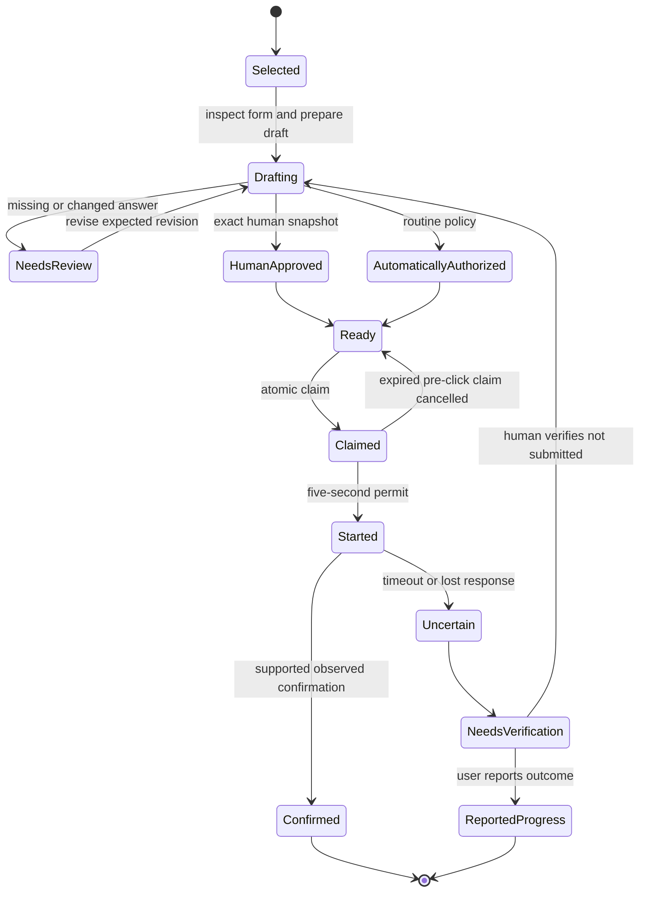
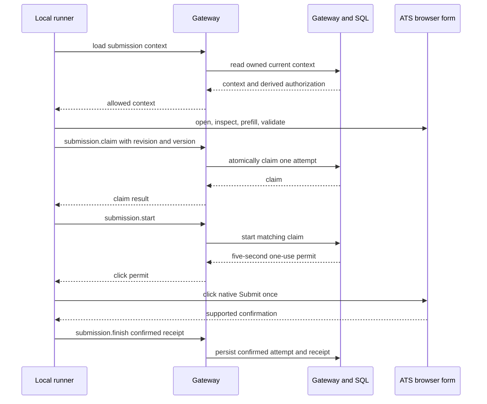

# Application drafting, authorization, and guarded submission

Opening a job is **not** applying. A saved application draft, a human approval, policy authorization, a user-reported progress update, and a runner-observed employer confirmation are separate facts with different writers and meanings. This workflow turns a selected posting into a controlled submission only when each relevant fact is current.

The durable application record and its revision are the working state; an approval is an immutable human snapshot; a `submission_attempts` row is execution evidence; and a milestone is a separate reported recruitment observation. See [data model, ownership, and consistency rules](../architecture/data-and-ownership.md) for the ownership model, and [agent credentials, gateway, MCP, and guide routing](../concepts/agent-access-and-mcp.md) for credential and scope boundaries.

## Lifecycle at a glance



*The application moves from an editable draft to one guarded attempt; uncertain execution is a verification stop rather than a retry branch.*

### 1. Select and inspect, then prepare a draft

A supported automatic target is an exact canonical Greenhouse, Ashby, or Lever posting URL. Public Greenhouse inspection can provide a preliminary structure, but it is marked incomplete because conditional questions may exist; supported submission ultimately inspects the live native browser form. Workday, custom widgets, CAPTCHA, extra documents, ambiguous controls, and unsupported confirmation pages go to a manual browser handoff rather than raw clicking.

`prepareDraftWithPrefill` loads the job and the owner’s personal context, checks the caller’s `expectedRevision`, and optionally loads an active search profile. It selects or validates an owned resume, derives prefill answers, then rechecks personal and search-profile versions before saving through `drafts.prepare`. The saved draft pins the selected resume ID and, when selected by rule, its SHA-256 content hash; it records exact field IDs, types, questions, choices, answer provenance, and the live-form fingerprint. A changed personal/search context produces a conflict instead of saving a mixed snapshot.

Draft edits are concurrency-controlled. Answer-only updates merge only into existing supported inspected fields, validate choice and length constraints, and remove prior provenance so a newly entered value cannot inherit automatic reuse permission. Material draft or blocker changes advance the application revision and invalidate an earlier approval. A claimed or started submission attempt freezes draft edits.

The preparation handoff is deliberately bounded: it identifies unresolved controls, their routing (human, agent, optional, or browser), and relevant profile evidence without emitting filled answers, file bytes, or signed URLs. Treat it as a review aid—not submission evidence.

### 2. Review and authorization are independent gates

Policy decides *whether review is required*, not whether a browser may execute. Excluded companies and role types are skipped. Unknown company/role facts, ambiguous tier placement, invalid or conflicting automation configuration, auto-apply-off, and important matches require review. A routine match may qualify for automatic authorization only under current configured policy; it still requires a verified profile, a permitted selected resume, and every answer to have allowed provenance.

There are two authorization modes:

- **Human authorization** requires application status `Approved`, reviewed questions, a verified owner profile, and an approval whose immutable snapshot exactly matches the current application revision, draft, profile facts, and owned resume. Editing the draft or changing those records prevents reuse of that approval.
- **Automatic authorization** is available only for a routine auto-apply decision. Each non-file answer must be either an exact current verified profile fact for a recognized label, or one uniquely matching owner-saved answer marked `autofill_policy: 'auto'`, verified, version-matched, and within any company scope. The resume must match the current profile selection rule. Unknown, inferred, ambiguous, custom, or stale answers require review.

The gateway reads current owned context and derives this decision server-side. It rejects caller-supplied owner identity, authorization, and snapshots; claim/start also compare the expected application revision and personal-context version. Required runner connection scopes include `workspace:read`, `drafts:write`, `approvals:read`, and `resumes:read`.

### 3. Run the guarded one-click path

The local runner exposes `inspect_application`, `fingerprint_resume`, `try_application`, and `submit_application`. `try_application` is prefill only: `Prepared` is not `Submitted`. `submit_application({applicationId,attemptId})` loads fresh server context and has the only concrete browser submission path. The runner process uses one dedicated page and serial calls; it has no bundled general browser evaluation, shell, CAPTCHA bypass, or autonomous post-submit recovery.



*The runner completes all form checks before claiming, then obtains one short-lived permit immediately before its single native Submit click.*

Before any claim, the runner navigates to the canonical target, opens and inspects the native application form, refuses unsupported controls/additional document uploads, pre-fills only the approved plan, and checks the fingerprint. It validates browser-native required fields, one exact matching submittable control per planned field, exact filled values, and the uploaded résumé’s SHA-256. It requires exactly one visible, enabled form submit control with an accepted label, and fails if a supported success marker was already visible.

Only after these checks does it call `submission.claim`. SQL locks the application, rechecks the full context and pinned authorization, cancels only an expired **pre-click** `claimed` attempt, and permits no new attempt when one is `claimed`, `started`, `uncertain`, or `confirmed`. Thus there is one active/uncertain/confirmed attempt per owned application. `submission.start` can transition only the matching connection’s claim, repeats cannot issue another permit, and the returned click permit expires within **five seconds**. The runner revalidates the form after the permit, calculates remaining permit time, and performs exactly one `button.click`.

### 4. Confirm honestly and preserve evidence

A click is not confirmation. The runner accepts a receipt only when the URL is the same canonical job or supported confirmation path, a platform-supported marker absent before submission is now visible, its bounded text matches a known success phrase and not a rejection phrase, and no visible form remains. The receipt is explicitly labelled `runner-observed-<ats>-confirmation`; it is not signed employer API proof. SQL independently validates its source, platform marker, URL, and message before marking the attempt `confirmed`, storing the receipt, and setting the application to `Submitted` when no later recruitment state supersedes it.

A person may separately observe a portal or email outcome and record progress as a user-reported milestone. That is useful recruitment evidence, but it neither creates approval nor converts an uncertain runner attempt into observed confirmation. Similarly, simply opening a posting, saving a draft, or receiving `Prepared` must never be presented as “applied.”

## Failures, uncertainty, and Action Board handoffs

The blocker contract sends fixed diagnostic codes, a stage, bounded question/choice metadata, click facts, and recovery guidance. It deliberately excludes raw exceptions, entered answers, file bytes, credentials, and session URLs. Typical recovery routing is:

| Situation | Board/agent action | What must not happen |
| --- | --- | --- |
| Missing answer, changed field, invalid value, or policy/draft issue before claim | Repair the draft from Lookout facts, then obtain fresh authorization if needed. | Reuse old approval or guess an answer. |
| Unsupported target, custom control, document requirement, navigation/form-entry issue | Use the browser/manual handoff and inspect the employer form. | Force raw submission or upload the résumé to a transcript/cover-letter slot. |
| Existing confirmation visible before execution | Verify the existing employer application. | Submit again. |
| Existing `claimed`, `started`, `uncertain`, or `confirmed` attempt | Read saved attempt and verify outcome. | Acquire a parallel attempt or second click. |
| Start response lost, permit/check failure after start, click timeout, redirect, or unsupported confirmation | Mark/report `uncertain`, send to **Needs you**, and verify portal/email. | Automatically retry Submit. |
| Confirmation was observed but `submission.finish` could not be saved | Retain `pendingReport` and retry `report_submission_result`/the result report only. | Re-execute browser submission. |

The no-retry-on-uncertainty rule is absolute: once a start request may have committed, any exception is treated as uncertain—even if the runner cannot prove that the click happened. `safeToRetry` on a pre-submit blocker is informational rather than permission; saved attempts and fresh authorization still govern execution.

For an uncertain outcome, the human checks the employer portal or confirmation email. If it was submitted, record that user-reported progress. If it was verified not submitted, the Action Board’s **Verified not submitted — allow a new attempt** recovery records where it was checked, cancels the old attempt, clears the blocker, and requires current authorization and a new attempt ID. It is human-only; agents cannot invoke it. Stalled `started` attempts must age five minutes before this recovery.

## Operating the local runner

Install the Node 22+ local runner in a graphical session (Xvfb is supported):

```sh
git clone https://github.com/wcia013twe/codex-automated-job-board.git
cd codex-automated-job-board
npm ci --prefix runner
npm run install:browser --prefix runner
```

Configure the MCP subprocess with a private `JOB_BOARD_AGENT_TOKEN`; do not commit a populated configuration. The runner starts its browser lazily and keeps it until process exit. Its supported submission adapters are intentionally narrow; no real employer application was submitted as development evidence. See the [runner setup and limits](../../runner/README.md), [workspace sync and demo mode](../concepts/workspace-sync-and-demo-mode.md), and [job discovery workflow](job-discovery.md).

## Change and test checklist

Changes to authorization, draft provenance, ATS selectors, fingerprints, receipt markers, attempt transitions, or recovery wording can create duplicate-submission or false-evidence risk. Preserve these focused checks:

- `tests/submission.test.mjs` covers automatic versus exact human authorization, no owner/snapshot injection, one click, expired/lost permits, changed fields, confirmation validation, uncertainty, report-only retry, and sanitized blockers.
- `tests/runner-attempt.test.mjs` verifies pre-submit recovery stays bounded and is independently revalidated, while a potentially started submission bypasses recovery and escalates.
- Database tests are necessary for the durable SQL lock, attempt-state, receipt, scope, and human-only recovery boundaries; a browser fixture alone cannot prove them.

Run the closest focused test first, then `npm run test:db` for persistence/RPC changes and `npm test` for shared behavior. The broader [testing strategy](../testing/verification-strategy.md) explains that a passing fixture is not proof of a live employer integration.

## Imported tracker history: focused update

The tracker import supports Saved, Applied, Screen, Interview, Offer, Rejected,
Withdrawn and Posting closed independently from the archive flag. Employment
types reuse the existing settings contract: FT, Internship, Part-time, Contract
and Temporary. The browser edit form and `update_imported_job` MCP tool share
the owner-scoped `simplify_import` writer (`imports.update` for agents), row
validation, tracker version lock and event-key replay checks. Corrections can
change title, location, employment type, status, known dates, notes and archive
state; source rows remain immutable. Re-import still preserves existing records.
Unknown locations/dates must stay unknown. No migration infers outcomes from
old notes, and imported outcomes never create receipts or approvals.

Duplicate source groups prefer process/outcome reports over applied/saved,
then newest known status date, retaining an explicit applied date from another
source row when available. Local tests do not establish deployed Muse parity.

### Original application UI for imports

Imported rows now use the same compact tracker row, shared progress bar and
application detail dialog as native records. Overview, Documents, Interview,
round history, recruiting emails and the vertical status panel remain visible.
Original import notes appear as dated/undated imported reports in history and
Notes; they are not parsed into linked emails or treated as new status evidence.
Per the requested UI-first restoration, imported records still lack a native
application backend ID: round writes report the existing sync error, and native
progress/draft actions report that the imported workflow is not connected. No
synthetic native records, receipts or approvals are created. Metadata corrections
remain available through update_imported_job; its separate row editor is removed.

### Application detail evidence and context

Application Overview always renders the four canonical fit dimensions, showing
N/A when no saved score exists. It never computes new scores on open. Current
prep links to the application's Interview brief and the Career Toolkit workspace;
it no longer repeats the application's status as preparation content. Notes is
a compact reference to two recent distinct current notes, with full text behind
disclosures; round/email history remains in Interview.

Documents shows captured attempt fields and the pinned resume, with individual
employer answers behind disclosures. Confirmed attempts are labeled submitted;
unconfirmed attempts remain labeled as saved attempts. Historical records without
a snapshot show Not available, including an explicit outside-Lookout message for
imported application history. An imported Saved job does not claim submission.
Current profile fields, current draft answers and current resume selections never
substitute for unavailable historical submission materials. Unsent native drafts
still display their recorded employer answers as a draft. Raw submission details
remain optional; historical/externally imported records have no draft editor.
