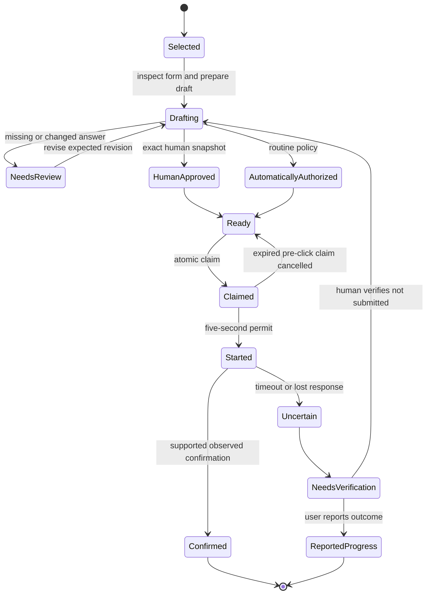
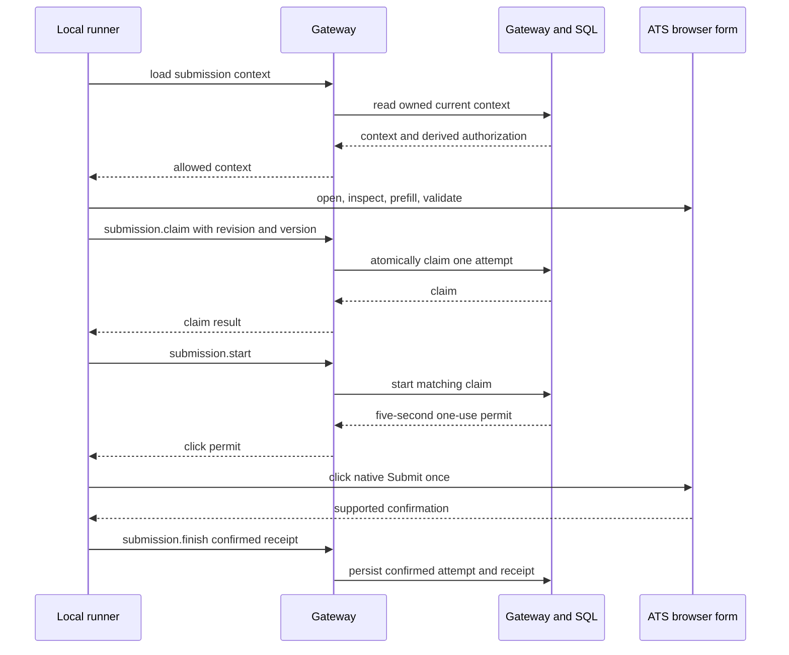

# Application drafting, authorization, and guarded submission

Opening a job is **not** applying. A saved application draft, a human approval, policy authorization, a user-reported progress update, and a runner-observed employer confirmation are separate facts with different writers and meanings. This workflow turns a selected posting into a controlled submission only when each relevant fact is current.

The durable application record and its revision are the working state; an approval is an immutable human snapshot; a `submission_attempts` row is execution evidence; and a milestone is a separate reported recruitment observation. See [data model, ownership, and consistency rules](../architecture/data-and-ownership.md) for the ownership model, and [agent credentials, gateway, MCP, and guide routing](../concepts/agent-access-and-mcp.md) for credential and scope boundaries.

## Lifecycle at a glance



*The application moves from an editable draft to one guarded attempt; uncertain execution is a verification stop rather than a retry branch.*

### 1. Select and inspect, then prepare a draft

A supported automatic target is an exact canonical Greenhouse, Ashby, or Lever posting URL. Public Greenhouse inspection can provide a preliminary structure, but it is marked incomplete because conditional questions may exist; supported submission ultimately inspects the live native browser form. Workday, custom widgets, CAPTCHA, extra documents, ambiguous controls, and unsupported confirmation pages go to a manual browser handoff rather than raw clicking.

`prepareDraftWithPrefill` loads the job and the owner’s personal context, checks the caller’s `expectedRevision`, and optionally loads an active search profile. It selects or validates an owned resume, derives prefill answers, then rechecks personal and search-profile versions before saving through `drafts.prepare`. The saved draft pins the selected resume ID and, when selected by rule, its SHA-256 content hash; it records exact field IDs, types, questions, choices, answer provenance, and the live-form fingerprint. A changed personal/search context produces a conflict instead of saving a mixed snapshot.

Draft edits are concurrency-controlled. Answer-only updates merge only into existing supported inspected fields, validate choice and length constraints, and remove prior provenance so a newly entered value cannot inherit automatic reuse permission. Material draft or blocker changes advance the application revision and invalidate an earlier approval. A claimed or started submission attempt freezes draft edits.

The preparation handoff is deliberately bounded: it identifies unresolved controls, their routing (human, agent, optional, or browser), and relevant profile evidence without emitting filled answers, file bytes, or signed URLs. Treat it as a review aid—not submission evidence.

### 2. Review and authorization are independent gates

Policy decides *whether review is required*, not whether a browser may execute. Excluded companies and role types are skipped. Unknown company/role facts, ambiguous tier placement, invalid or conflicting automation configuration, auto-apply-off, and important matches require review. A routine match may qualify for automatic authorization only under current configured policy; it still requires a verified profile, a permitted selected resume, and every answer to have allowed provenance.

There are two authorization modes:

- **Human authorization** requires application status `Approved`, reviewed questions, a verified owner profile, and an approval whose immutable snapshot exactly matches the current application revision, draft, profile facts, and owned resume. Editing the draft or changing those records prevents reuse of that approval.
- **Automatic authorization** is available only for a routine auto-apply decision. Each non-file answer must be either an exact current verified profile fact for a recognized label, or one uniquely matching owner-saved answer marked `autofill_policy: 'auto'`, verified, version-matched, and within any company scope. The resume must match the current profile selection rule. Unknown, inferred, ambiguous, custom, or stale answers require review.

The gateway reads current owned context and derives this decision server-side. It rejects caller-supplied owner identity, authorization, and snapshots; claim/start also compare the expected application revision and personal-context version. Required runner connection scopes include `workspace:read`, `drafts:write`, `approvals:read`, and `resumes:read`.

### 3. Run the guarded one-click path

The local runner exposes `inspect_application`, `fingerprint_resume`, `try_application`, and `submit_application`. `try_application` is prefill only: `Prepared` is not `Submitted`. `submit_application({applicationId,attemptId})` loads fresh server context and has the only concrete browser submission path. The runner process uses one dedicated page and serial calls; it has no bundled general browser evaluation, shell, CAPTCHA bypass, or autonomous post-submit recovery.



*The runner completes all form checks before claiming, then obtains one short-lived permit immediately before its single native Submit click.*

Before any claim, the runner navigates to the canonical target, opens and inspects the native application form, refuses unsupported controls/additional document uploads, pre-fills only the approved plan, and checks the fingerprint. It validates browser-native required fields, one exact matching submittable control per planned field, exact filled values, and the uploaded résumé’s SHA-256. It requires exactly one visible, enabled form submit control with an accepted label, and fails if a supported success marker was already visible.

Only after these checks does it call `submission.claim`. SQL locks the application, rechecks the full context and pinned authorization, cancels only an expired **pre-click** `claimed` attempt, and permits no new attempt when one is `claimed`, `started`, `uncertain`, or `confirmed`. Thus there is one active/uncertain/confirmed attempt per owned application. `submission.start` can transition only the matching connection’s claim, repeats cannot issue another permit, and the returned click permit expires within **five seconds**. The runner revalidates the form after the permit, calculates remaining permit time, and performs exactly one `button.click`.

### 4. Confirm honestly and preserve evidence

A click is not confirmation. The runner accepts a receipt only when the URL is the same canonical job or supported confirmation path, a platform-supported marker absent before submission is now visible, its bounded text matches a known success phrase and not a rejection phrase, and no visible form remains. The receipt is explicitly labelled `runner-observed-<ats>-confirmation`; it is not signed employer API proof. SQL independently validates its source, platform marker, URL, and message before marking the attempt `confirmed`, storing the receipt, and setting the application to `Submitted` when no later recruitment state supersedes it.

A person may separately observe a portal or email outcome and record progress as a user-reported milestone. That is useful recruitment evidence, but it neither creates approval nor converts an uncertain runner attempt into observed confirmation. Similarly, simply opening a posting, saving a draft, or receiving `Prepared` must never be presented as “applied.”

## Failures, uncertainty, and Action Board handoffs

The blocker contract sends fixed diagnostic codes, a stage, bounded question/choice metadata, click facts, and recovery guidance. It deliberately excludes raw exceptions, entered answers, file bytes, credentials, and session URLs. Typical recovery routing is:

| Situation | Board/agent action | What must not happen |
| --- | --- | --- |
| Missing answer, changed field, invalid value, or policy/draft issue before claim | Repair the draft from Lookout facts, then obtain fresh authorization if needed. | Reuse old approval or guess an answer. |
| Unsupported target, custom control, document requirement, navigation/form-entry issue | Use the browser/manual handoff and inspect the employer form. | Force raw submission or upload the résumé to a transcript/cover-letter slot. |
| Existing confirmation visible before execution | Verify the existing employer application. | Submit again. |
| Existing `claimed`, `started`, `uncertain`, or `confirmed` attempt | Read saved attempt and verify outcome. | Acquire a parallel attempt or second click. |
| Start response lost, permit/check failure after start, click timeout, redirect, or unsupported confirmation | Mark/report `uncertain`, send to **Needs you**, and verify portal/email. | Automatically retry Submit. |
| Confirmation was observed but `submission.finish` could not be saved | Retain `pendingReport` and retry `report_submission_result`/the result report only. | Re-execute browser submission. |

The no-retry-on-uncertainty rule is absolute: once a start request may have committed, any exception is treated as uncertain—even if the runner cannot prove that the click happened. `safeToRetry` on a pre-submit blocker is informational rather than permission; saved attempts and fresh authorization still govern execution.

For an uncertain outcome, the human checks the employer portal or confirmation email. If it was submitted, record that user-reported progress. If it was verified not submitted, the Action Board’s **Verified not submitted — allow a new attempt** recovery records where it was checked, cancels the old attempt, clears the blocker, and requires current authorization and a new attempt ID. It is human-only; agents cannot invoke it. Stalled `started` attempts must age five minutes before this recovery.

## Operating the local runner

Install the Node 22+ local runner in a graphical session (Xvfb is supported):

```sh
git clone https://github.com/wcia013twe/codex-automated-job-board.git
cd codex-automated-job-board
npm ci --prefix runner
npm run install:browser --prefix runner
```

Configure the MCP subprocess with a private `JOB_BOARD_AGENT_TOKEN`; do not commit a populated configuration. The runner starts its browser lazily and keeps it until process exit. Its supported submission adapters are intentionally narrow; no real employer application was submitted as development evidence. See the [runner setup and limits](../../runner/README.md), [workspace sync and demo mode](../concepts/workspace-sync-and-demo-mode.md), and [job discovery workflow](job-discovery.md).

## Change and test checklist

Changes to authorization, draft provenance, ATS selectors, fingerprints, receipt markers, attempt transitions, or recovery wording can create duplicate-submission or false-evidence risk. Preserve these focused checks:

- `tests/submission.test.mjs` covers automatic versus exact human authorization, no owner/snapshot injection, one click, expired/lost permits, changed fields, confirmation validation, uncertainty, report-only retry, and sanitized blockers.
- `tests/runner-attempt.test.mjs` verifies pre-submit recovery stays bounded and is independently revalidated, while a potentially started submission bypasses recovery and escalates.
- Database tests are necessary for the durable SQL lock, attempt-state, receipt, scope, and human-only recovery boundaries; a browser fixture alone cannot prove them.

Run the closest focused test first, then `npm run test:db` for persistence/RPC changes and `npm test` for shared behavior. The broader [testing strategy](../testing/verification-strategy.md) explains that a passing fixture is not proof of a live employer integration.

## Imported tracker history: focused update

The tracker import supports Saved, Applied, Screen, Interview, Offer, Rejected,
Withdrawn and Posting closed independently from the archive flag. Employment
types reuse the existing settings contract: FT, Internship, Part-time, Contract
and Temporary. The browser edit form and `update_imported_job` MCP tool share
the owner-scoped `simplify_import` writer (`imports.update` for agents), row
validation, tracker version lock and event-key replay checks. Corrections can
change title, location, employment type, status, known dates, notes and archive
state; source rows remain immutable. Re-import still preserves existing records.
Unknown locations/dates must stay unknown. No migration infers outcomes from
old notes, and imported outcomes never create receipts or approvals.

Duplicate source groups prefer process/outcome reports over applied/saved,
then newest known status date, retaining an explicit applied date from another
source row when available. Local tests do not establish deployed Muse parity.

### Original application UI for imports

Imported rows now use the same compact tracker row, shared progress bar and
application detail dialog as native records. Overview, Documents, Interview,
round history, recruiting emails and the vertical status panel remain visible.
Original import notes appear as dated/undated imported reports in history and
Notes; they are not parsed into linked emails or treated as new status evidence.
Per the requested UI-first restoration, imported records still lack a native
application backend ID: round writes report the existing sync error, and native
progress/draft actions report that the imported workflow is not connected. No
synthetic native records, receipts or approvals are created. Metadata corrections
remain available through update_imported_job; its separate row editor is removed.

### Application detail evidence and context

Application Overview always renders the four canonical fit dimensions, showing
N/A when no saved score exists. It never computes new scores on open. Current
prep links to the application's Interview brief and the Career Toolkit workspace;
it no longer repeats the application's status as preparation content. Notes is
a compact reference to two recent distinct current notes, with full text behind
disclosures; round/email history remains in Interview.

Documents shows captured attempt fields and the pinned resume, with individual
employer answers behind disclosures. Confirmed attempts are labeled submitted;
unconfirmed attempts remain labeled as saved attempts. Historical records without
a snapshot show Not available, including an explicit outside-Lookout message for
imported application history. An imported Saved job does not claim submission.
Current profile fields, current draft answers and current resume selections never
substitute for unavailable historical submission materials. Unsent native drafts
still display their recorded employer answers as a draft. Raw submission details
remain optional; historical/externally imported records have no draft editor.

### Active application ordering

The Active tab puts Screening/OA, Interview/Onsite and Offer progress first,
then applications still waiting after submission. Each group sorts newest
application date first. The shared reader uses explicit tracker/import applied
dates, stored submitted timestamps or current submission milestones, falling
back to a recorded opened date. Future interview dates are not application dates.
Missing/invalid dates sort last within their group; ties retain their prior order.
Both native and imported records use the same progress rules, including tracker
updates and sourced milestones. Other tabs retain their existing ordering. This
is read-only presentation over existing reads; it creates no dates or records.

### Optional next action ordering

Application rows show **Next action** only when a current scheduled round has a
recorded date, or an owned preparation plan has a confirmed date and unfinished
tasks. Current scheduled rounds own their timing; superseded/completed rounds and
old preparation deadlines do not reappear as a second reminder. Terminal or
archived applications have no next action. Unknown/invalid dates stay blank;
inbox notification `available_at` is never treated as an employer deadline.

Active defaults to the progress/application-date ordering above. Its **Sort →
Next action date** option orders recorded pending dates earliest first, including
past dates until the underlying round/task is completed or replaced. Equal and
undated rows retain the default order, with undated rows last. Other tabs keep
their ordering. This adds no recurring scheduling or automatic priority rules.

Dates use existing timeline/planner records, rather than a separate manual field:
website Add round / Confirmed date & time maps to MCP
`record_application_milestone` (`applications.milestone`, activity:write), with
`supersedesId` for corrections/completion. `read_application_timeline` and
`read_preparation_planner` provide scoped reads. Preparation updates keep their
existing `update_preparation_plan` boundary; no new mutation/scopes are added.
The list refreshes confirmed preparation dates on account refresh, focus and
reconnect, guards account/demo changes and reports failed reads. This is source
behavior; production availability must be checked separately.

### Imported action dates and completed stages (contract 116 source update)

`update_imported_job` and the browser's **Overview → Tracking details** now edit
`nextAction`, `actionDate`, `needsAction` and `completedStages` on the existing
owned imported tracker record. A completed Screen may remain SCREEN while the
employer decides; it does not become an Interview. Explicit completions show check
marks on the original five-stage progress display. Only a true `needsAction`
flags candidate work; waiting for the employer can have a next-action description
with no date and no flag. Dates feed the existing optional Next action sort.

`completedStages` replaces the full intended set using SAVED/APPLIED/SCREEN/
INTERVIEW/OFFER. Preserve earlier completions; stages ahead of the current stage
are rejected. `nextAction` is bounded text or null, `actionDate` is a real confirmed
YYYY-MM-DD or null, and `needsAction` is boolean. A date/true flag requires an
action description. Clear an action with all three values (null/null/false).
Browser/MCP share ownership, global tracker version, validation and event replay.

Muse reads the latest tracker/version, preserves source notes and unrelated data,
and migrates only explicit confirmed dates—not guessed dates parsed from notes.
Unknown dates stay null. Original CSV source rows are immutable. Existing native
milestone/preparation writers remain separate; generic native workflow mutations
on imported records still report the documented mismatch. Migration, gateway/MCP
and dev runtime activation are required before tools advertise these fields.

### Green progress checkmarks

Progress now shows green checks for steps before the current stage, recorded
opened links, and a reported Applied/Submitted step. An explicit completedStages
flag can complete the current Screen/Interview/Offer without advancing its status.
A current screening/interview is otherwise pending. In the imported editor,
already-passed steps appear checked and disabled; current-stage completion stays
editable. These are display projections: no dates, receipts or stored completion
flags are generated. Synthetic current-status timeline entries cannot promote a
Phone Screen into Interview. Shared community stage displays still show only the
shared current step, without projecting private history.

Visual correction: the progress bar, circles and current-step ring are purple;
only the checkmark glyph inside a completed step is green. Completion rules above
are unchanged.

Palette refinement: progress uses the softer original lavender (#a78bcb), with a
contrasting green checkmark inside. No completion or data behavior changes.

### Dynamic rounds and shared Stats (contract 121 source update)

Employer rounds now have an explicit Screen/Interview assignment and type,
including OA, take-home, technical, system design, behavioral, hiring manager,
onsite, recruiter and other. Custom labels do not determine stage or counts.
Native steps remain immutable application milestones with optional round metadata;
corrections/reschedules use the current supersedesId. Imported steps use the owned
record.rounds array with stable IDs and full-array replacement/version/replay.
These are the only round sources; no independent count or progress store exists.

Applications → Stats uses the same applicationRoundStats projector as MCP
read_application_round_stats. The application flow remains one entry per job;
Rounds counts each saved round once by phase, stage and type. Cancelled records
stay visible in activity totals but do not promote stages or supply next actions.
Replacements count once; stage/status placeholders and note text count zero.
The MCP reader applies the same native/import duplicate preference as the board.

An active Interview round displays Interview; Screen-only take-homes stay Screen.
Imported status advances to that saved stage when earlier, preserving terminal
outcomes and never creating Offer. Actual round phases determine current-stage
completion when rounds exist; legacy completedStages is the stage-only fallback.
All known rounds completed means waiting for the employer. Confirmed pending dates
feed the existing Next action sort; unknown dates remain null.

The native Add round editor supports stage/type and cancellation; replacing an
existing event preloads its saved identity/details. Imported Interview → Edit
rounds opens Overview Tracking details, where steps can be added, renamed,
reordered, completed, rescheduled or cancelled. Saved rounds display under
Interview. The fictional `?demo=1&demoApi=application-rounds` scenario and isolated
import editor cover Screen take-homes and mixed round states without account
storage/backend calls. Source verification is not a hosted release claim.
## Connected Action Board decisions (source update)

Desktop retains its rows, framing and existing review dialog. Accept/Reject controls and required human questions are derived by `read_action_board`; mobile horizontal swipes use the same human response operation. Application and outreach acceptance require acknowledgment of the exact saved content first. Unsaved application edits and changed source keys invalidate board review. Missing answers and uncertain submissions open their owned input/recovery flow instead of offering binary acceptance. Answer links open My Agent's expanded shared question bank; application links select the Documents or Interview tab and owned round.

The existing application inbox remains authoritative for application handoffs. Versioned human review/response receipts add answer, interview and outreach decisions without duplicating their drafts. `respond_action_board` is authenticated-human-only and checks source locks, current keys and replay events. `read_action_board` is the gated read-only MCP counterpart; `request_human_action` returns owned record links. Agents cannot approve, verify, reject or resume through these reads. Responses and history do not establish external execution. Outreach acceptance means ready for the human to send, never sent or authorized agent sending.

Rejecting an application keeps its history and tracker state, resets draft review to invalidate approval, cancels queued execution and persists a human-controlled work hold. Draft/preparation writes, queueing and runner prefill/claim/start are fenced until an explicit human Resume action in the existing application controls. Already-started outcomes remain real or uncertain; no click is undone or receipt fabricated. Resume never restores a declined approval. Declined outreach cannot be automatically rewritten into a new decision; explicit human initiation is required.

Source checks include the connected-board database scenario, unique-versus-ambiguous legacy-plan upgrade, shared planner/demo tests and `scripts/check-connected-action-board-ui.mjs`. These establish local source behavior only. The migration and gateway/MCP must release together before advertising hosted parity.

Round integration retains the connected Action Board stable round_id, confirmation, practice focus and timezone. Proposed or incorrect dates do not supply a next-action date. Native cancellation uses phase cancelled; Screen/Interview remains independent of practice focus. Guide versions are application-workspace 18 and interview-preparation 7; integrated developer contract 122.

### Application coverage on the Action Board

The owner-scoped board read also includes Draft applications with a saved résumé,
cover letter or answered question, Approved applications still awaiting submission,
and imported records with `needsAction: true` and a nonempty `nextAction`. These
are links to existing editors, not new approval or execution controls. Inbox
blockers/review/uncertainty take precedence for the same native application;
claimed, started, uncertain and confirmed attempts prevent ordinary submission suggestions.
Stopped native work and archived/terminal imported records do not contribute these
additional rows. Clearing the imported flag on its owning page clears its board
row; keys change when the source record changes. Exact imported links use
`application=import:<owned-id>` and remain selectable even when ordinary tracker
deduplication hides the matching imported role. Website and `read_action_board`
MCP read the same projection.

### Inline referenced action cards

The board retains its framing and Weekly Prep placement but gives each action a
content-specific view: editable application answers, saved-answer/reuse fields,
a complete outreach message, interview details, an explicit next-action task, or
a submission verification form. Each names its owned object with the Circles
`@` reference treatment; provenance labels such as Imported are omitted. Optional
reference links remain, but routine review and responses happen in the card.
Check and red-X controls have explicit accessible action names. Required answers
and evidence gate acceptance. Saving edited draft answers creates a new revision
and invalidates review; it never approves that revision. Blocker acceptance saves
human corrections, while rejection durably stops application work. Proposed
answer edits retain explicit reuse permission. Submission outcomes require a
human verification note and confirmation; reports and observed receipts stay
distinct. The same narrowly scoped authenticated response RPC enforces ownership,
source locks, versioning and idempotency. Agents can read the shared projection
and human-action links but cannot manufacture a human response.

Application references on action cards render the same compact JobAttachment UI
as Circles, including the company/role identity and stage strip. These are private
read-only previews, not Circle publications. A scheduled round alone is never a
human handoff; needsAction must represent a real unresolved task. Clearing an
incorrect event-only flag preserves the scheduled round and its calendar display.
Explicit assessment or time-confirmation tasks remain actionable even when a
round is scheduled. No display-label interpretation is needed at board read time.

## Agent-managed application sets (application guide v23)

Any connected Agent can coordinate small nonoverlapping job sets through its
host's subagents, retaining assignments and session references in its own context.
Subagents analyze fit and save/read back application drafts through existing scoped
tools, then stop for exact-version human review in Lookout. The user tells the
Agent "I approved them; continue" to resume the responsible subagents. That message
requests continuation; each application still requires its current authenticated
approval and fresh server authorization. Approved items can proceed independently.

Lookout remains the authority for drafts, approvals, holds, attempts and receipts.
No assignment table, automatic approval watcher, scheduler or wake mechanism is
added. Unsupported host delegation falls back to direct work; lost subagent
sessions can be replaced using saved application references after stopping the
prior assignment. Confirmed/uncertain work is never resubmitted. Existing website
review and scoped MCP preparation/submission paths are unchanged. This instruction
update needs gateway release and client context refresh; host subagent behavior
and live employer submission are not verified by source checks.

### Orchestrator quality audit (application guide v24)

The coordinating Agent audits every assigned job against saved analysis/drafts
before the review handoff, checking role accounting, source facts, team scope,
eligibility, disclosed pay, four fit dimensions, candidate evidence/material gap,
resume and employer questions/answers. It fills supported omissions and corrects
mistakes directly or delegates specific repairs, then reads back and rechecks them.
Unknown facts remain explicit; human edits, holds, version locks and renewed
approval requirements remain authoritative. Submission summaries likewise require
per-item saved attempt/receipt evidence. This is a host instruction using existing
scoped tools, not a new review service or proof of host compliance.


### Action review source disclosures

Submission cards cover prepared drafts and submission steps; Need your input
cards cover questions, CAPTCHA/login blockers and uncertainty. Both reuse the
compact discovered-role identity widget and show the saved draft résumé/version.
The board reads questions and resume selection from the owned draft. Question
metadata uses existing direct profile/saved-answer/preference references or
answerSource=ai_generated/inferred with inferenceNote. questionSource distinguishes
observed employer_form fields from hypothetical ai_generated questions; unknown
legacy provenance remains unknown. Draft inferences [{field,reason}] and
coverLetterSource are read by the same owner/version-scoped projection for web
and MCP. These labels are disclosures, never human verification or consent.

Agents save through prepare_draft and read back the current revision and board;
there is no second board post. Browser refresh/focus/reconnect and existing
workspace-refresh events synchronize the projection; no new push channel is
claimed. Changed draft content requires current-version review. Legacy data is
not backfilled with invented provenance. Gateway guide25/contract137 and the new
read projection require their normal backend release for hosted availability.


### Unified request, decision and outcome pipeline (contract 138 source update)

AI Apply saves its existing queued application job and an application_requested
change pointer atomically. Human board decisions and native application approvals
emit action_decision pointers with exact decision keys and responses. Existing
read_muse_changes/read_action_board/read_backend_jobs and per-connection feed
acknowledgements serve the same pipeline. The count-only watcher includes both
event types; reading/acknowledging never grants execution or completes a task.
An installed host wake callback remains a separately verified runtime boundary.

Tracker checkmarks now authorize Muse to handle the exact task; they no longer
clear needsAction. The existing decision receipt stores pickup/outcome metadata
and an immutable task summary for audit. Task text and completion remain on the
owned imported record, with no separate editable update sheet. The board shows
approved, started, blocked/uncertain, completed, stopped or superseded rows.
record_tracker_action_progress requires workspace:read, tracking:write and
activity:write, exact key/version, UUID idempotency and a single connection claim.
Only that connection may report outcomes; completion clears only the unchanged
approved task via the existing tracker writer. It never creates a submission
receipt, grants exact-draft approval or sends outreach.

Rejection survives source edits, cancels queued matching native jobs, and fences
agent tracker writes and matching native queue/draft/execution paths. Human
Reopen for review invalidates the old approval; blockers/uncertainty require
a verification note and confirmation first. Already-started observed outcomes
remain reportable after stop or source change without clearing a replacement
task or lifting the stop. Legacy Done/Dismissed receipts are not reinterpreted
as approvals. Website responses remain human-only; agents cannot forge them.

Application-workspace guide26 explains event pickup, worker coordination, source
refresh, exact approvals, progress reporting and durable acknowledgement. AI
Apply events point to the existing queued job; agents must not start competing
workers. Backend migration/gateway/MCP release and an authenticated host wake
receipt are required before claiming this is active in a hosted account.


### Muse-owned AI Apply routing (source update)

AI Apply now waits for connection-bound Muse pickup and host computer use. The existing saved draft is reused; required approval, durable stops and uncertainty checks remain. Prepared/completed request outcomes never manufacture submission evidence. Deterministic browser registrations are temporarily paused. See [the routing contract](../../docs/discover-application-jobs.md) and [current implementation state](../operations/current-state.md) for activation and host-verification limits.

Muse request intake accepts HTTPS posting URLs independently of deterministic adapter support; the old provider allowlist is commented out. This only queues agent work; deterministic submission platform support and approval/receipt authority are unchanged. Queue failures display the backend message, including plain-object RPC errors.

### Quiet Muse preparation and secure account setup

Application guide28/notifications5 (developer141) require quiet authorized host-browser work after AI Apply, Lookout-first recovery and no extra chat start for supported preparation. Workday alone is not a blocker. A host password manager may generate/store/autofill an employer credential under user permission; credentials and verification secrets never belong in Lookout, chat or logs. Already-authorized mailbox access can handle account verification through a supported secure flow. Missing secure host capabilities require human secure entry; final submission still follows the existing exact-version approval gate. These are agent instructions, not proof a host vault, mailbox or browser is connected.

Blocked browser work must use the existing failure/draft writer to create the owning application blocker and verify its Need your input projection with read_action_board before acknowledgement. Backend request status alone does not create that human-input card. The card contains a concrete human next step and safe resume condition, never credentials or verification secrets. No new card store or approval authority is added.

### Batch concurrency and Lookout-first recovery

Application guide29/change-resumption3 (developer142) keep the standing rules general: check current Lookout facts before asking the user, parallelize independent work, and serialize shared accounts/sessions and records. One dispatcher may coordinate multiple workers; one application keeps one owner/writer. Existing version, claim, approval and uncertainty boundaries remain. Host concurrency capability is not established by these instructions.

When waiting for input, the host may retain the existing application tab/session and resume the same application. Employer-side draft persistence must be verified before relying on reopening; neither Lookout nor the instructions guarantee browser-session retention.

Application guide30/developer143 explicitly group all unanswered employer fields for one application in its existing draft.questions and one Need your input card. The agent saves and verifies the full group, keeps proposals unconfirmed and preserves existing answers, then continues the same application to Submission review after resolution. This clarifies existing scoped writers/projections; no new card store or UI behavior is introduced.

Application card focus (guide31/developer144): retain the selected résumé and show unanswered/proposed answers; unknown provenance also remains reviewable. Hide direct sourced factual answers only in the card, retaining full application access through the widget. Validation and response payloads still use the complete ordered questions, preserving hidden answers and ownership/revision gates. Existing MCP readers/writers keep their complete projection.

Recorded submission supersedes old preparation labels in Applications. The existing native application/progress writer owns the outcome; default Discover visibility derives from that saved state. The applied-history toggle still allows deliberate browsing. Old blocked-job records remain historical rather than being rewritten as successful submissions; uncertainty remains explicit. Guide32/developer145 require saving and reading back the actual application outcome.
