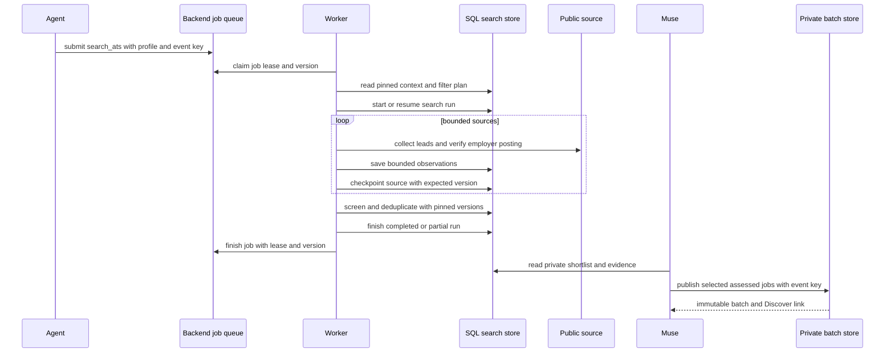

> Current direct path: pipeline 2 stages candidates on the Docker worker volume,
> applies metadata gates before verification and full filters before permanent
> storage, and saves only the deduplicated new/changed shortlist for agent analysis.
> Hosted-board collection and automatic publication are disabled. The receipt's
> first 100 IDs are a preview; page the run for all results. SQL leases/checkpoints
> remain durable; temporary snapshot references are fenced. Missing files trigger
> recollection; finished runs without retained Jobright leads clean up; retained pools and abandoned files expire after seven days.
> See `backend/runtime/README.md` for current storage/recovery details. Legacy
> manual discovery operations documented below remain explicit fallback tools.

---
type: job discovery workflow
title: Job discovery, search runs, and private batch publishing
description: How an owned profile and portal configuration become a leased, bounded search run, verified private observations, a version-fenced shortlist, Muse assessment, and an immutable private Discover batch.
tags: [job-discovery, search, worker, screening, deduplication, muse, batches]
verified:
  - by: openwiki/0.7.2
    at: 2026-11-07T02:52:01.830Z
sources:
  - id: openwiki-source-fe05dca9cc71338a8264bea9
    resource: repo://backend/runtime/ats.ts
  - id: openwiki-source-1ac7f42b755d1758646f11a5
    resource: repo://backend/runtime/hiringcafe.ts
  - id: openwiki-source-59fbab138f8a655b0be18622
    resource: repo://backend/runtime/worker.ts
  - id: openwiki-source-53829ebe28af57ee2b57b08d
    resource: repo://lib/search-dedup.mjs
  - id: openwiki-source-e602bd1dbbced1baabe4c441
    resource: repo://lib/search-screening.mjs
  - id: openwiki-source-5171d9f87336369eafa2ef8c
    resource: repo://lib/search/documents.mjs
  - id: openwiki-source-ca3503fc3e747d2bae1e91af
    resource: repo://supabase/functions/agent-gateway/backend-jobs.mjs
  - id: openwiki-source-1a0ceb3366dbb2f200b54919
    resource: repo://supabase/functions/agent-mcp/protocol.mjs
  - id: openwiki-source-6a85d15d60829c2dc4e07d68
    resource: repo://supabase/migrations/20261013164918_agent_gateway.sql
  - id: openwiki-source-015f81db95c9694bec6522ed
    resource: repo://supabase/migrations/20261026175155_backend_discovery_resume_dedup.sql
  - id: openwiki-source-2101375efb2244a0b3535373
    resource: repo://supabase/migrations/20261026225756_backend_search_pipeline_job.sql
  - id: openwiki-source-999791634b7fa363891f2e22
    resource: repo://tests/search-dedup.test.mjs
  - id: openwiki-source-10ac925a4794ba6ee173e4c6
    resource: repo://tests/search-job-pipeline.test.mjs
  - id: openwiki-source-90233eddcc36c7a176ceae19
    resource: repo://tests/search-mcp-integration.test.mjs
generated: { by: "openwiki/0.7.2", at: "2026-11-07T02:52:01.830Z" }
---

# Job discovery, search runs, and private batch publishing

Job discovery is a controlled evidence pipeline, not a public-catalog import or an application workflow. It starts from an owned search profile and portal configuration, persists employer-posting observations privately, screens and deduplicates them against the pinned configuration, and leaves candidate-specific assessment and publication to Muse. A resulting shortlist is **not** an application, proof of applicant eligibility, an AI-generated candidate report, or a guarantee that all relevant jobs were searched.

This page describes the backend `search_ats` path. For ownership and canonical writers, see [Data model, ownership, and consistency rules](../architecture/data-and-ownership.md); for credential/scoped-tool behavior, see [Agent credentials, gateway, MCP, and guide routing](../concepts/agent-access-and-mcp.md); for the guarded next step, see [Application drafting, authorization, and guarded submission](application-submission.md).

## What is public, private, and immutable

Three records have intentionally different meanings:

- The **public catalog** (`jobs`, keyed by canonical URL) holds reusable employer-facing identity such as an employer, title, and URL. It must not hold a person's ranking, fit rationale, search screening, or application state.
- A **private search run** belongs to one user. Its source attempts, verified observations, screening revisions, checkpoints, diagnostics, profile/version context, and retained shortlist IDs are private evidence. Source content is untrusted until it has passed the source/verification path.
- A **private batch** is a user-owned, immutable `job_batches` record plus ordered `batch_items`. It can point at a catalog job, while the recommendation stores personal notes. An event key identifies the publication action and returns the original batch on retry rather than altering its recommendations.

In particular, raw discoveries do not populate Discover cards. Muse must read the saved shortlist, make the candidate-specific report and four ratings, then call `publish_batch` with selected employer postings and recommendation data. Publishing returns a board link, but does not create an `applications` row, approval, submission attempt, message, or employer interaction.

## Entrypoints and configuration

A connected agent can edit a profile/rules/portals document through `save_search_document`, start or resume a durable manual sweep through `start_search_run`, or queue a request for a personal agent. These are configuration and coordination boundaries: a queued request does not execute work, and an active run means unfinished durable work rather than a hosted process.

Profiles use bounded YAML frontmatter (`id`, `name`, `active`, `filters`, and `priorities`) plus a targeting narrative. Portals describe enabled public sources with bounded URLs, provider/API options, keywords, and configuration. Parsing rejects unknown document fields, oversized text, invalid source shapes, duplicate source IDs, and invalid discovery-filter declarations. If no saved portals document exists, context exposes built-in source templates without silently writing a personal portals document.

For the automated backend route, `submit_backend_job` accepts only `kind: 'search_ats'`, a saved `profileId`, and a stable `eventKey`. It requires the appropriate read/preferences/draft scopes. The job is not proof that a worker is configured: it requires the Node API, worker, and database migration to be deployed and execution enabled. The worker itself never schedules searches; it claims already queued jobs. See [Local stack, backend processes, and release boundaries](../operations/local-and-release-runtime.md) for startup and release separation.

Before collection, the worker loads the profile and portals context and runs `inspect-discovery-filters`. A non-ready plan fails before creating a run, with a recovery instruction to correct the profile; broadening a query to bypass targeting is not a recovery path. Starting a run pins the context and enabled-source/query snapshot. A fresh run defaults to three days and backlog mode to 30 days; an explicit saved max_posting_age_days governs provider collection and screening (this user now uses seven days).

## Leased execution and collection

The durable job queue—not the browser or agent—coordinates execution. A service worker claims queued work (or expired running work) under `FOR UPDATE SKIP LOCKED`, checks the still-active owned connection and valid profile, increments its attempt count, and issues an opaque five-minute lease token. Search jobs renew this lease every 30 seconds through a service-only heartbeat with the same ownership/version fence and connection/profile authorization. Renewal never revives an expired lease. Every internal dispatch and final finish must present the job ID, lease token, and expected job version. Ownership loss cancels source requests and isolated process groups; shutdown preserves the pinned run for reclaim after lease expiry. Expired/revoked/cancelled work cannot overwrite newer state; a job has three attempts, after which its retained evidence is closed as partial.



*From queued work through a fenced worker and source checkpoints to version-fenced shortlist completion and agent-owned batch publication.*

The worker rotates configured sources deterministically from the durable run ID, while prioritizing aggregate defaults. It scans all configured run sources with up to ten concurrent source tasks. Sources first checkpoint as `active`; each verification batch is saved and checkpointed with the current source version. A source is marked `completed` only with exhaustive coverage; otherwise it is `blocked` with coverage, counts, diagnostics, and a human-readable blocker. Completed sources are skipped on retry; pending and blocked sources are attempted again. Provider-specific page, request and result budgets still report partial coverage.

HiringCafe, Simplify and isolated Career Ops collection share the `{id, detect, fetch}` provider contract and copied resolver in `source-providers.ts`. `fetchSource` deduplicates and verifies every provider’s leads before the worker persists observations. Career Ops collection runs in a sanitized child process. The child has no agent, Supabase, cloud, proxy, or user credentials; it has a 384 MiB heap, a 120-second task budget, and a 16 MiB output limit. Employer sources preserve upstream pagination, request spacing, retries and safety bounds without blanket page/request/result caps. All returned leads are verified in batches of at most 25; failed batches retain per-link uncertainty and successful batches remain available. Simplify reads feed metadata in full but selects only the 100 newest title/seniority-matching leads per feed for verification; omitted matching leads make coverage partial. HiringCafe remains explicitly sampled. Observations are saved in transactions of at most 25 rows and 48,000 encoded bytes; an oversized single observation fails rather than escaping the transaction bound.

### Source behavior and verification

Supported source output is only a lead until `verify-discovery-leads` confirms its exact official employer ATS posting and parses the available job description. The persisted observation records source ID, URL, company, title, nullable location/posting date/list age, check time, liveness, evidence, description, and—when available—ATS identity, requisition ID, and employment type. Active but unparseable descriptions, unresolved links, provider limits, and inaccessible providers remain diagnostics and partial/inaccessible coverage rather than invented records.

The HiringCafe provider derives query combinations from profile role/location/employment filters, clamps freshness to 1–30 days, attempts each query under a 75-second overall deadline, bounds response bodies to 2 MB, and resolves exactly one explicit external Apply link before shared verification. Its current public MCP structured-search tool returns up to 25 jobs per query and five per employer and exposes no pagination cursor, so coverage is always `truncated`; it is not an exact posting-date filter or exhaustive board scan. Interrupted later queries retain earlier results with diagnostics, while the first failed query fails the source.

Other supported sources use copied CareerOps scanner/tracker behavior. The backend does not create a second URL-normalization or provider-parser algorithm: it maps sanitized provider results to the owned search tables. Unsupported providers return an explicit blocker directing agent research or a supported copied connector.

## Persistence, retry, and coverage semantics

Each source save gets an event key derived from job ID, source hash, persisted source version, worker attempt, and batch offset. The attempt suffix matters because a live fetch can change between retries; canonical database identity is still responsible for preventing duplicate listings. A worker re-reads bounded private identity history before retrying a pinned run and skips already completed sources. It refuses pagination that exceeds 5,000 history entries instead of weakening deduplication silently.

A source checkpoint is durable operational progress, not a claim of quality or fit. Coverage has these practical meanings:

| Coverage/result | Meaning |
| --- | --- |
| `exhaustive` | The adapter verified all leads it was responsible for in that source attempt; it does not prove market-wide completeness. |
| `truncated` | A provider/sample/query/source budget was bounded; retained results may still be useful, but the source is incomplete. |
| `inaccessible` | The provider/link/adapter could not produce usable verified observations. |
| job `completed` | Every run source is completed with exhaustive coverage. |
| job/run `partial` | At least one source is blocked, truncated, inaccessible, or otherwise incomplete. Saved evidence remains available. |

On a retry of an already completed run, the pipeline can reconstruct the shortlist from saved observations without recollecting or duplicating screening records. A lease failure or settings race does not turn retained observations into a successful shortlist. Operational logs report database outages at most once per minute while the polling worker waits five seconds between attempts.

## Screening and deduplication are version-fenced

After source collection, the worker re-reads profile and personal-context versions. If either differs from the collection snapshot, it stops with “settings changed” rather than combining old collection with new requirements. It pages all persisted discoveries into the shortlist pipeline, processes screening in groups of ten, and derives a stable screening event key from the run, current versions, and listing/observation IDs.

`screenSearchDiscoveries` first looks up the same screening request for replay. Otherwise it reloads the owned run/context/listings, passes only the requested listings and portal projection to `filter-discovery`, validates the returned result contract, and commits each decision with its expected screening version plus the expected personal and profile versions. An eligible decision requires an active employer observation, actual location, and resolved required checks; unknowns are review-needed and do not prove candidate facts or authorize applying.

Only non-ineligible rows proceed to copied CareerOps deduplication. The adapter exposes canonical URL, company, title, location, ATS identity, requisition ID, and listing identity—deliberately excluding description, observation text, and application state. Its result must be a unique subset of the requested listing IDs or the job fails rather than saving a false shortlist. Native identity aliases are suppressed, but same-title postings with distinct requisitions, locations, or functional query URLs are retained. The current job-level call compares retained rows within the run; explicit prior-history comparison is available to the reusable adapter but is not silently assumed.

Immediately before run completion, the worker checks versions again. The SQL final receipt independently locks and compares the personal/profile versions, bounds retained IDs to 250, and verifies every retained ID belongs to that job's run. This double fence protects both a JavaScript-time race and a change between the final read and commit.

The result records `pipelineVersion: 1`, observed/saved counts, source blockers/provenance, filter plan, stages, and a shortlist with retained IDs, duplicate IDs, screening counts, and the evaluated versions. It expressly marks `applicantEligibility: 'not-evaluated'` and `reporting: 'pending-muse'`. The summary reports incomplete sources. No language model runs in this pipeline.

## Muse assessment and batch publication

Muse is the agent-side consumer of the private shortlist, not a worker subroutine. It reads the current run and observations, performs the candidate-specific report and four ratings, and selects what to publish. That assessment is separate from deterministic source filtering: neither a retained ID nor an `eligible` screening decision says that a candidate qualifies, should apply, or has been recommended by an AI.

`publish_batch` requires `batches:write`. A batch contains at most 100 items, each either an existing catalog `jobId` or a canonical HTTPS URL plus public `employer` data. The service creates/reuses the shared catalog row by canonical URL where necessary, but writes recommendation JSON only to the private batch item. The caller supplies a label and stable `eventKey`; the unique owner/event key returns the original immutable batch on retry, including original recommendations. Reusing a key for a different logical publication must be treated as reconciliation, not an update mechanism.

A batch is therefore a private presentation/selection artifact. It may contain screening links such as `searchRunId` and `searchListingId` in recommendation data, but it does not change source coverage, convert an observation to a public recommendation, create a draft application, grant approval, or invoke the submission runner. The person still selects a job and enters the distinct guarded application workflow.

## Failure handling and safe extensions

Do not hide a limitation with a successful label. Preserve source diagnostics, counts, liveness, coverage, and blockers; return `partial` when the pipeline has useful saved evidence but incomplete coverage. Read current durable job/run state after a timeout before retrying a write, reuse the exact event key only for the same semantic request, and reload context after a version conflict.

When adding a source or stage:

1. Keep source configuration bounded and public-only; do not add credentials, scripts, arbitrary parsers, or candidate data to portal records.
2. State the source's lead limit, time/response/request bound, identity and verification path, and honest coverage condition.
3. Persist only through the search run/source/observation/screening writers using expected versions and stable event keys.
4. Keep candidate assessment, reports, ratings, batch recommendation, drafting, consent, and submission as separate boundaries.
5. Add a focused test for partial/inaccessible behavior, retry/replay, stale context, and duplicate/identity edge cases.

## Focused verification

`tests/search-job-pipeline.test.mjs` exercises a real SQL-backed leased job: task ordering, verified observation persistence, screening/dedup shortlist construction, partial coverage, retry without recollection, changes during collection, final SQL receipt fencing, built-in portal context, and filter-plan refusal before collection. `tests/search-dedup.test.mjs` verifies the pinned copied scanner/tracker files, privacy-safe row mapping, alias suppression, preservation of distinct postings, explicit history behavior, and malformed-child failure. `tests/search-mcp-integration.test.mjs` covers the agent-facing document/run/checkpoint/discovery/screening/publication flow and confirms that publication does not create application, approval, or submission records.

Start with:

```sh
node --test tests/search-job-pipeline.test.mjs tests/search-dedup.test.mjs tests/search-mcp-integration.test.mjs
npm run test:db
npm run test:filter
```

See [Testing strategy and safety invariants](../testing/verification-strategy.md) for when to expand to the full suite, and [Local stack, backend processes, and release boundaries](../operations/local-and-release-runtime.md) for the fact that a local test, API health check, or frontend deployment does not prove a worker or external source is live.


Worker recovery preserves the existing job and run. Resume reads persisted identities to avoid repeating saved verified postings; numeric offsets are informational because upstream results can change. Checkpoints retain a bounded recent diagnostic window plus an explicit omitted count. Child cancellation/timeout kills the whole process group, and Docker init reaps exited browser descendants. Oversized verified descriptions remain explicit incomplete source diagnostics while sibling sources continue. These mechanisms do not establish live source reachability or complete market coverage.

Worker lease and source-version conflicts return HTTP 409 (`PT409`), so PostgREST rejects stale requests once instead of repeatedly retrying a deterministic failure. Genuine transaction serialization failures retain their native error.


### Agent-reviewed private Discover handoff

A completed or partial direct scan supplies the private shortlist; it does not itself populate Discover. The connected personal agent now finishes an authorized search by reading all shortlist pages and current candidate/profile evidence, selecting personally suitable live opportunities, writing the four assessment dimensions and role-specific narrative, then publishing through the existing scoped `publish_batch` service. It reads each returned private batch back before claiming Discover is populated. Stable run/profile/chunk event keys prevent duplicate batches on completion-event replay. No new model runtime, scheduler, worker publication, automatic applications or shared hosted-board collection is added. Raw filter matches remain outside Discover until agent review. Empty Discover keeps the existing search-history/request control visible while waiting.


### Broad review with fit-based effort

Search guide16 surfaces relevant plausible jobs after personal analysis instead of selecting only exceptional fits. Fit strength guides priority and tailoring depth; weaker fit, unknown pay, unclear team scope and unconfirmed clearance/citizenship are not automatic rejections. User-requested clearance roles stay visible with active-at-application/start versus obtainable-after-hire requirements called out explicitly. Confirmed non-exempt mandatory conflicts and clearly unrelated work can still be excluded. Conditional graduation scenarios remain targeting, never changes to actual education facts or employer-form answers.

Application guide17 supports routine accurate preparation volume during already authorized application work, with deeper effort for the best matches. Notifications guide2 distinguishes actual prepared, tailored, blocked, ready-for-review and submitted counts. Instructions do not execute work, activate schedules, send messages or grant submission consent. Match strength reuses the existing recommendation priority (Apply Now, Strong Consider, Skip Unless Team Fit) and four fit scores, with no separate tag, column or UI. Lower priority does not stop otherwise authorized preparation. Current Discover batches and applications are not reassessed or republished by this pass.


### Employer compensation on private Discover cards

`publish_batch` accepts optional `recommendation.jobFacts.compensation` for an existing catalog job, using the same source URL/check timestamp as its other observed facts. It is bounded employer pay text preserving currency, range, original pay period (hour/week/month/year) and base/bonus/equity distinctions. No automatic annualization or benchmark substitution occurs. The browser and card-pack projection prefer this private observed value over older catalog compensation; explicit Not disclosed can override an outdated value. Omission retains the catalog fallback. Cards no longer extract a salary from personal fit prose, which can contain comparison benchmarks. This extends the existing private JSON observation; it does not rewrite catalog facts, assessments, applications or historical batches and introduces no database column/migration.

Search guide17, application guide19 and developer contract124 advertise the scoped publication path. Fictional Discover previews cover hourly/monthly and undisclosed pay; validation covers annual pay too. Local code/database tests and a frontend export establish source behavior only; hosted release remains separate.


### Compact team-focused fit analysis

Search guide18 makes the default analysis a 130–180-word decision brief: existing priority with a short verdict; up to five chat bullets covering team, candidate contribution, growth, support and practical fit; and one sentence on what changes priority. Research exact-team evidence first and clearly distinguish adjacent-team context, inference and unknowns. Save the same substance in existing whyItFits/materialGap text and four assessments; no new tags, fields or Markdown-rendering requirement. Application guide20 follows this format during authorized work. This changes future instructions, not historical assessments or publication.


### Broader collection with recoverable Jobright leads

Both Jobright providers snapshot every published row into immutable, lease-fenced temporary storage before title triage or detail resolution. Source dates/work settings remain source-list metadata. Each raw row retains resolution and triage status, while only live parsed, filtered and history-deduplicated jobs enter database discoveries. Completion keeps Jobright pools for seven days; read expiry is enforced even before filesystem pruning. A missing pool is explicit, never silently replaced by a fresh feed.

The existing `read_search_source_leads` tool pages all retained rows (100 maximum per response) after both run/source and backend-job ownership checks. It never drops title-excluded or unresolved rows. The API requires the existing staging volume mounted read-only at the same configured path as the worker. This works on the existing single-host Docker/Compute Engine deployment; separately hosted API/worker instances need a genuinely shared staging volume. No new database table or generic file reader is introduced.

Explicit engineering families expand to common title variants while preserving negative and seniority rules. US-wide profile targeting recognizes country/state forms and treats incomplete locations as unknown; explicit foreign countries and explicit scanner/narrow city restrictions retain their exclusions. The saved freshness limit controls provider collection as well as later filtering. General was updated through the owned writer to seven days with engineering aliases; candidate facts and applications were preserved.

Search guide19/developer131 directs the connected agent to inspect retained/pending counts, page source pools, research exact employer links for plausible unresolved leads and use the existing verification/screening/deduplication path before private publication. Worker completion does not imply those research tasks finished. Source accounting distinguishes raw, title-excluded, unresolved, verified, filtered and screened-candidate counts from the final shortlist. No automatic worker search engine or LLM is added.


### Engineering-family recall and focused link recovery

Jobright Markdown parsing now preserves nested/escaped brackets in posting titles and inherits the source company website as an unverified research hint. Software-engineering family aliases include MTS/Member of Technical Staff, junior/associate/application developers and platform/GPU/graphics engineering. Both prefilter and full screening use the same title-context adapter: Staff inside the MTS family and bracketed multi-level ranges offering a junior path do not become senior-only exclusions. Explicit senior rank outside those contexts and explicit role-specific negative rules still apply. Original titles and identities are preserved; unknown actual experience requirements remain for review. The copied Career Ops matcher/classifier implementations remain unchanged.

The existing owned `read_search_source_leads` tool accepts optional `resolution=unresolved`; it pages only pending/unresolved/reverification rows while sourceTotal preserves the full pool count. Returned companyWebsite/researchQuery fields guide the connected agent's exact employer lookup; they are not canonical application URLs or live-job evidence. No search engine, LLM or automatic publication is added to the worker. Search guide20 and notifications guide4 distinguish broadly verified Worth a look recommendations from deeply researched Top picks using existing priorities/scores, and require honest recovery counts. Closed employer postings stay out of live recommendations. Saved profile constraints, candidate facts, current batches and application permissions are unchanged.

## Focused single-portal searches

`submit_portal_search` queues the existing direct `search_ats` pipeline with
`input:{profileId,portalId}` and a stable event key. Obtain the exact enabled ID
from current owned search context. The browser backend-job service shares this
optional input and SQL ownership validation. Saved settings remain unchanged;
SQL pins only the selected portal, omits web queries, and rejects a worker that
omits or changes the queued selection. `start_search_run` also accepts the same
portal selector for explicit agent-executed work. Disabled/unowned IDs fail.

All existing staging, leases, verification, filtering, deduplication and agent
publication boundaries remain. A top-two demo request limits final agent
recommendations, not collection. For two employers, reconcile each run before
starting the next on that profile and deduplicate combined results. New source
selection does not imply new provider support: ByteDance has a collector but
currently lacks supported full-JD verification; TikTok is not a configured
automated source. Test that support before using either in a live class demo.

## Discover across reviewed batches

Default Discover now loads every owned saved batch through the existing paged
batch readers, rather than selecting only the latest batch. This fixes the
appearance of a 14-role publication replacing an earlier 32-role publication;
14 was a batch size, not a search or storage cap. A pure projection deduplicates
by canonical job URL/catalog identity, uses the newest saved assessment and
retains the earliest discovery date. A latest dismissal suppresses older copies.
No batches, discoveries or applications are rewritten. Explicit `?batch=` links
retain their original single-batch view, with a link to the cumulative board.

The cumulative view defaults to all discovery dates and only unapplied jobs.
“Include applied jobs” exposes retained applied history without changing any
application state. Existing profile employment/search/date controls still apply.
Website reads use the existing authenticated/RLS batch readers; MCP's existing
`read_batch` remains the owner-scoped reader for each original batch. No new
queue, database table, migration, publication or agent analysis is required.

### Explicit applied/rejected exclusion

Discover uses the same status predicate for its cumulative board, date-filtered
views, single-batch views, public browsing and the onboarding saved-role preview.
Applied roles are excluded by default. An explicit Include applied jobs toggle
can expose applied history; it never exposes rejected roles. A recorded rejection
is sufficient even without a submission date or receipt. Matching checks all
owned application records by job ID or canonical URL, plus tracker outcomes, so
a queued duplicate cannot conceal an earlier submission or rejection. Pending,
failed, blocked or uncertain preparation alone is not an application/rejection.

The direct worker already excludes tracked application identities independently
of status; real leased SQL regression coverage now checks both Submitted and
Rejected, including a rejection without submitted_at. These visibility checks
never mutate application history or rewrite immutable batches.


### Discover evidence display and imported outcomes

The preview preserves full source-backed attendance and sponsorship text, including
uncertainty, work-authorization restrictions, cadence and relocation notes. A null
match score is displayed as “Not rated” with the saved reason expanded; it does
not imply the employer omitted pay. Five saved plain-text labels (Team, Your
contribution, Your growth, Support, Practical fit) render as five escaped list
items. Legacy prose is preserved with its line breaks; missing sections are never
invented. The ongoing compact card redesign is outside this change.

Discover reads the existing owned Simplify history as Applications does, and checks
all exact-ID/URL native and imported matches. It waits for history to load and
offers retry on failure. Rejections stay excluded even in applied-history mode;
explicit batch and day views use the same predicate. Null-URL imports and email-only
outcomes cannot establish a specific catalog identity. Use the existing scoped
batch dismissal for an authorized exact-role hold; do not infer companywide status
or invent tracker records. The latest dismissed occurrence suppresses older copies
in the cumulative view.

The batch URL migration updates only the returned link to the verified Pages path
`https://wcia013twe.github.io/Lookout.job/`, preserving dispatch scopes and grants.
Publishing an already cataloged canonical URL does not overwrite employer facts,
including deadline; source-backed deadlines can remain explicit in the private
Practical fit narrative without changing the shared catalog.
### Single-portal persistence repair

The existing `submit_portal_search` tool and leased worker remain the execution
path. Shared observation validation and SQL now accept location text up to 2000
characters: one valid 572-character Cisco location previously rejected an entire
final save batch. This preserves the complete location rather than truncating it.

The owned, paged worker history now includes applied/rejected imported tracker
records as well as native applications, and is refreshed after collection before
final deduplication. Imports are identity hints only; search never rewrites their
records or excludes every role at a company. Lease, owner, settings and bounded
transaction checks remain in place. Fictional SQL-leased tests cover multi-location
saves, imported applied/rejected exclusions and an import arriving mid-collection.

A live local Jobright-only run retained 845 source rows, but its 581 selected
public detail pages exposed no employer application link; it saved zero listings.
That is unresolved coverage, not evidence of an empty job market. Exact employer
link research remains the existing agent handoff; no login bypass, guessed links,
LLM worker or alternate write path was introduced. Local Docker persistence proof
is recorded separately from hosted deployment in the feature change note.

The repeat test also exposed a SmartRecruiters URL-alias gap: its native identity
was not reconstructed from storage, which retained only Greenhouse/Lever triples.
The existing adapter now restores all five verified provider triples (including
Ashby, Workday and SmartRecruiters) before delegating to copied Career Ops dedup.
An unchanged short/slugged URL pair is covered by both child-process and SQL-leased
regressions; distinct native posting IDs remain separate.
