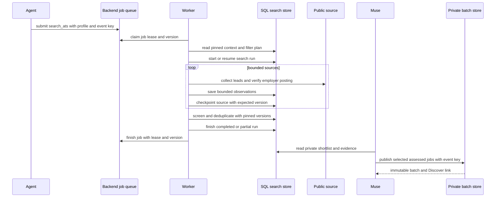

# Job discovery, search runs, and private batch publishing

Job discovery is a controlled evidence pipeline, not a public-catalog import or an application workflow. It starts from an owned search profile and portal configuration, persists employer-posting observations privately, screens and deduplicates them against the pinned configuration, and leaves candidate-specific assessment and publication to Muse. A resulting shortlist is **not** an application, proof of applicant eligibility, an AI-generated candidate report, or a guarantee that all relevant jobs were searched.

This page describes the backend `search_ats` path. For ownership and canonical writers, see [Data model, ownership, and consistency rules](../architecture/data-and-ownership.md); for credential/scoped-tool behavior, see [Agent credentials, gateway, MCP, and guide routing](../concepts/agent-access-and-mcp.md); for the guarded next step, see [Application drafting, authorization, and guarded submission](application-submission.md).

## What is public, private, and immutable

Three records have intentionally different meanings:

- The **public catalog** (`jobs`, keyed by canonical URL) holds reusable employer-facing identity such as an employer, title, and URL. It must not hold a person's ranking, fit rationale, search screening, or application state.
- A **private search run** belongs to one user. Its source attempts, verified observations, screening revisions, checkpoints, diagnostics, profile/version context, and retained shortlist IDs are private evidence. Source content is untrusted until it has passed the source/verification path.
- A **private batch** is a user-owned, immutable `job_batches` record plus ordered `batch_items`. It can point at a catalog job, while the recommendation stores personal notes. An event key identifies the publication action and returns the original batch on retry rather than altering its recommendations.

In particular, raw discoveries do not populate Discover cards. Muse must read the saved shortlist, make the candidate-specific report and four ratings, then call `publish_batch` with selected employer postings and recommendation data. Publishing returns a board link, but does not create an `applications` row, approval, submission attempt, message, or employer interaction.

## Entrypoints and configuration

A connected agent can edit a profile/rules/portals document through `save_search_document`, start or resume a durable manual sweep through `start_search_run`, or queue a request for a personal agent. These are configuration and coordination boundaries: a queued request does not execute work, and an active run means unfinished durable work rather than a hosted process.

Profiles use bounded YAML frontmatter (`id`, `name`, `active`, `filters`, and `priorities`) plus a targeting narrative. Portals describe enabled public sources with bounded URLs, provider/API options, keywords, and configuration. Parsing rejects unknown document fields, oversized text, invalid source shapes, duplicate source IDs, and invalid discovery-filter declarations. If no saved portals document exists, context exposes built-in source templates without silently writing a personal portals document.

For the automated backend route, `submit_backend_job` accepts only `kind: 'search_ats'`, a saved `profileId`, and a stable `eventKey`. It requires the appropriate read/preferences/draft scopes. The job is not proof that a worker is configured: it requires the Node API, worker, and database migration to be deployed and execution enabled. The worker itself never schedules searches; it claims already queued jobs. See [Local stack, backend processes, and release boundaries](../operations/local-and-release-runtime.md) for startup and release separation.

Before collection, the worker loads the profile and portals context and runs `inspect-discovery-filters`. A non-ready plan fails before creating a run, with a recovery instruction to correct the profile; broadening a query to bypass targeting is not a recovery path. Starting a run pins the context and enabled-source/query snapshot. A fresh run defaults to three days, while backlog mode defaults to 30 days.

## Leased execution and collection

The durable job queue—not the browser or agent—coordinates execution. A service worker claims queued work (or expired running work) under `FOR UPDATE SKIP LOCKED`, checks the still-active owned connection and valid profile, increments its attempt count, and issues an opaque five-minute lease token. Every internal dispatch and final finish must present the job ID, lease token, and expected job version. Expired/revoked/cancelled work cannot overwrite newer state; a job has three attempts, after which its retained evidence is closed as partial.



*From queued work through a fenced worker and source checkpoints to version-fenced shortlist completion and agent-owned batch publication.*

The worker rotates configured sources deterministically from the durable run ID, while prioritizing aggregate defaults. It scans all configured run sources with up to ten concurrent source tasks. A source is checkpointed after collection as `completed` only with exhaustive coverage; otherwise it is `blocked` with coverage, counts, diagnostics, and a human-readable blocker. Completed sources are skipped on retry; pending and blocked sources are attempted again. Provider-specific page, request and result budgets still report partial coverage.

`fetchSource` chooses a supported aggregate adapter or invokes copied CareerOps code in a sanitized child process. The child has no agent, Supabase, cloud, proxy, or user credentials; it has a 384 MiB heap, a 120-second task budget, and a 16 MiB output limit. Employer sources preserve upstream pagination, request spacing, retries and safety bounds without blanket page/request/result caps. All returned leads are verified in batches of at most 25; failed batches retain per-link uncertainty and successful batches remain available. Simplify reads the full supported feed; HiringCafe remains explicitly sampled. Observations are saved in transactions of at most 25 rows and 48,000 encoded bytes; an oversized single observation fails rather than escaping the transaction bound.

### Source behavior and verification

Supported source output is only a lead until `verify-discovery-leads` confirms its exact official employer ATS posting and parses the available job description. The persisted observation records source ID, URL, company, title, nullable location/posting date/list age, check time, liveness, evidence, description, and—when available—ATS identity, requisition ID, and employment type. Active but unparseable descriptions, unresolved links, provider limits, and inaccessible providers remain diagnostics and partial/inaccessible coverage rather than invented records.

The first-party HiringCafe adapter illustrates the constraints: it derives up to four queries from profile role/location/employment filters, clamps freshness to 1–30 days, reads at most 25 unique provider results under a 75-second overall deadline, bounds response bodies to 2 MB, and resolves exactly one explicit external Apply link before verification. HiringCafe returns a per-company, rounded-freshness sample, so its coverage is always `truncated`; it is not an exact posting-date filter or exhaustive board scan. Interrupted later queries retain earlier results with diagnostics, while the first failed query fails the source.

Other supported sources use copied CareerOps scanner/tracker behavior. The backend does not create a second URL-normalization or provider-parser algorithm: it maps sanitized provider results to the owned search tables. Unsupported providers return an explicit blocker directing agent research or a supported copied connector.

## Persistence, retry, and coverage semantics

Each source save gets an event key derived from job ID, source hash, persisted source version, worker attempt, and batch offset. The attempt suffix matters because a live fetch can change between retries; canonical database identity is still responsible for preventing duplicate listings. A worker re-reads bounded private identity history before retrying a pinned run and skips already completed sources. It refuses pagination that exceeds 5,000 history entries instead of weakening deduplication silently.

A source checkpoint is durable operational progress, not a claim of quality or fit. Coverage has these practical meanings:

| Coverage/result | Meaning |
| --- | --- |
| `exhaustive` | The adapter verified all leads it was responsible for in that source attempt; it does not prove market-wide completeness. |
| `truncated` | A provider/sample/query/source budget was bounded; retained results may still be useful, but the source is incomplete. |
| `inaccessible` | The provider/link/adapter could not produce usable verified observations. |
| job `completed` | Every run source is completed with exhaustive coverage. |
| job/run `partial` | At least one source is blocked, truncated, inaccessible, or otherwise incomplete. Saved evidence remains available. |

On a retry of an already completed run, the pipeline can reconstruct the shortlist from saved observations without recollecting or duplicating screening records. A lease failure or settings race does not turn retained observations into a successful shortlist. Operational logs report database outages at most once per minute while the polling worker waits five seconds between attempts.

## Screening and deduplication are version-fenced

After source collection, the worker re-reads profile and personal-context versions. If either differs from the collection snapshot, it stops with “settings changed” rather than combining old collection with new requirements. It pages all persisted discoveries into the shortlist pipeline, processes screening in groups of ten, and derives a stable screening event key from the run, current versions, and listing/observation IDs.

`screenSearchDiscoveries` first looks up the same screening request for replay. Otherwise it reloads the owned run/context/listings, passes only the requested listings and portal projection to `filter-discovery`, validates the returned result contract, and commits each decision with its expected screening version plus the expected personal and profile versions. An eligible decision requires an active employer observation, actual location, and resolved required checks; unknowns are review-needed and do not prove candidate facts or authorize applying.

Only non-ineligible rows proceed to copied CareerOps deduplication. The adapter exposes canonical URL, company, title, location, ATS identity, requisition ID, and listing identity—deliberately excluding description, observation text, and application state. Its result must be a unique subset of the requested listing IDs or the job fails rather than saving a false shortlist. Native identity aliases are suppressed, but same-title postings with distinct requisitions, locations, or functional query URLs are retained. The current job-level call compares retained rows within the run; explicit prior-history comparison is available to the reusable adapter but is not silently assumed.

Immediately before run completion, the worker checks versions again. The SQL final receipt independently locks and compares the personal/profile versions, bounds retained IDs to 250, and verifies every retained ID belongs to that job's run. This double fence protects both a JavaScript-time race and a change between the final read and commit.

The result records `pipelineVersion: 1`, observed/saved counts, source blockers/provenance, filter plan, stages, and a shortlist with retained IDs, duplicate IDs, screening counts, and the evaluated versions. It expressly marks `applicantEligibility: 'not-evaluated'` and `reporting: 'pending-muse'`. The summary reports incomplete sources. No language model runs in this pipeline.

## Muse assessment and batch publication

Muse is the agent-side consumer of the private shortlist, not a worker subroutine. It reads the current run and observations, performs the candidate-specific report and four ratings, and selects what to publish. That assessment is separate from deterministic source filtering: neither a retained ID nor an `eligible` screening decision says that a candidate qualifies, should apply, or has been recommended by an AI.

`publish_batch` requires `batches:write`. A batch contains at most 100 items, each either an existing catalog `jobId` or a canonical HTTPS URL plus public `employer` data. The service creates/reuses the shared catalog row by canonical URL where necessary, but writes recommendation JSON only to the private batch item. The caller supplies a label and stable `eventKey`; the unique owner/event key returns the original immutable batch on retry, including original recommendations. Reusing a key for a different logical publication must be treated as reconciliation, not an update mechanism.

A batch is therefore a private presentation/selection artifact. It may contain screening links such as `searchRunId` and `searchListingId` in recommendation data, but it does not change source coverage, convert an observation to a public recommendation, create a draft application, grant approval, or invoke the submission runner. The person still selects a job and enters the distinct guarded application workflow.

## Failure handling and safe extensions

Do not hide a limitation with a successful label. Preserve source diagnostics, counts, liveness, coverage, and blockers; return `partial` when the pipeline has useful saved evidence but incomplete coverage. Read current durable job/run state after a timeout before retrying a write, reuse the exact event key only for the same semantic request, and reload context after a version conflict.

When adding a source or stage:

1. Keep source configuration bounded and public-only; do not add credentials, scripts, arbitrary parsers, or candidate data to portal records.
2. State the source's lead limit, time/response/request bound, identity and verification path, and honest coverage condition.
3. Persist only through the search run/source/observation/screening writers using expected versions and stable event keys.
4. Keep candidate assessment, reports, ratings, batch recommendation, drafting, consent, and submission as separate boundaries.
5. Add a focused test for partial/inaccessible behavior, retry/replay, stale context, and duplicate/identity edge cases.

## Focused verification

`tests/search-job-pipeline.test.mjs` exercises a real SQL-backed leased job: task ordering, verified observation persistence, screening/dedup shortlist construction, partial coverage, retry without recollection, changes during collection, final SQL receipt fencing, built-in portal context, and filter-plan refusal before collection. `tests/search-dedup.test.mjs` verifies the pinned copied scanner/tracker files, privacy-safe row mapping, alias suppression, preservation of distinct postings, explicit history behavior, and malformed-child failure. `tests/search-mcp-integration.test.mjs` covers the agent-facing document/run/checkpoint/discovery/screening/publication flow and confirms that publication does not create application, approval, or submission records.

Start with:

```sh
node --test tests/search-job-pipeline.test.mjs tests/search-dedup.test.mjs tests/search-mcp-integration.test.mjs
npm run test:db
npm run test:filter
```

See [Testing strategy and safety invariants](../testing/verification-strategy.md) for when to expand to the full suite, and [Local stack, backend processes, and release boundaries](../operations/local-and-release-runtime.md) for the fact that a local test, API health check, or frontend deployment does not prove a worker or external source is live.
