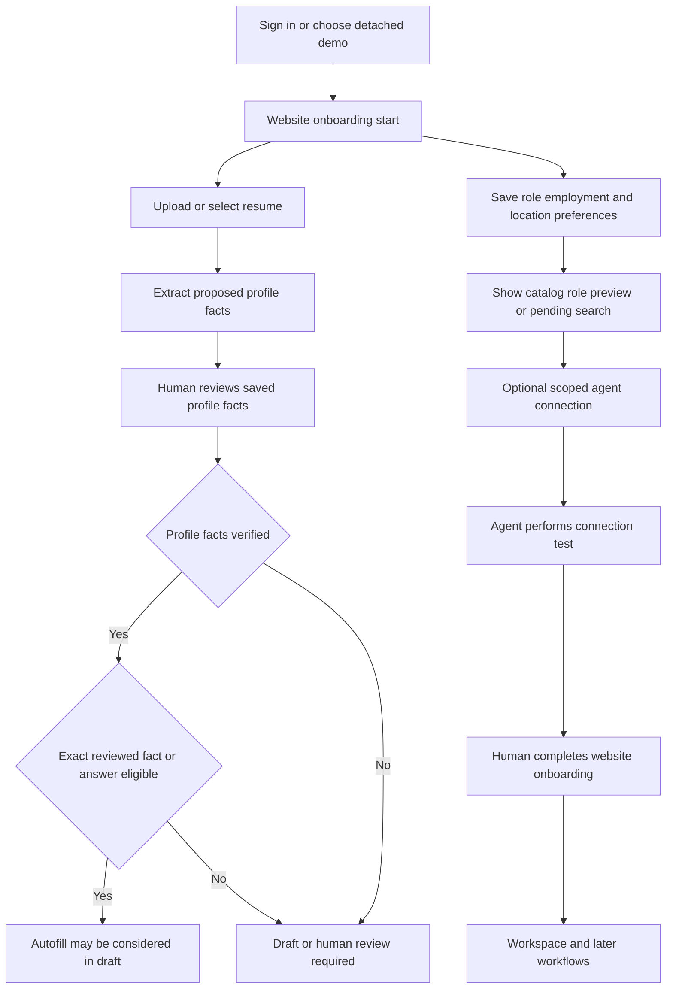

# Onboarding, profile, resumes, and preference changes

First-use setup is deliberately split between a **human-owned website** and a **scoped agent interface**. The website can authenticate a person, collect and review profile facts, upload private files, edit search preferences, issue or revoke an agent credential, and mark website setup complete. An agent can read its authorized workspace context and, only when `profile:write` is enabled, propose/import facts, answers, and résumé metadata—but it cannot claim human verification, complete the website flow, approve an application, or submit one.

This division matters downstream. [Job discovery](job-discovery.md) pins personal and profile context before screening a run; [application submission](application-submission.md) rechecks profile/resume/answer eligibility before an attempt. Credential ownership and MCP scope enforcement are covered by [Agent credentials, gateway, MCP, and guide routing](../concepts/agent-access-and-mcp.md), while account/browser synchronization and fictional demo isolation are covered by [Browser workspace state, cloud sync, and demo isolation](../concepts/workspace-sync-and-demo-mode.md).

## Setup dependencies and the review boundary



*The website may collect setup data in a flexible order, but human review is the boundary between proposed facts and autofill eligibility; agent readiness and website completion are separate.*

### Website authentication, checkpoints, and completion

`next-app/components/onboarding.jsx` renders the website journey under the account-scoped `ApplicationProfileProvider`. A signed-out real user is shown Google sign-in rather than setup controls. The browser keeps only the current scene checkpoint in browser storage, keyed by account ID (or demo epoch); it resumes a transient reveal at a safe preview scene, isolates accounts and demo epochs, and clears the checkpoint after completion. This is navigation convenience, not authoritative onboarding state.

The flow offers a résumé entry point, basic target preferences, a catalog preview, optional agent connection, and a final **Open my workspace** action. A real preview may be a matching public catalog role or a pending search; the fictional fallback is demo-only. Selecting a preview stores a small reference rather than copied job details, and changing role/employment/location removes a prior selection before choosing the new preview.

The final website action reads current onboarding state and sends `onboarding.submit_step` with `event: 'website_complete'`, its current `expectedRevision`, and a stable `website-complete-<revision>` key. The resulting `websiteCompletedAt` controls routing for signed-in users. It is intentionally not evidence that an agent checked in, the profile was verified, or an application was approved. The agent tool contract explicitly labels `website_complete` human-only.

### Agent onboarding is a separate durable conversation

An agent with `workspace:read` can call `read_onboarding_state`, submit a versioned onboarding event, and read/claim/report bounded tasks. The gateway permits only allowlisted event types and requires `expectedRevision` plus a stable `eventKey` for a step update. A stale revision is a conflict; retries must reuse the same key only for the same action.

The agent must begin by reading authoritative state. A `connection_test` is a special agent-only check-in: it records a connection/runtime result and may return scheduling setup instructions, but does not attest that browsing occurred, advance discovery, or run queued work. The web UI polls `onboarding.get_state` only; a token issuance, copied instructions, or later UI step does not count as connected. It waits for a valid runtime check-in and offers retry after twelve 2.5-second polling attempts.

Other agent onboarding events guide a controlled progression: actual runtime capability check, intent, a fresh first match/no-match outcome, policy, profile check, and execution/delivery result. `first_match` has unusually strict evidence requirements—an owned published-batch job ID, its exact HTTPS canonical URL, current availability, timestamp, evidence, and fit text. Queued tasks are not completed work: an agent must claim a task, report a concrete outcome with the lease token/current revision, and treat uncertain external activity as a stop for recovery. Neither a policy choice nor an onboarding task permits submission.

## Profile facts: editing, review, and optimistic concurrency

### Website editor and human verification

The Profile workspace separates **About me**, job preferences, agent settings, and optional appearance. The editor supports scalar identity/contact/professional fields plus whole history sections for work experience, education, and projects. It holds local edits while the form is active so a background refresh does not overwrite typing.

Saving a changed fact writes `verified: false`; only an unchanged reviewed snapshot can retain verification. The confirmation checkbox requires a trusted human browser event, no unsaved edits, and the same currently saved profile. It confirms facts only—not an employer answer, application approval, or submission. Importing facts, changing a nested history value, account hydration, or clearing the checkbox invalidates the prior review.

The browser sync layer saves profile changes against a baseline and resolves a `PT409` profile conflict explicitly. Non-overlapping local and remote field changes are preserved; a same-field conflict requires choosing local or latest values. This protects an agent import or another device’s update from silently overwriting a person’s concurrent edit.

### Agent-proposed imports are always unverified

`profile.import` is available only to an active, owned agent connection with `profile:write`. Its payload is bounded to candidate facts, answer proposals, an optional owned default résumé, source, event key, and `expectedPersonalVersion`; it cannot carry a user ID or a verification assertion. The database serializes the owner’s import, locks profile/preferences/answers/version rows, checks the personal version, and makes exact same-key retries idempotent. Reusing a key with different content or using an obsolete version fails rather than merging a stale proposal.

Facts are merged only for supplied top-level fields; supplied history arrays replace that whole history section. A changed fact clears `verified_at`. Imported answers are stored with agent provenance, no verification timestamp, and `autofill_policy: 'ask'`, even if the agent requested auto reuse. The response explicitly marks `reviewRequired: true`; there is no import path to create an approval.

For narrower agent edits, `update_profile_fields` requires the current `expectedUpdatedAt`, accepts only named editable fields, preserves unspecified fields, and treats supplied arrays/nested values as whole-field replacements. Agents must source profile facts and reread state after an uncertain write before retrying.

## Résumés: private immutable sources, parsing, and selection

### Upload and replacement

The website accepts only PDF or DOCX files from 1 byte through 10 MiB and a known variant (`Backend`, `Distributed Systems`, `ML Infrastructure`, or `Master`). It calculates SHA-256, uploads to the owner-prefixed private `resumes` object path without upsert, then inserts matching metadata. Owner identity is checked around asynchronous boundaries; a metadata failure attempts object cleanup and is never adopted as a local success. A preview uses a 60-second signed URL only after confirming the object path belongs to the current owner.

A replacement is not an in-place mutation. It uploads a new row/version, marks the old source superseded through a versioned replacement RPC, and remaps default/rule/profile references. Existing applications continue to refer to their original file bytes. UI replacement is blocked while profile changes need saving/reloading, and an ambiguous failure warns that a newly uploaded file may remain saved and should be reconciled before retrying.

A browser may also save an HTTPS document reference, but private application defaults are restricted to uploaded PDFs with a content hash. In detached demo mode, résumé records are in-memory placeholders: file bytes are never uploaded, downloaded, or sent to a parser.

### Parse is proposal and review, never extraction-as-truth

Selecting **Autofill profile** invokes the human `/v1/resume-import` route for one owned current uploaded résumé. The shared parser verifies ownership/access and file checksum before it sends file bytes to APILayer, maps only supported fields, and returns warnings plus the profile’s observed update timestamp. It does not import raw provider text or unsupported/ambiguous fields; date strings are preserved in descriptions rather than invented as structured dates. The UI shows a saved-versus-extracted comparison, selects only missing values by default, leaves existing values unchecked, and warns that selecting a history section replaces that entire section. Only the person’s explicit selected fields are saved, and they remain unverified.

The same scoped agent parser, `parse_profile_resume` / `resumes.parse`, requires `workspace:read`, `resumes:read`, and `profile:write`; it returns an unverified proposal and never persists profile changes. It is Node/API-key dependent rather than an Edge-only capability. Parsing and saving are version-aware: the browser captures a profile baseline before parsing, refuses to save if the profile changed in the interim, and server writes compare the returned profile timestamp. Thus a parser result cannot overwrite newer human or agent facts.

### Agent private-upload capability

An agent uses `resumes.begin_upload` with bounded file metadata, SHA-256, size, variant, and stable event key, then `resumes.complete_upload`. The service derives its storage path from the authenticated upload intent, mints a short-lived signed PUT URL with `upsert: false`, then downloads the owned object itself before registering it. Finalization verifies exact length, SHA-256, and PDF/DOCX signature; a mismatch must not create a résumé record. Completed/reused uploads return the existing record rather than a fresh storage capability. Upload intents expire after 15 minutes and are owner-scoped; revocation, expiry, or a foreign ID is rejected before storage access.

### Selection must fail closed

The selected search profile, not merely an account-wide default, governs application résumé selection. Active role-title/employment assignments within that profile take precedence; an unambiguous profile fallback can apply when no assignment matches. Overlapping matches, malformed/duplicate assignment fields, unchecked conditions/timelines, inactive targets/profiles, missing job type, foreign/superseded/missing files, or no valid fallback yield **Needs selection**, not a guessed résumé. Draft preparation pins the selected résumé ID and SHA-256; a later mapping/context change blocks authorization rather than mixing a new selection into an existing draft.

## Saved answers, preferences, and eligibility

### Reusable answers remain opt-in

The shared employer-answer library stores an exact question, answer, optional company scope, policy, version, and review state. Editing question, answer, or scope clears verification; deleting records a deleted ID for synchronization. A special prior-employment question requires a company and constrains values to Yes, No, or Ask me; only a reviewed Yes/No enables automatic reuse.

Automatic reuse requires exactly one normalized exact-question match that is reviewed and `auto` policy, and its company scope must match when present. Similar questions, duplicate candidates, unreviewed/imported answers, `ask` policy, and wrong-company answers do not qualify. This is the answer side of the human-review boundary used by guarded draft/submission authorization.

### Search and automation configuration

Onboarding saves role preference, employment type, location, optional default résumé ID, and a selected first-role reference in the active search-profile narrative. The Profile workspace exposes search profiles in Job preferences and automation/default résumé controls in My Agent. Preferences synchronize to the owner workspace when signed in; without sign-in, they remain browser-local.

Eligibility is represented in the search-profile narrative. Changing its country clears country-specific answers but preserves availability fields and custom prose; unknown eligibility stays unspecified. This avoids carrying country-specific assertions across a changed jurisdiction. Search profiles also own recruiting targets and résumé assignments, so modifying them may increment their own profile version in addition to the owner’s broader personal context.

## Connections and version invalidation

### Issuing a connector does not establish readiness

A signed-in person creates an agent connection with selected scopes and a 30-day expiry in the UI. The one-time token is displayed only for copying into a secure credential form; the chat-oriented instructions omit it, the `Bearer` prefix, and agent-token text. The owner can list, revoke, and toggle profile-setup access on an active owned connection. Revocation stops future gateway access but cannot erase data an external agent already received.

Connection setup is intentionally scoped: issuing credentials, pasting a server URL, or copying setup instructions does not prove runtime connectivity. The agent must execute its `connection_test`; the website then reads state until it sees the recorded check-in. Agents can configure saved automations and report receipts/blockers during setup, but must stop rather than execute searches or submissions immediately.

### Personal version is the anti-mixing fence

`personalVersion` is a server-maintained owner setting version, incremented by triggers on changes to profiles, preferences, résumés, and the answer library. It is not a per-agent “read” flag. `context.versions` exposes the version for a scoped connection; `context.personal` returns an owner-scoped snapshot paired with its version. An agent caches context per **connection**, loads both personal and developer context on bootstrap/lost memory/account change, then reloads only a section whose version changed. Failed fetches must not advance that cache.

This is a correctness requirement rather than cache optimization:

- An agent import uses `expectedPersonalVersion`; a change made while it was preparing an import rejects the write instead of blending old candidate data with new state.
- Discovery pins personal context and profile version; it stops if either changes during collection/screening rather than publishing a shortlist with mixed requirements.
- Draft/submission paths compare expected application revision and personal version, pin profile facts/answers/resume bytes, and refuse stale authorization. A profile or résumé change must lead to a fresh read/preparation/review—not be applied invisibly to an in-flight search or submission.

## Demo behavior and focused verification

Demo onboarding is an isolated fictional walkthrough. It may simulate a résumé, extraction, catalog result, connection check, and tasks, but it does not use account storage, cloud sync, private file bytes, real credentials, or production MCP. Its onboarding progress is separate by demo epoch and disappears on reset/recreation.

High-value regression coverage includes:

- `tests/onboarding.test.mjs`, `tests/onboarding-progress.test.mjs`, `tests/onboarding-search-handoff.test.mjs`, and `tests/website-onboarding.test.mjs` for route/completion separation, browser checkpoints, preview behavior, state-only connection polling, and agent readiness semantics.
- `tests/profile-review.test.mjs`, `tests/profile-sync.test.mjs`, and `tests/profile-setup.test.mjs` for review invalidation, conflict preservation, scoped/idempotent agent imports, ownership, and personal-version rejection.
- `tests/resume-upload.test.mjs`, `tests/resume-import.test.mjs`, and `tests/profile-resume-selection.test.mjs` for byte verification, parse boundaries, selected-field imports, stale profile protection, and fail-closed résumé selection.
- `tests/saved-answers.test.cjs` and `tests/context-versions.test.mjs` for exact reviewed-answer reuse and connection-scoped context refresh behavior.

Run the focused checks before changing these boundaries:

```sh
node --test tests/onboarding.test.mjs tests/profile-setup.test.mjs tests/resume-upload.test.mjs tests/resume-import.test.mjs tests/profile-resume-selection.test.mjs tests/context-versions.test.mjs
```
